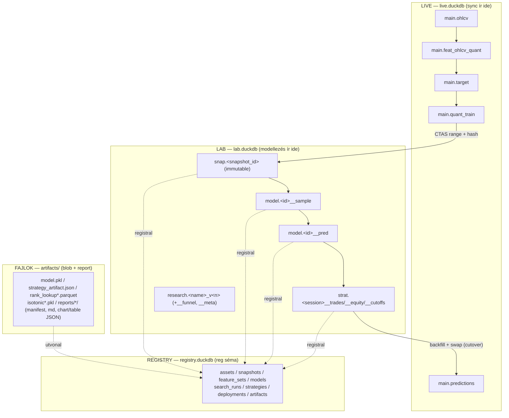
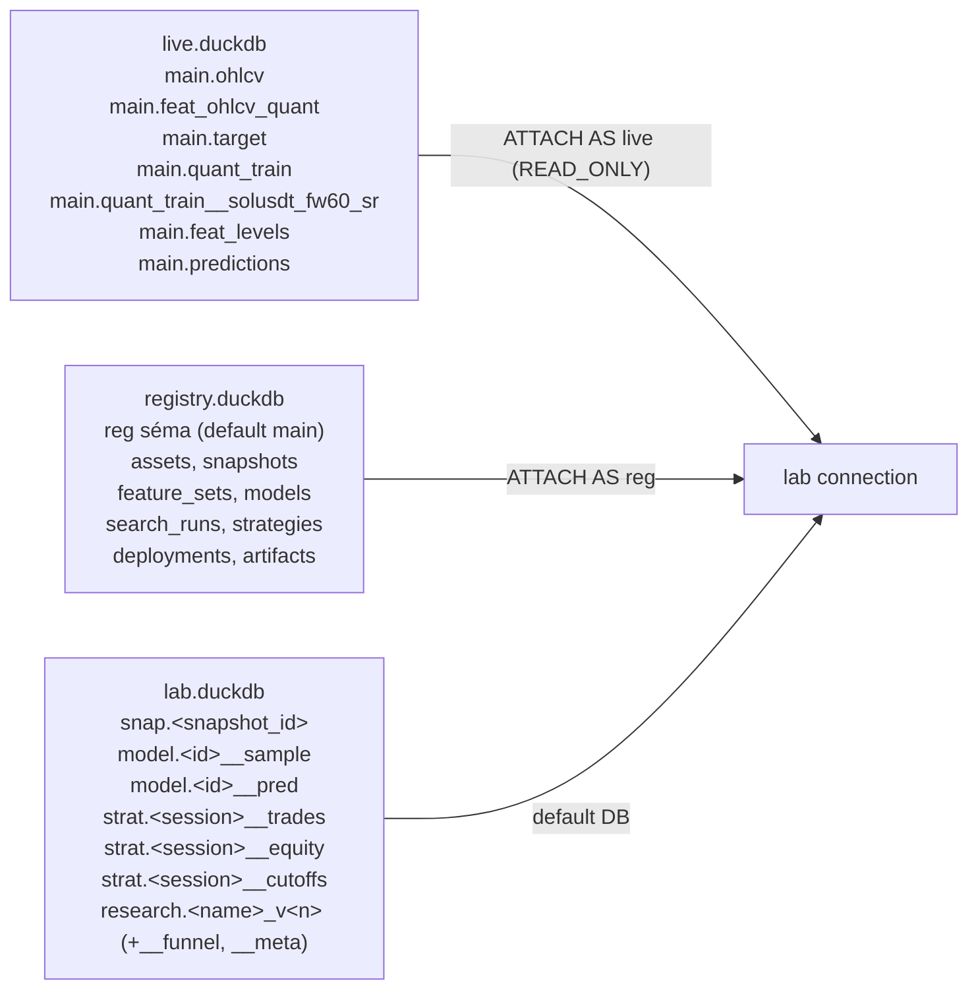
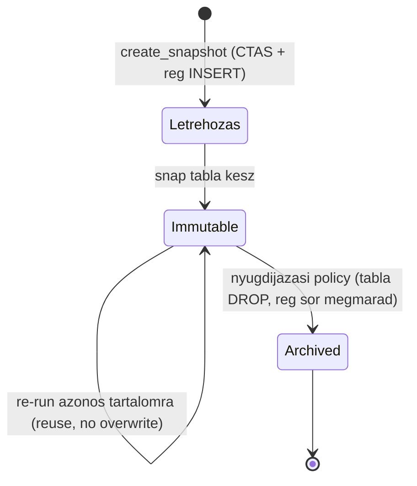
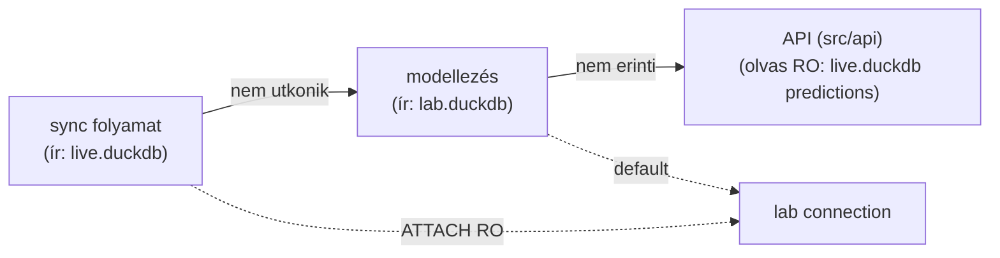

# 0002 — Adat-architektúra (Tárolási Topológia)

ChronoQuant DuckDB-natív, 3-fájlos tárolási topológiát használ. Az élő adat, a
modellezési labor és a katalógus külön DuckDB fájlban él — írás szerint szétválasztva,
ATTACH-csal olvasásra egyesítve.

---

## Overview



A három fájl írás szerint szét van választva, de egyetlen connectionből olvasásra
egyesíthető ATTACH-cal (lásd alább). Ez garantálja, hogy a modellezés és az élő
az API egyszerre futhat anélkül, hogy ütköznének.

---

## A 3-fájlos topológia

### Fájlok és séma-kiosztás



| Séma | DB fájl | Objektumok | Mutability |
|------|---------|-----------|-----------|
| `main` | `live.duckdb` | ohlcv, feat_ohlcv_quant, target, predictions, quant_train, feat_levels, `quant_train__<profile>` | élő, frissül |
| `snap` | `lab.duckdb` | `snap."<snapshot_id>"` — befagyasztott range | **immutable** |
| `model` | `lab.duckdb` | `model."<model_id>__sample"`, `model."<model_id>__pred"` | per-modell |
| `strat` | `lab.duckdb` | `strat."<session_id>__trades/__equity/__cutoffs"` | per-session |
| `research` | `lab.duckdb` | `research."<name>_v<n>"`, `research."<name>_v<n>__funnel"`, `research."<name>_v<n>__meta"` | kutatási, verziózott; nem élő |
| `reg` | `registry.duckdb` | assets, snapshots, feature_sets, models, search_runs, strategies, deployments, artifacts | katalógus |

### Fizikai elrendezés

```
database/
  solusdt/
    solusdt.duckdb         <- LIVE  (sync ír ide)
    solusdt_lab.duckdb     <- LAB   (modellezés, strategy, predict ír ide)
  bchusdt/                 <- második asset (epic_069), azonos struktúra
    bchusdt.duckdb         <- LIVE
    bchusdt_lab.duckdb     <- LAB
  btcusdt/, ethusdt/       <- sync-aktív, data-only assetek (epic_074/t939): csak LIVE DB, 2021-01-01-től; modell: epic_075
  _registry/
    registry.duckdb        <- REGISTRY  (globális katalógus, asset-agnosztikus)
```

**Asset-onként külön DB-pár** (`config/assets.json` `db_path`, lab: `<asset>_lab.duckdb`); a registry globális és közös. Az asset-feloldás a `utils`-on át megy (`default_asset_id`, `resolve_asset_id`, `load_asset_config`, `model_asset_id`); a `live` ATTACH az adott asset DB-jére mutat. A `funding_rate` tábla a live DB-ben él (migráció v7, `funding_ts, funding_rate, mark_price`); a `sync_tables/sync_funding.py` tölti (Binance `fapi/v1/fundingRate`, CLI `--tables funding`, worker `sync_full` esedékességkor). A SOL/BCH tábla korábban ad-hoc töltött; a sync a meglévő oszlopokhoz igazodik.

**Élő (sync-aktív) assetek:** `solusdt`, `bchusdt` (modellel), `btcusdt`, `ethusdt` (epic_074 / t939: data-only — OHLCV, `feat_ohlcv_quant` `<asset>_fw60` profillal, `target`, `funding_rate`; predikció az epic_075 modellje után). A `target`-et a worker egyik assetnél sem frissíti — tanítás előtt kézzel: `02_sync_pipeline.py --asset-id <a> --tables targets`. Sync-aktív = konfigurált asset ÉS live DB ÉS `config/trading.json` `assets.<id>` blokk (üres blokk is elég, → [8310_worker.md](8310_worker.md)).

### ATTACH elérési minta

Egy lab connection, amelyből minden joinolható:

```sql
-- A lab DB a default (open_lab_connection visszaadja)
ATTACH 'database/solusdt/solusdt.duckdb'    AS live (READ_ONLY);
ATTACH 'database/_registry/registry.duckdb' AS reg;
-- snap * live.quant_train * reg.models egy lekérdezésből elérhetok
```

A hívók nem nyúlnak közvetlenül a path-okhoz — az `utils` gateway API adja a
connectiont (`utils.open_lab_connection`, `utils.open_registry_connection`).

---

## Sémák részletezése

### `main` séma — live.duckdb

Az operatív réteg. A sync percenként frissíti. Append-only upsert minden táblán
(`open_time` PK). Egyetlen writer: a `data_handling` sync folyamat.

| Tábla | Tartalom |
|-------|---------|
| `ohlcv` | 1 perces OHLCV candle-k Binance-ről |
| `feat_ohlcv_quant` | Kvantitatív feature-ök (`feat_` prefix) |
| `target` | fw60 forward outcome-ok (long/short MFE) |
| `quant_train` | Ad-hoc join: feat_* + target oszlopok (champion) |
| `feat_levels` | S/R szint- és trendvonal-feature-ök, 1m baronként, PK `open_time`, t-1 lag (epic_071 challenger; a champion nem olvassa) |
| `funding_rate` | Elszámolt futures funding (`funding_ts`, `funding_rate`, `mark_price`), `sync_funding` (migráció v7) |
| `quant_train__<profile>` | Challenger profil quant_train-je (pl. `quant_train__solusdt_fw60_sr` = champion join + `feat_levels` LEFT JOIN); a champion `quant_train`-t nem írja felül |
| `predictions` | Élő modell-pontszámok + `long_model_id` / `short_model_id` stamp |

### `snap` séma — lab.duckdb

Immutable befagyasztott range-másolatok. Minden snapshot `CREATE TABLE IF NOT
EXISTS` szemantikával jön létre; a tartalom soha nem íródik felül.

A `snapshot_id` formátuma: `{asset}_fw{h}_{range}__{hash8}`
(pl. `solusdt_fw60_2023__a37d2703`, `bchusdt_fw60_2101_2607__51471332`).

Részletek: → [1400_snapshots.md](1400_snapshots.md)

### `model` séma — lab.duckdb

Egy-egy modellhez tartozó kicsi táblák:

| Tábla minta | Tartalom |
|-------------|---------|
| `model."<id>__sample"` | Hourly sample + `split` (0=train, 1=valid), ~tízezer sor |
| `model."<id>__pred"` | Teljes snapshot range offline predikciói `(open_time, pred)` |

A predikció NEM fúzódik a snapshotba — a snapshot hash-e és reprodukálhatósága
sértetlen marad. A `snap ⋈ model.__pred` join `open_time`-on 1:1.

### `strat` séma — lab.duckdb

A strategy-kalibráció kimenete (parquet helyett DuckDB tábla):

| Tábla minta | Tartalom |
|-------------|---------|
| `strat."<session>__trades"` | Trade ledger (entry/exit time, direction, hold_minutes, …) |
| `strat."<session>__equity"` | Kumulatív MFE proxy equity curve per trade |
| `strat."<session>__cutoffs"` | Per-direction decile cutoffok a kalibrált scored-table-ből |

Az UI és a deploy folyamat ezekből olvassa az élesítés előtti teljesítményadatokat.

### `research` séma — lab.duckdb

Kutatási datasetek a lab DB-ben. **Cél:** kutatási (nem éles) adat; a `report` builderek írják
(`src/reports/builders/`), jelenleg a `wave_events.py` / `wave_event_dataset.py` (`persist()`, `load_events()`).
**Nem használja** sem a live trading, sem a worker; a `live` / `main` sémához nincs köze.

| Tábla minta | Tartalom |
|-------------|---------|
| `research."<name>_v<n>"` | Az esemény-/sor-dataset maga (pl. `research."wave_events_v1"`) |
| `research."<name>_v<n>__funnel"` | Szűrési funnel: a szűrőlépésenkénti sorszámok |
| `research."<name>_v<n>__meta"` | Egysoros reprodukálhatósági metaadat (lásd lent) |

**Elnevezési konvenció:**
- `<name>` a dataset logikai neve, `_v<n>` a séma-verzió; a verzió a **táblanévben** van.
- `__funnel` és `__meta` suffix a fő tábla mellé, azonos `<name>_v<n>` prefixszel.
- Verziók **egymás mellett élnek**: a `wave_events_v2` (létezik: 5200 v2, 2 cella, háromosztályos first-touch címke + `cv_block`) nem írja felül a `wave_events_v1`-et.
  Ugyanazon verzió újraírása (`CREATE OR REPLACE`) viszont felülírja az adott verzió három táblát.

**`__meta` tartalma** (a `persist()` írja): `version`, `table`, `generator`, `params_json` (a builder
paraméterei JSON-ban), az OHLCV forrás első/utolsó időpontja és sorszáma, `n_events`, `content_hash`
(a dataset CSV-jének SHA-256-ja, 16 hex karakterre vágva), `created_at`. A `content_hash` a
reprodukálhatóság ellenőrzésére szolgál: azonos paraméter + azonos bemenet esetén azonos hash.

**Életciklus:** a `persist()` a `CREATE SCHEMA IF NOT EXISTS research` után három `CREATE OR REPLACE TABLE`
utasítással ír, és a lab DB zárolására várva újrapróbálkozik. Nem snapshot-szerű (nincs `IF NOT EXISTS`
védelem), és a live DB-t soha nem érinti. Olvasás: `load_events()` read-only kapcsolattal.

**`research."scout_events_v1"` család** — az Impulse Scout több-asset eseményadatkészlete (epic_073 t930, `reports.builders.scout_events.persist()`; a SOL lab DB-ben, a `wave_events_v2` mellett). Táblák: `scout_events_v1` (A ≥ 1,5·σ_W, elsődleges), `scout_events_v1_a125`, `scout_events_v1_a10` (A-küszöb érzékenység; azonos séma, külön tábla, mert a nem-átfedő szűrő miatt a halmazok nem részhalmazok), `scout_events_v1__funnel` (asset × cella × változat), `scout_events_v1__meta` (változatonként egy sor, `content_hash`, `cv_bounds`) és a `scout_flow_v1` order-flow társtábla. Az eseménytábla = a `wave_events_v2` oszlopai + `asset_id`, `event_id` (`asset|cell|t0`), `flow_key` (`asset|t0`, a `scout_flow_v1` kulcsa), `a_variant`, `tau_min` (első érintés perce `t_c` után; oldalazás: `H`, cenzorált), `first_touch_min` (oldalazásnál NULL), `label_masked`, `is_holdout2`. **Holdout-2 szabály:** azon sorok minden címke-függő oszlopa (`label_class`, `fwd_*`, `mins_to_*`, `first_hit`, `same_bar`, `tau_min`...) NULL, amelyek címke-ablaka a holdout-2-be nyúlik (`label_end > 2026-08-01`); a `p_star` megmarad. A `scout_flow_v1` (20 order-flow jellemző a `[t0 − B, t_c]` prefixről, csak `t_c`-ig zárt bar-ból) nem tartalmaz címkét. Írás: `CREATE OR REPLACE`; olvasás: `load_scout(variant, with_flow=)`. A riport: `_doc_/reports/scout_events/`.

**`research."scout_leaderboard_v1"` (+ `__runs`)** — az Impulse Scout benchmark (epic_073 t931, `reports.builders.scout_bench.runner.persist()`)
**append-only** leaderboard-ja, nem a fenti `CREATE OR REPLACE` mintát követi: egy futás (`run_id` = a futás-hash első 12 hex
karaktere) soronként egy modellt ír (`model`, `family`, `primary`, `hypothesis` H1-H3, `round`, `config_hash`, `auc`, `delta_auc`, CI,
3-osztályos log-loss, felső 20% / 10% precizitás + lift, blokk-/asset-bontás összegzők, kalibráció, `perm_p`, `holm_p`, `spa_p`,
`trade20_*` / `trade10_*` / `tradeall_*` szimulációs mutatók). A `__runs` tábla futásonként egy sor (`run_hash`, `fold_hash`, `data_hash`,
`seed`, `n_perm`, `n_boot`, `spa_boot`, `costs_json`, `spec_hashes`, `spa_p`, `git_sha`, `note`). Ugyanazon bemenet újrafuttatása a saját
`run_id` sorait cseréli; a korábbi futások / változatok megmaradnak (5300: a leaderboard minden kipróbált változatot tartalmaz).
Olvasás: közvetlen read-only lekérdezés; a riport: `_doc_/reports/scout_leaderboard/`.

### `reg` séma — registry.duckdb

8 tábla, normalizált igazságforrás. A séma a `registry.duckdb` **default (main)**
sémájában él (ATTACH alias = `reg`). Részletek: → [1500_registry.md](1500_registry.md)

---

## Snapshot és immutability

A snapshot az egyetlen pont, ahol a változékony élő adat rögzül. Minden modell
egy konkrét, soha többé nem változó adatállapotból tanul.



A `content_sha256` és `feature_set_hash` biztosítják a reuse-detektálást és a
reprodukálhatóságot. Részletek: → [1400_snapshots.md](1400_snapshots.md)

---

## Miért 3 fájl és nem 1?

A single-writer korlát: ha az élő sync (worker job) folyamatosan írja a DB-t, a
modellezés nem tud ugyanabba írni. A 3-fájlos szétválasztás garantálja:



Egy modell-újrabecslés a `lab.duckdb`-be ír — az élő `main.predictions` táblát
nem érinti. A két folyamat párhuzamosan futhat.

---

## Kapcsolódó dokumentumok

| Téma | Hivatkozás |
|------|-----------|
| Snapshot réteg — miért és hogyan | [1400_snapshots.md](1400_snapshots.md) |
| Registry séma + életciklus | [1500_registry.md](1500_registry.md) |
| Éles folyamat (sync → predict → trade) | [0003_runtime_flow.md](0003_runtime_flow.md) |
| Modell életciklus (snapshot → deploy) | [0004_model_lifecycle.md](0004_model_lifecycle.md) |
| quant_train metodológia | [4000_quant_train.md](4100_quant_train.md) |
