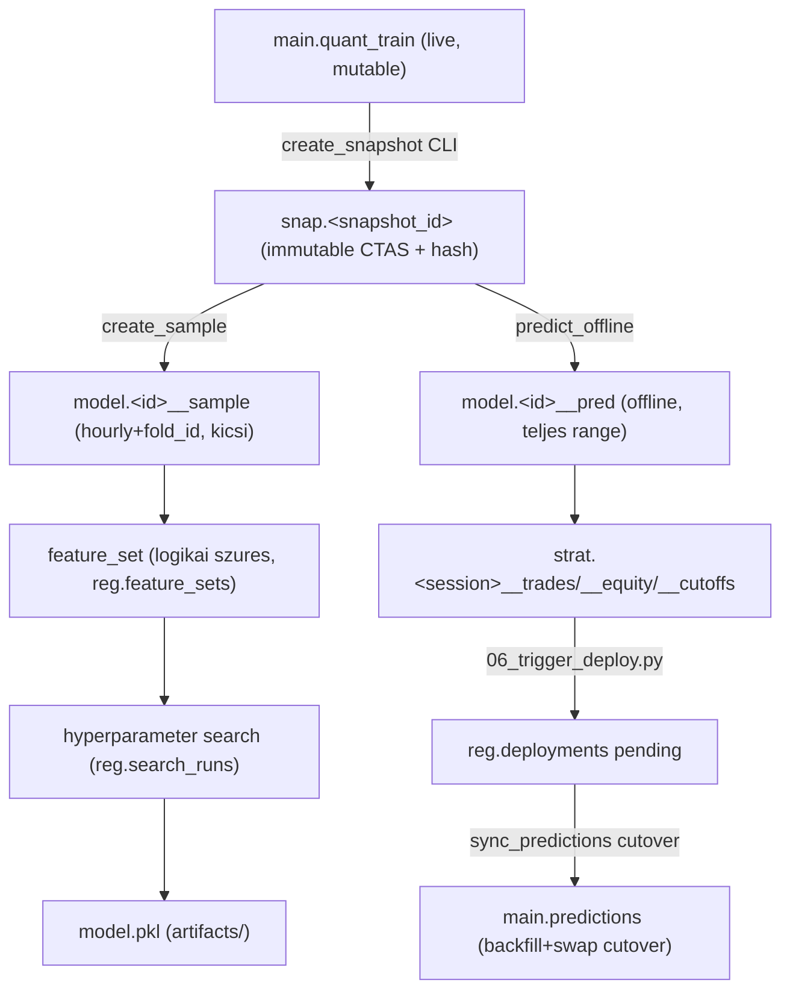
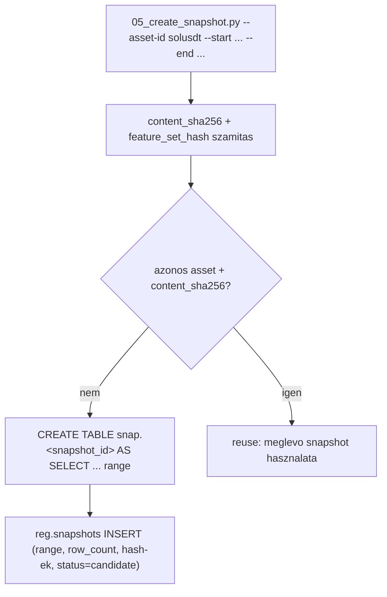
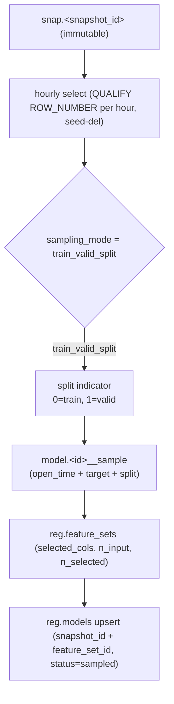
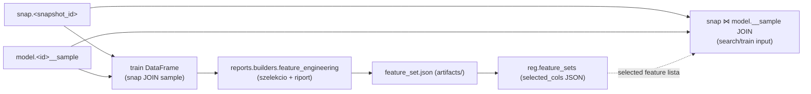
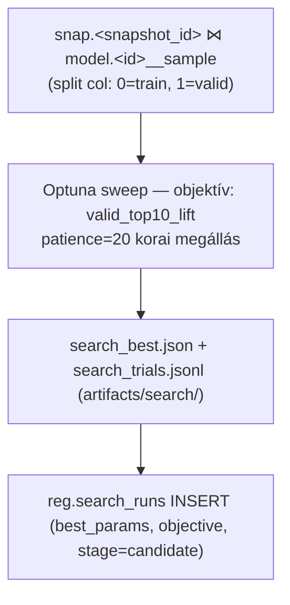
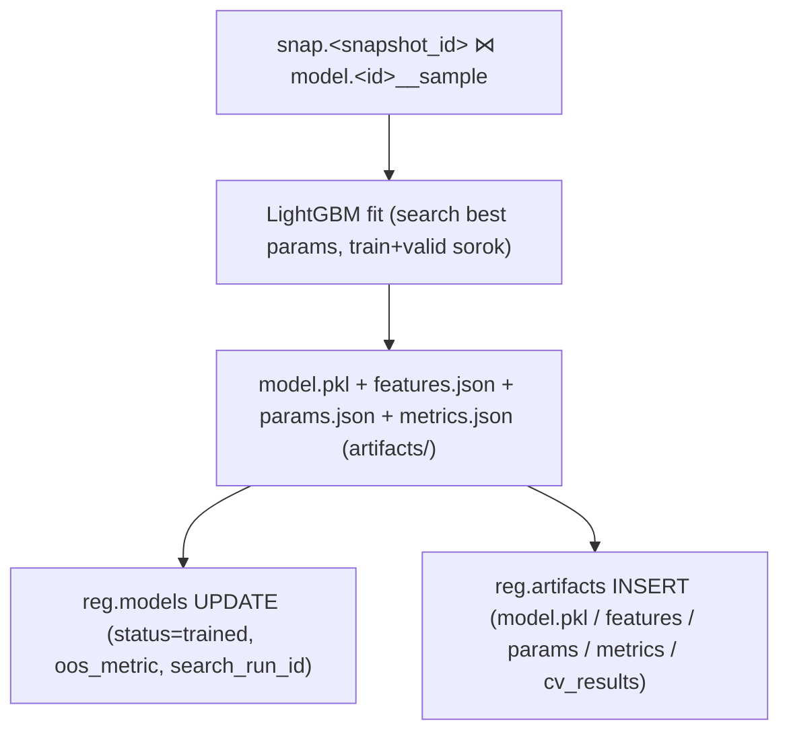
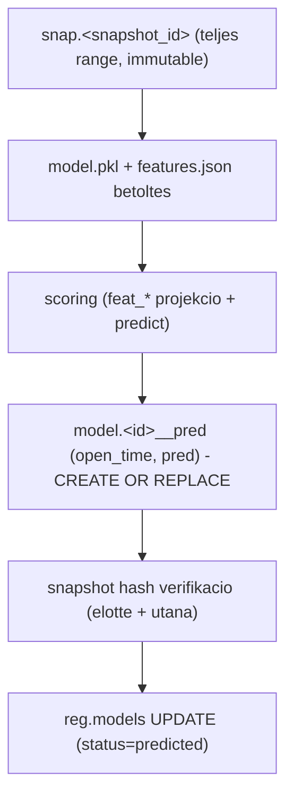
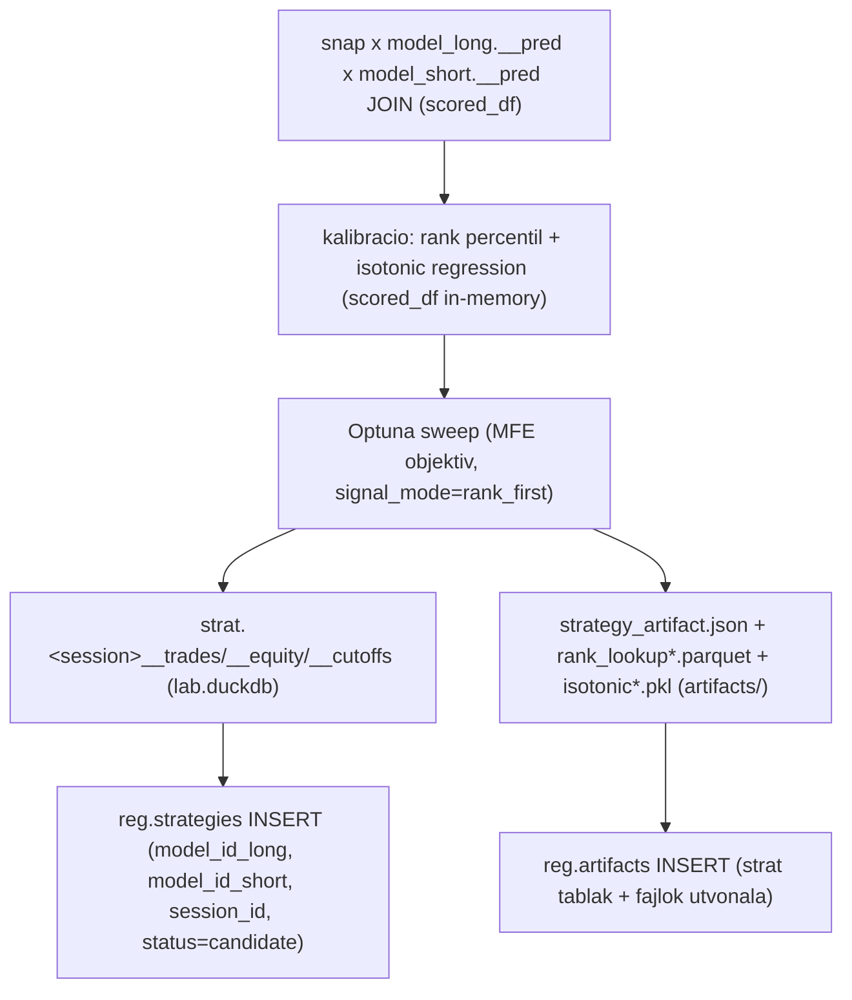
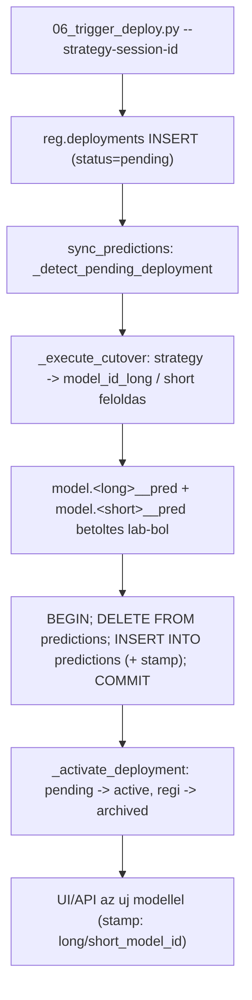
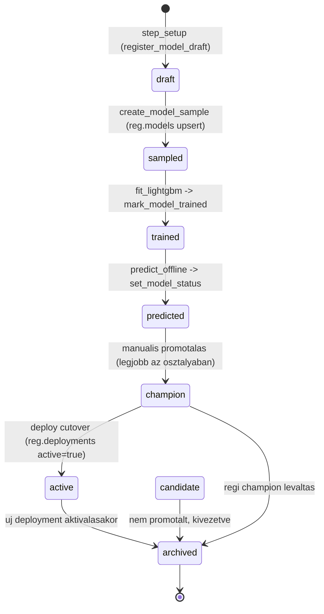

# 0004 — Modell Életciklus (Model Lifecycle)

A teljes modellfejlesztési és élesítési folyamat: snapshot befagyasztástól a live
predictions backfill+swap cutoverig. Minden lépés DuckDB-natív — a modellezési
adat a `lab.duckdb`-ben él, a registry (`registry.duckdb`) köti össze a lánc
elemeit, a live predikció az élesítés után a `live.duckdb` `predictions` táblájába kerül.

---

## Overview

A registry minden lépésnél kap provenance-bejegyzést. A státusz-lánc:
`draft → sampled → trained → predicted → (strategy candidate) → deployed → archived`

---

## 1. Snapshot (adatállapot rögzítése)

A fejlesztési folyamat forrása a `live.quant_train` egy befagyasztott
range-másolata. Ez az egyetlen pont, ahol a változékony élő adat rögzül.

A `snapshot_id` formátuma: `{asset}_fw{h}_{range}__{hash8}`
(pl. `solusdt_fw60_2023__a37d2703`).

Részletek: → [1400_snapshots.md](1400_snapshots.md)

---

## 2. Sample (mintavétel a snapshotból)

A sampling az immutable snapshot fölött dolgozik. Forrása a `snap."<snapshot_id>"`
tábla (nem a `quant_train`), kimenete `model."<model_id>__sample"` DuckDB tábla.

A modellek az egyetlen támogatott `train_valid_split` módot használják: egyetlen kronológiai
felosztás, `split` TINYINT oszloppal (0=train, 1=valid). A korábbi `walk_forward` mód törölve (epic_068).

A sample kicsi (~tízezer sor hourly felbontásban). A feat_* oszlopok a snapshotban
maradnak — a downstream lépések közvetlen `snap."<snapshot_id>" ⋈ model."<model_id>__sample"`
joinnal dolgoznak (nincs per-modell feature-másolat).

**Train/valid split paraméterek (aktív, champion modellek):**
`train_start`, `train_end`, `valid_start`, `valid_end` dátum határok;
`feature_lookback_embargo_minutes=240` (train eleje); `target_purge_minutes=60` (train vége).

**I6 garantálva:** Egy `model_id`-hez pontosan egy `target_name` tartozik (`config/models.json`).

Részletes invariáns összefoglaló (I1–I7): → [4100_quant_train.md](4100_quant_train.md#invariánsok--sample-scoped-pipeline)

---

## 3. Feature Engineering

A feature engineering (`reports.builders.feature_engineering`, a pipeline `feature_engineering` lépése) az adott modell mintáját a
`snap."<snapshot_id>" ⋈ model."<model_id>__sample"` joinból tölti be. Kimenete továbbra is egy **logikai feature_set**: a kiválasztott
oszlopok listája, amelyet a registry tárol.

A search és a train lépés a snapshotból és a sample-ból közvetlenül építi a
betanítási mátrixot — columnar projekcióval, fizikai feature-másolat nélkül.

**I1 kikényszerítve (FE input):** `materialize_sample_scoped_quant_train` ellenőrzi,
hogy a TEMP `quant_train` sorszáma == `model.__sample` sorszáma.
**I7 garantálva:** A `feature_set.json["provenance"]` tartalmazza: `snapshot_id`,
`sample_table`, `sample_rows`, `joined_rows`, `source_contract: "snap ⋈ model.__sample"`.

---

## 4. Hyperparameter Search

Az objektív: `valid_top10_lift` (top 10% predikciók átlagos y_true értéke mínusz overall
átlag a valid seten). A legjobb trial kiválasztása: max `valid_top10_lift` elsőrendű
kritérium, `train_valid_gap` másodlagos tiebreaker (top-5 jelölt közül a legkisebb gap-et preferálja).

A search best-effort módon írja a registry-t: egy hiba a search futásában nem
veszíti el a kész eredményt.

---

## 5. Train

A tréning a `snap ⋈ model.__sample` joinból dolgozik, kimenete a model bináris és
az artifact fájlok.

A final modell **az összes train során** refittelt (a fold CV csak metrika-mérés).

---

## 6. Offline Predict

A predikció a snapshot teljes range-ét scorolja a frissen betanított modellel.
A predikció **nem** íródik vissza a snapshotba — külön `model.__pred` tábla keletkezik.

A `snap ⋈ model.__pred` join `open_time`-on 1:1. A snapshot immutability
sértetlen: a hash a predict lépés előtt és után egyezik.

---

## 7. Strategy Kalibráció

A strategy a `snap ⋈ model_long.__pred ⋈ model_short.__pred` joinból dolgozik —
nincs parquet-mozgatás.

A `strategy_artifact.json`, `rank_lookup_*.parquet`, `isotonic_*.pkl` a stratégia kontraktusa (az API `/api/strat/active` olvassa);
az `strat.*` DuckDB táblák az UI-nak és validációnak szólnak. Az éles order-végrehajtó (live service) törölve.

---

## 8. Deploy és Cutover

A deploy a modell-életciklus utolsó fázisa: az élesítés atomikusan cseréli a
`predictions` táblát és átállítja a registry-t.

Rollback: az előző `strategy_id` a `reg.deployments.previous_strategy_id`-ben
tárolódik. Újra-élesítéssel (`06_trigger_deploy.py`) a következő sync ciklus
visszacsinálja a backfill+swap-ot.

Részletek: → [0003_runtime_flow.md](0003_runtime_flow.md)

Asset-onként külön: `06_trigger_deploy.py --asset-id <asset>`; a cutover a megfelelő asset `sync_predictions` jobjában fut.

---

## Új asset onboarding

Egy új asset (pl. `bchusdt`, epic_069) felvételének teljes lépéssora; a parancsok `--asset-id <asset>` paraméterrel futnak, `PYTHONIOENCODING=utf-8` kell Windows alatt.

| # | Lépés | Parancs / fájl | Megjegyzés |
|---|-------|----------------|-----------|
| 1 | `config/assets.json` | új bejegyzés: `symbol`, `interval`, `market`, `db_path`, `metadata_path`, `features_profile`, `qty_step` | `qty_step` = Binance `exchangeInfo` LOT_SIZE stepSize; `default_asset_id` marad |
| 2 | Features profile | `config/features.json`: `<asset>_fw60` profil (a SOL profil másolata) | az indikátor-halmaz azonos lehet |
| 3 | Bootstrap backfill | `02_sync_pipeline.py --asset-id <a> --tables ohlcv --start <onboardDate>`, majd `--tables targets,features --chunk-months 3`, majd `03_build_quant_train.py --asset-id <a>` | onboardDate: `fapi/v1/exchangeInfo` `onboardDate`. **Funding:** `02_sync_pipeline.py --asset-id <a> --tables funding` (`sync_funding`, `fapi/v1/fundingRate`); auto-sync előtt fusson le a teljes bootstrap, majd `config/trading.json` `assets.<a>` blokk (modell nélkül üres `{}` is elég) |
| 4 | Sanity tesztek | `tests/store/sanity` (default assetet olvasnak; más assetre monkeypatch kell) | a SOL-ra hangolt küszöbök más assetnél hamis riasztást adhatnak |
| 5 | `config/models.json` | long + short modell, `asset_id: <a>`, a champion sampling-blokkja | `utils.model_asset_id(model_id)` ebből oldja fel az assetet |
| 6 | Snapshot | `05_create_snapshot.py --asset-id <a> --start .. --end ..` | az 1-3. szekció |
| 7 | Pipeline | `pipeline.py --model <id> --step setup/sample/feature_engineering/search/train/predict/analyze` | a registry-érintő lépéseket sorban futtasd (registry lock), párhuzamosan csak a search mehet |
| 8 | Strategy | `00_run_strategy_session.py --long-model <l> --short-model <s> --session-id strat_<a>_fw60_{long,short}_2101_2607 --calib-start 2026-02-01 --calib-end 2026-07-31 --opt-start 2026-02-01 --opt-end 2026-07-31 --directions long` (majd `short`) | az asset: `--asset-id` -> modell `asset_id` -> default. A kimenet `artifacts/<session_id>/`-ba kerül: a long session tartalmát `artifacts/<long_model>/strategy/`-ba, a shortét `artifacts/<short_model>/strategy/`-ba kell másolni (ezt olvassa az `analyze` 04_strategy és a `trading.json` `<model>/strategy` id); a `reg.artifacts` a session-mappára mutat (SOL/BCH/BTC azonos) |
| 9 | Deploy trigger | `06_trigger_deploy.py --asset-id <a> --strategy-session-id <session>` (long és short) | 2 pending deployment |
| 10 | `config/trading.json` | `assets.<a>.strategy_session_{long,short}_id` = `<model>/strategy` | ettől lesz az asset sync-aktív (auto-sync) |
| 11 | Worker `sync_predictions` | `POST /api/jobs {"kind":"sync_predictions","params":{"asset_id":"<a>"}}` | a cutover végrehajtja a deployt; worker-újraindítás nem kell |
| 12 | UI fül | automatikus: `GET /api/assets` -> `AssetTabs` (`has_data`), `/a/<a>`; a fülsorrend `config/assets.json` `display_order` (új asset nélküle a lista végére kerül) | MCP: `list_assets`, `asset` paraméterek |

Megjegyzések (epic_075 t944, BTC): a worker a `target`-et nem frissíti, ezért a snapshot előtt `02_sync_pipeline.py --asset-id <a> --tables targets`, majd `03_build_quant_train.py --asset-id <a>`. A `models.json` bejegyzés `active: false` maradjon a deployig: egy sync-aktív assetnél (`trading.json` blokk) az `active: true` modellt a worker `sync_predictions` azonnal felveszi. A snapshot `content_sha256` csak az `open_time`-rácsot + sorszámot + oszlopkészletet ujjlenyomatozza (értékeket nem), ezért azonos range-ű, hézagmentes assetek (BCH, BTC) hash-e egyezik; a reuse `(asset_id, hash)` kulcsú, így ez nem okoz keveredést. Az `analyze` a builder-hibát (pl. live DB lock) csak WARNING-ként írja ki, ezért a logot ellenőrizd, és szükség esetén futtasd újra.

Élesítés egy már sync-aktív assetre (epic_075 t946, BTC; a BCH is így ment): (a) `06_trigger_deploy.py --asset-id <a>` a long, majd a short sessionre (2 pending), (b) `models.json` `active: true` + `trading.json` session id-k. A futó worker `sync_full` a következő ciklusban (üres `predictions`-nél csak a friss OHLCV-ablakkal, nem a teljes történettel) észleli a pendinget → cutover a lab `__pred` range-re (snapshot vége, pl. 2026-07-31), a második ciklus a short pendinget (long `archived`, short `active`), a harmadik a `predictions` utolsó sorától a gap-et (~4 hónap, BTC: 166 780 sor egy inferenciában). Külön `04_backfill_predictions.py` / `sync_predictions` job nem kell (a `sync_predictions` job üres táblánál `INITIAL_SYNC_START`-tól töltené be a feature-öket a cutover előtt — kerülendő). Ellenőrzés: `count(*)` = percek száma a min..max között, `lag` gap = 0, egy stamp-pár. A `reg.models` / `reg.strategies` státusz változatlan (`predicted` / `candidate`, mint SOL/BCH).

Megjegyzések: az 1-3. lépés után (modell és trading.json blokk nélkül) az asset NEM sync-aktív, ezért a hosszú bootstrap nem blokkolja a többi asset syncjét. Ellenőrzés: `python -m src.data_handling.store.registry_validator`. Referencia-eset: BCH, a rövid összegzés `_doc_/0000_project_overview.md` Modellek szekciójában.

---

## Reg.models státusz-lánc

A `champion` státusz manuális promóciót igényel — ez a gate, amely megelőzi, hogy
egy validálatlan modell automatikusan élesedjen.

---

## Részleges retrain döntési tábla

A registry hash-ek (`content_sha256`, `feature_set_hash`) automatikusan detektálják,
mit lehet újrahasználni:

| Mi változott | Snapshot | Sample | FE | Search | Train | Predict | Deploy |
|--------------|:---:|:---:|:---:|:---:|:---:|:---:|:---:|
| Csak hyperparam | – | – | – | Igen | Igen | Igen | Igen |
| Új feature_set (ua. range) | – | – | Igen | Igen | Igen | Igen | Igen |
| Új range | Igen | Igen | Igen | Igen | Igen | Igen | Igen |
| Csak újra-élesítés (kész modell) | – | – | – | – | – | – | Igen |

---

## Impulse Scout (külön életciklus)

Az Impulse Scout (`scout_s0c_r1`, epic_074) **nem** ezen a láncon megy: nincs snapshot / registry / deploy lépés.
Egyszer fagyasztjuk be (`python -m scout.freeze` → `artifacts/scout_s0c_r1/`, manifest + `freeze_hash`), további
hangolás nincs; az éles futtatás a `scout.run()` runtime-mal történik. Új definíció vagy újratanítás = új artifact
verzió (`scout_s0c_r2`). Részletek: [5800_scout_runtime.md](5800_scout_runtime.md).

---

## Kapcsolódó dokumentumok

| Téma | Hivatkozás |
|------|-----------|
| Tárolási topológia (3 fájl, sémák) | [0002_data_architecture.md](0002_data_architecture.md) |
| Éles folyamat (sync → predict → trade → cutover) | [0003_runtime_flow.md](0003_runtime_flow.md) |
| Snapshot réteg — miért és hogyan | [1400_snapshots.md](1400_snapshots.md) |
| Registry séma + életciklus | [1500_registry.md](1500_registry.md) |
| Sampling metodológia | [5400_sampling.md](../methodology_doc/3000_sampling.md) |
| Hyperparameter search | [5500_hyper_param_search.md](../methodology_doc/5000_hyper_param_search.md) |
| Strategy metodológia | [6000_strategy.md](../methodology_doc/6000_strategy.md) |
| quant_train tábla + I1-I7 invariánsok | [4100_quant_train.md](4100_quant_train.md) |
| Sampling kód-ref (create_model_sample) | [5300_create_sample.md](5300_create_sample.md) |
| Pipeline / predict / provenance kód-ref | [5530_pipeline_predict_provenance.md](5530_pipeline_predict_provenance.md) |
