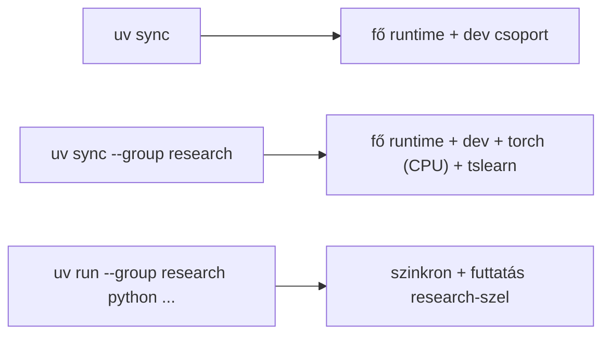

# 0005 — Tooling és függőségek (uv, opcionális `research` csoport)

Az `uv` kezeli a `.venv`-et (`pip` nincs). A fő runtime (`uv sync`) szándékosan nem tölti le a
nehéz ML-csomagokat; a kutatási csoport külön, opt-in telepítéssel érhető el.

---

## Overview



---

## Csoportok (`pyproject.toml`)

| Csoport | Tartalom | Alapértelmezett `uv sync`? |
|---|---|---|
| fő `dependencies` | pandas, duckdb, lightgbm, fastapi, mcp, ... | igen |
| `dev` (`[dependency-groups]`) | pytest, ruff, pyright, httpx | igen |
| `research` (`[dependency-groups]`) | `torch` (CPU), `tslearn` | **nem** — opt-in |

### torch CPU index

A `torch` csak a `research` csoporthoz van kötve, explicit indexről:

```toml
[[tool.uv.index]]
name = "pytorch-cpu"
url = "https://download.pytorch.org/whl/cpu"
explicit = true

[tool.uv.sources]
torch = { index = "pytorch-cpu", group = "research" }
```

`explicit = true`: a PyTorch index csak a `torch` csomagra kerül használatba, a többi csomag
a normál PyPI-ról jön. A `tslearn` PyPI-ról települ.

---

## Telepítés és futtatás

```powershell
# Fő runtime + dev (alap)
uv sync

# Kutatási csoport telepítése (torch CPU + tslearn)
uv sync --group research

# Futtatás research csoporttal (szinkronizál is, ha kell)
uv run --group research python -c "import torch, tslearn; print(torch.__version__, tslearn.__version__)"
```

**Figyelem:** a sima `uv sync` a `.venv`-et pontosan a `dependencies` + `dev` állapotra hozza,
tehát egy korábbi `uv sync --group research` után a `torch`/`tslearn` eltávolításra kerül a
`.venv`-ből. Kutatási munkához mindig `uv run --group research ...` vagy `uv sync --group research`.

---

## Lock és verziók

- `uv.lock` a teljes (fő + dev + research) állapotot tartalmazza.
- A `torch` és `numba` miatt a lock resolution-marker blokkjai bővültek (darwin / Python 3.13
  ágak); a meglévő csomagverziók nem változtak.
- Ellenőrzés: `uv lock --check`.

---

## Smoke

Import smoke (`uv run --group research`): ha `torch` és `tslearn` betölthető, a csoport működik.
A teszt-suite alap futtatása (`uv run pytest src/reports -q`) nem igényli a research csoportot.
