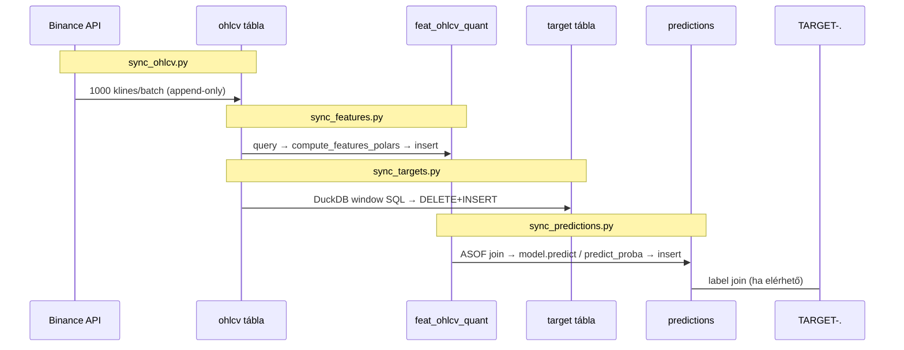
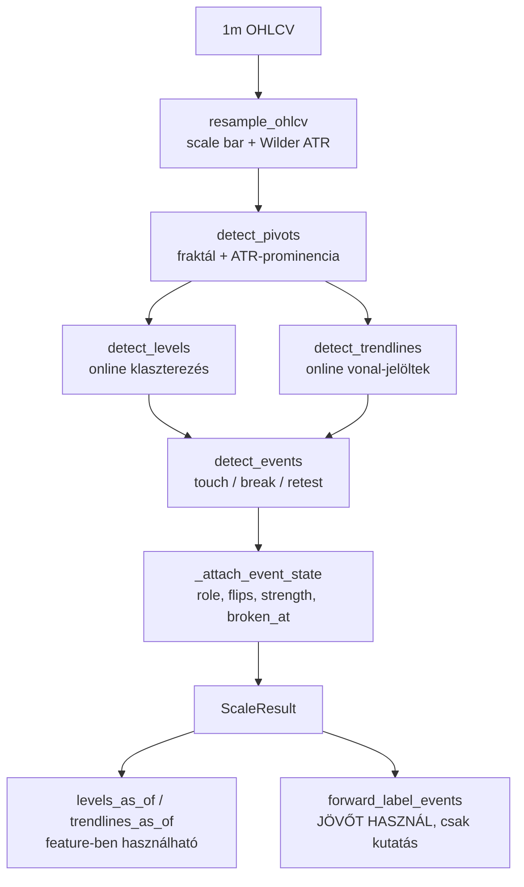
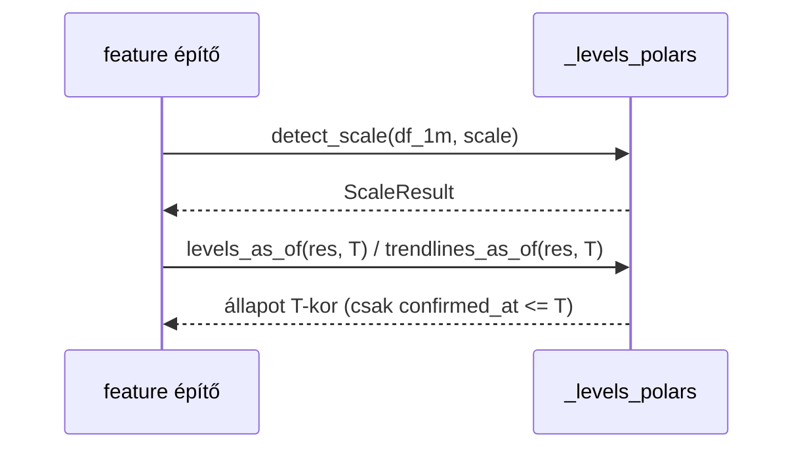
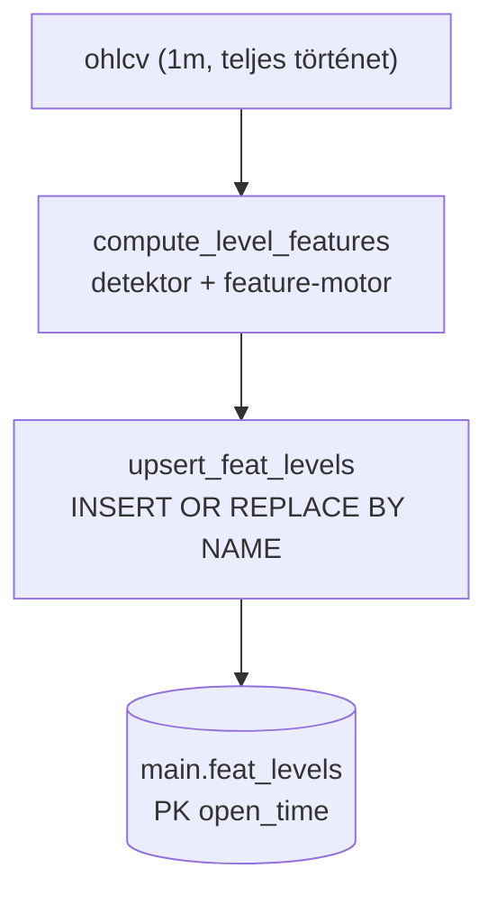
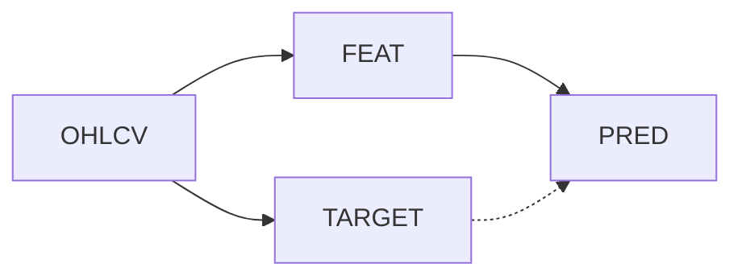
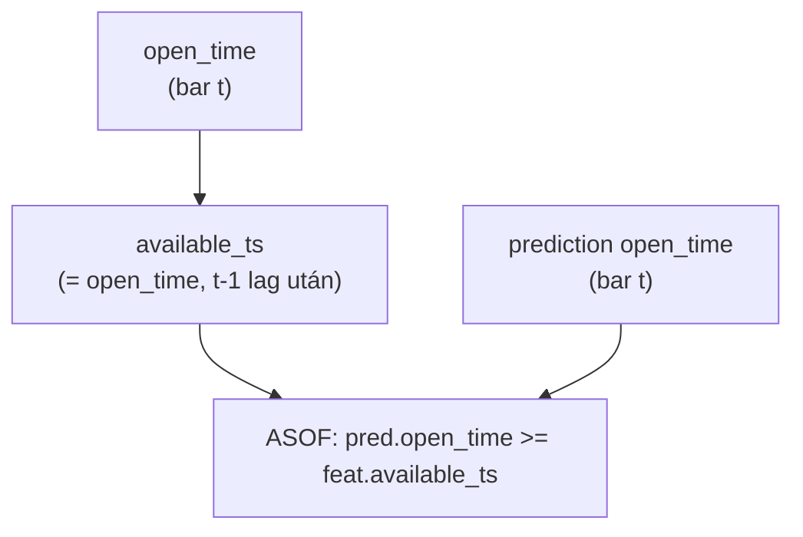

# sync_tables/ — Sync Pipeline

A `src/data_handling/sync_tables/` könyvtár felelős az összes adat mozgatásáért és transzformálásáért: Binance API → OHLCV → features → targets → predictions. Minden funkció idempotens — biztonságosan újrafuttatható.

---

## Pipeline áttekintés



---

## Fájlok

### [sync_ohlcv.py](1210_sync_ohlcv.md)

Binance 1-perces kline szinkron. Paginálás 1000/batch, stale guard, gap check.

**Belépési pont:** `sync_ohlcv(open_time_ms_from, asset_id)`

**Kritikus invariáns:** 10 oszlop tárolva (Binance 12-ből — `close_time` és `ignore` elhagyva).

---

### [sync_features.py](2100_sync_features.md)

Feature számítás Polars LazyFrame pipeline-nal. t-1 lag minden OHLCV-alapú feature-re.

**Belépési pont:** `sync_features(start_time, lookback_bars, end_time, asset_id, backfill=False)`

**Kritikus invariáns:** `available_ts = open_time` (t-1 lag az `_apply_t1_lag_pl` biztosítja).

**Catch-up start (epic_076 / t947):** a `feat_ohlcv_quant` append-only (`insert_feat_ohlcv_quant`: csak `open_time > MAX`), ezért ha a kért `start_time` > tárolt feature-tail + 1 perc, a `sync_features` a kezdést a tail + 1 percre csökkenti (WARNING `Feature catch-up`). Így egy félbeszakadt élő job (OHLCV beírva, feature-írás előtt DuckDB-zár / crash / restart) nem hagy végleges lyukat. `backfill=True`: belső lyukak kitöltése (`backfill_feat_ohlcv_quant`, a meglévő `open_time`-okat kihagyja; catch-up nélkül).

### `repair_gaps.py` (epic_076 / t947)

Belső 1 perces lyukak felderítése és pótlása: `find_missing_ranges(db_path, table, reference)` (gaps-and-islands, csak `[MIN, MAX]` belsejében — az élő tail-késés nem lyuk), `repair_gaps(asset_id, dry_run=False) -> GapRepairResult`: előbb `feat_ohlcv_quant` vs `ohlcv` → `sync_features(backfill=True)`, majd `predictions` vs `feat_ohlcv_quant` → `sync_predictions(backfill=True)`; minden lépés rövid írási tranzakció, DuckDB-zárnál lépésenként újrapróbál (30 × 2 s), idempotens — élő worker mellett futtatható.

```
uv run python src/data_handling/02_sync_pipeline.py --repair-gaps --asset-id <id> --dry-run
uv run python src/data_handling/02_sync_pipeline.py --repair-gaps --asset-id <id>
```

---

### [sync_predictions.py](1230_sync_predictions.md)

Champion modellek betöltése és inference futtatása. Unified long+short output egy sorban.

**Belépési pont:** `sync_predictions(start_time, end_time, asset_id, backfill=False)`

**Kulcs lépések:** `champion_models_for_asset` → `_load_model_artifacts` → feature query → target join → `_run_inference` → `insert_predictions` / `backfill_predictions`

**Deploy detektálás:** Minden híváskor ellenőrzi a `reg.deployments` pending sorát — ha talál, atomikus predictions csere (cutover) fut.

---

### [sync_targets.py](3100_sync_targets.md)

Bináris target labelek számítása DuckDB window SQL-lel. Teljes rebuild szemantika.

**Belépési pont:** `sync_targets(asset_id)`

**Kritikus invariáns:** `ROWS BETWEEN 1 FOLLOWING AND 60 FOLLOWING` — az aktuális bar NEM szerepel a forward window-ban.

---

### `sync_funding.py` (epic_074 / t939)

Binance USDT-M elszámolt funding (`GET fapi/v1/fundingRate`, python-binance `futures_funding_rate`) → live `main.funding_rate` (migráció v7: `funding_ts TIMESTAMP, funding_rate DOUBLE, mark_price DOUBLE`; `IF NOT EXISTS`, így a régi ad-hoc SOL/BCH tábla változatlan marad). Olvasója: `strategy.costs.load_funding_schedule`.

**Belépési pont:** `sync_funding(asset_id=None, start_time=None, only_if_due=False, now=None) -> int` (írt sorok)

- Inkrementális: a tárolt `MAX(funding_ts)` után kér (1000/oldal); üres táblánál `start_time`, ennek hiányában a legkorábbi OHLCV `open_time`. Nem-futures asset: kihagyva (0).
- Írás: `duckdb_store.insert_funding_rate` — csak a tábla és a batch közös oszlopai, `funding_ts`-re `NOT EXISTS` dedup (idempotens).
- `only_if_due=True` (worker mód): Binance-hívás csak ha `now >= utolsó + intervallum`; az intervallum az utolsó két elszámolás különbsége (min 1 h, 1 sornál 8 h) — **nem** feltételez fix 8 órás rácsot.
- CLI: `02_sync_pipeline.py --asset-id <a> --tables funding`; worker: `sync_full` minden futáskor (nem-fatális, → [8310_worker.md](8310_worker.md)).

---

### `sync_scout.py` (epic_074 / t941)

Impulse Scout forward-log: `scout.run` ([5800](5800_scout_runtime.md)) kimenete → live `scout_signals`
([1000](1000_database.md#scout_signals), migráció v8). A tábla egyetlen írója.

**Belépési pont (a t942 worker job is ezt hívja):**

```python
from data_handling.sync_tables.sync_scout import sync_scout, ScoutSyncResult
res = sync_scout("btcusdt", art=art)          # art = scout.load_artifact() egyszer / folyamat (opcionális)
res.to_dict()                                  # JSON-barát számlálók a job payloadhoz
```

`sync_scout(asset_id=None, *, since=None, art=None, now=None, attempts=24, wait_s=5.0) -> ScoutSyncResult`

- Egy RW kapcsolat (zárolásnál `attempts × wait_s` újrapróbálás) → `ensure_tables` → `check_table_schema` (drift →
  `RuntimeError`) → `ohlcv` olvasás `art.detect_anchor`-tól → `scout.run(..., since)` → `upsert_scout_signals` egy
  tranzakcióban. ~0,7 s / asset (az első SOL futás a v7+v8 migrációval ~2 s).
- `since`: legkorábbi `t0` (alapértelmezés és minimum `art.live_start` = 2026-11-01; korábbi → `ValueError`).
- `ScoutSyncResult`: `asset_id, model_id, events, inserted, inserted_backfilled, resolved, filled, refreshed,
  immutable_mismatch, missing_in_run, open_events, total_rows, as_of, first_live_sync_at`.

**Upsert szabályok (`upsert_scout_signals(conn, df, asset_id, now)`):**

| Eset | Viselkedés |
|---|---|
| új `event_id` | INSERT, `scored_at = now`, `backfilled = t_c < first_live_sync_at` (`MIN(scored_at)`, üres táblánál `now`) |
| `IMMUTABLE_COLUMNS` eltér | a sor kimarad (semmi nem frissül), WARNING log, `immutable_mismatch += 1` — a tárolt érték nyer |
| set-once (`entry`, `{rule}_tp/_sl`) | csak NULL → érték; eltérő nem-NULL érték: WARNING, tárolt marad |
| tárolt `status = open`, új `resolved`/`invalid` | kimenet-oszlopok + `status` + `label_class` + `as_of` egyszer beírva (`resolved += 1`) |
| tárolt `status = open`, új is `open` | csak `as_of` frissül (`refreshed`) |
| tárolt `status != open` | semmi; eltérő újraszámolt kimenet → WARNING |
| tárolt, de a futásból hiányzó esemény | megmarad, WARNING (`missing_in_run`) |

- CLI: `02_sync_pipeline.py --asset-id <a> --tables scout [--start "2026-11-20 00:00:00"]` — **opt-in**: a `--tables`
  nélküli alapfutás (`DEFAULT_TABLES`) nem tartalmazza (kísérleti; BCH később, külön döntéssel).
- Tesztek: `src/data_handling/tests/sync_tables/smoke/test_sync_scout.py` (migráció v6/v7 → v8, immutabilitás,
  idempotencia, set-once, kimenet-átmenet, séma-drift, sync wiring).

---

### [_features_polars.py](2200_features_polars.md)

Feature computation engine — 30+ indikátor csoport Polars LazyFrame API-val.

**Belépési pont:** `compute_features_polars(df_ohlcv, indicators, feat_prefix, available_activity, targets_cfg)`

**Kritikus invariáns:** `T_MINUS_1_SKIP` frozenset — P2 időindexes feature-ök ki vannak zárva a t-1 lag alól.

---

### `_levels_polars.py` (epic_071 / t910)

Tiszta, mellékhatás-mentes S/R szint- és trendvonal-detektor: 1m OHLCV be, Polars DataFrame-ek ki. Nincs DB-hozzáférés és fájlírás. A definíciók, a paraméter-indoklás és a go/no-go küszöbök a [módszertani doksiban](../methodology_doc/1700_features_sr_trendline.md) vannak; ez a szakasz a kód-referencia.

**Belépési pont:** `detect_all_scales(df_1m, scales=None, params=None)` (a `t911` riport is ezt hívja).



A `scales` map három léptéket ír le: `s` = 1h bar / 7 nap lookback, `m` = 4h / 30 nap, `l` = 1d / 180 nap. A bar-ok epoch-igazítottak (UTC), az időbélyegek naiv `Datetime("us")` (UTC, mint az `ohlcv` tábla).

#### Publikus API

| Függvény | Visszatérés | Megjegyzés |
|----------|-------------|------------|
| `load_params(params=None)` | `dict` | az átadott dict, különben `utils.load_levels_detector_config()` |
| `resample_ohlcv(df_1m, bar, atr_window=14)` | `pl.DataFrame` | nem zárt utolsó bar eldobva; ATR null az első `atr_window-1` bar-on |
| `detect_pivots(bars, scale, params=None)` | `pl.DataFrame` | fraktál pivot, ATR-prominencia szűrővel |
| `detect_levels(bars, pivots, scale, params=None)` | `(levels, level_touches)` | pivotok online klaszterezése, ár = érintések átlaga, első megerősítés után fagyasztva |
| `detect_trendlines(bars, pivots, scale, params=None)` | `(trendlines, line_touches)` | támasz: emelkedő mélypontok, ellenállás: csökkenő csúcsok; 2 érintéses jelölt belső, nem kerül ki |
| `detect_events(bars, levels, trendlines, scale, params=None)` | `pl.DataFrame` | `touch` / `break` / `retest` eseménylista |
| `detect_scale(df_1m, scale, params=None)` | `ScaleResult` | teljes pipeline egy léptékre; az élettartam-állapot az eseményekből töltődik |
| `detect_all_scales(df_1m, scales=None, params=None)` | `dict[str, ScaleResult]` | minden konfigurált lépték (vagy a `scales` részhalmaz) |
| `levels_as_of(res, as_of, active_only=True, params=None)` | `pl.DataFrame` | szintek állapota `as_of` időpontban (csak `confirmed_at <= as_of`) |
| `trendlines_as_of(res, as_of, active_only=True)` | `pl.DataFrame` | vonalak állapota `as_of`-kor; `price_at` a `as_of` előtt zárt utolsó bar szerint |
| `forward_label_events(bars, events, params=None)` | `pl.DataFrame` | `events` + `forward_*` címkék; **jövőt használ**, csak a t913 kutatási címke |

`ScaleResult` (dataclass) mezői: `scale`, `bars`, `pivots`, `levels`, `level_touches`, `trendlines`, `line_touches`, `events`. A `forward_label_events` kimenetét a `detect_scale` nem tartalmazza, azt külön kell hívni.

#### Look-ahead szabály

Minden objektum `confirmed_at` mezőt visel: az az legkorábbi időpont, amikor már zárt scale-bar-ok határozzák meg. Pivot esetén a pivot-bar `i`-jére `n` bar-ral mindkét oldalon ez az `i+n`. bar **záróideje**. Szint / vonal a teljessé tevő pivot `confirmed_at`-jén születik, esemény az eseménybar záróidején. A feldolgozás `confirmed_at` szerint online történik, így a csonkolt futás (`T`-ig) pontosan a teljes futás `confirmed_at <= T` objektumait adja (leakage teszt: t910, 15m és 1h léptéken).



> A `levels` / `trendlines` / `level_touches` életvégi mezői (`n_touches`, `last_touch`, `strength`, `role`, `n_role_flips`, `broken_at`, `expired_at`, `expiry_reason`) a teljes történet alapján készülnek: **jövő információ**. Bar-szintű feature-höz KIZÁRÓLAG az `*_as_of` kimenet használható.

#### Kimeneti sémák

- `bars`: `open_time`, `close_time`, `open`, `high`, `low`, `close`, `volume` (f64), `n_minutes` (u32), `bar_num` (i64, nyitó epoch / bar-másodperc), `atr` (f64)
- `pivots`: `pivot_id` (`<scale>-P<seq>`), `scale`, `kind` (`high`/`low`), `bar_idx`, `bar_num`, `pivot_time`, `price`, `atr`, `prominence_atr`, `confirm_idx`, `confirmed_at`
- `levels`: `level_id` (`<scale>-L<seq>`), `scale`, `price`, `tolerance` (0.25·ATR), `atr_at_confirm`, `n_touches`, `first_touch`, `last_touch`, `confirm_idx`, `confirmed_at`, `expired_at`, `strength`, `is_round`, `is_round_secondary`, `role` (`support`/`resistance`), `n_role_flips`, `broken_at`
- `level_touches` / `line_touches`: `obj_id`, `pivot_id`, `pivot_time`, `price`, `confirmed_at`
- `trendlines`: `line_id` (`<scale>-T<seq>`), `scale`, `kind` (`support`/`resistance`), `anchor1_time`, `anchor1_price`, `anchor1_bar_num`, `anchor2_*` (ugyanezek), `slope_per_bar`, `slope_per_bar_atr`, `atr_at_confirm`, `n_touches`, `last_touch`, `confirm_idx`, `confirmed_at`, `expired_at`, `expiry_reason` (`break`/`stale`), `broken_at`
- `events`: `event_time` (eseménybar záróideje), `bar_idx`, `bar_num`, `scale`, `obj_type` (`level`/`line`), `obj_id`, `event_type` (`touch`/`break`/`retest`), `side`, `price`, `obj_slope_per_bar`, `bar_close`, `atr`
- `forward_label_events` hozzáadja: `forward_label`, `forward_bars`, `forward_timeout`, `forward_mfe_atr`, `forward_mae_atr`

Vonal ár bar-onként: `anchor1_price + slope_per_bar * (bar_num - anchor1_bar_num)`.

#### Konfiguráció: `utils.load_levels_detector_config`

`src/utils.py` — visszaadja a `config/features.json` `levels_detector` blokkjának másolatát (`copy.deepcopy`). Hiányzó blokknál `KeyError`. A `params` ezután a `load_params`-on keresztül jut a függvényekbe; a teszt és a kutatás explicit dict-et adhat át.

| Kulcs | Érték (config v1) | Szerep |
|-------|-------------------|--------|
| `atr_window` | 14 | Wilder ATR a scale-bar-okon |
| `pivot_n` | 3 | fraktál-szomszédság bar-ban mindkét oldalon |
| `pivot_min_prominence_atr` | 1.0 | pivot minimális prominenciája ATR-ben |
| `level_tolerance_atr` / `line_tolerance_atr` | 0.25 / 0.25 | érintési tűrés ATR-ben |
| `level_min_touches` / `line_min_touches` | 2 / 3 | szint / vonal megerősítéséhez szükséges érintés |
| `line_dedup_slope_atr` | 0.1 | vonal-duplikátum meredekség-tűrés |
| `break_atr` | 0.5 | törés: záróár ennyi ATR-rel a másik oldalon |
| `retest_bars` | 12 | visszateszt-ablak törés után (bar) |
| `strength_tau_frac` | 0.3333 | erő-bomlás τ = lookback · frakció |
| `round_step` / `round_step_secondary` | 10.0 / 5.0 | kerek szám lépés |
| `forward_bars` / `forward_move_atr` | 24 / 1.0 | kutatási címke horizont és elmozdulás-küszöb (csak t913) |
| `scales` | `s`: 1h/7 nap, `m`: 4h/30 nap, `l`: 1d/180 nap | léptékek bar-mérete és lookback-je |

---

### `_levels_features.py` + `sync_levels.py` (epic_071 / t912)

A `feat_levels` tábla (live main, migráció v6) feature-motorja és sync-je. A `_levels_features.py` tiszta, DB-mentes számítás: 1m OHLCV + detektor-kimenet → egy feature-sor 1m baronként. A `sync_levels.py` ezt futtatja le és upsert-eli a `main.feat_levels` táblába. **Nem** része a champion feature-láncnak: a `feat_ohlcv_quant` és a champion `quant_train` nem olvassa; csak a challenger profil (`solusdt_fw60_sr`) join-olja a `quant_train__solusdt_fw60_sr` táblába (→ [4100_quant_train.md](4100_quant_train.md)).

**Módszertan (miért):** → [`../methodology_doc/1700_features_sr_trendline.md`](../methodology_doc/1700_features_sr_trendline.md)

#### `_levels_features.py` — publikus API

| Függvény | Visszatérés | Megjegyzés |
|----------|-------------|------------|
| `compute_level_features(df_1m, params=None, scales=None, start=None, end=None)` | `pl.DataFrame` | lefuttatja a detektort a teljes `df_1m`-en, majd a feature-sorokat adja (`open_time`, `available_ts`, `feat_*`) |
| `level_features_from_results(df_1m, results, params=None, start=None, end=None)` | `pl.DataFrame` | ugyanaz, előre kiszámolt `dict[str, ScaleResult]`-ból (teszt / újrafelhasználás) |
| `feature_columns(level_scales=("s","m","l"), round_scales=("s","m"), line_scales=("s","m"))` | `list[str]` | a `feat_*` oszlopok sorrendje; a v1 alapérték a migrációval azonos |
| `FEATURE_DOCS` | `dict[str, str]` | egysoros definíció minden oszlopmintához (`{x}` = lépték) |

Konstansok: `LEVEL_SCALES = ("s","m","l")`, `ROUND_SCALES = ("s","m")`, `LINE_SCALES = ("s","m")` (a `l` léptéken ~140 vonal van 6 év alatt, ezért nincs rajta trendline-feature).

#### Tábla: `feat_levels`

`open_time TIMESTAMP PRIMARY KEY`, `available_ts TIMESTAMP` (= `open_time`, a `feat_ohlcv_quant` konvenciója szerint), utána 50 db `feat_*` `DOUBLE` oszlop. Minden feature `DOUBLE` (az egész jellegűek is), hogy a pandas/numpy konverzió NULL mellett se adjon nullable int dtype-ot. Séma-forrás: `_feat_levels_v1_columns()` a `duckdb_store.py`-ban (befagyasztott lista; új feature új migrációt igényel).

| Oszlopminta | Léptékek | Definíció | NULL, ha |
|-------------|----------|-----------|----------|
| `feat_sr_dist_res_atr_{x}` | s, m, l | (legközelebbi aktív ellenállás ára − ref) / ATR_x, > 0 | nincs aktív szint ref felett, vagy ATR ismeretlen |
| `feat_sr_dist_sup_atr_{x}` | s, m, l | (ref − legközelebbi aktív támasz ára) / ATR_x, ≥ 0 | nincs aktív támasz ref alatt |
| `feat_sr_strength_{res,sup}_{x}` | s, m, l | Σ exp(−(T − pivot_time)/τ) a `confirmed_at ≤ T` érintésekre (= `levels_as_of.strength`) | mint fent |
| `feat_sr_touches_{res,sup}_{x}` | s, m, l | érintésszám `confirmed_at ≤ T` | mint fent |
| `feat_sr_flips_{res,sup}_{x}` | s, m, l | szerepcserék száma = a szint break-eseményei `≤ T` | mint fent |
| `feat_sr_n_active_{x}` | s, m, l | aktív szintek száma (0 = nincs) | soha (csak a 0. sor) |
| `feat_sr_is_round_{res,sup}_{x}` | s, m | 1, ha a szint 10 többszöröse a tűrésen belül | nincs szint |
| `feat_sr_break_age_{x}` | s, m, l | scale-bar-ok a legutóbbi szint-break óta (`event_time ≤ T`) | nincs break a lookback-en (7 / 30 / 180 nap) |
| `feat_sr_break_dir_{x}` | s, m, l | +1 ellenállás felfelé tört, −1 támasz lefelé | mint break_age |
| `feat_sr_retest_flag_{x}` | s, m, l | 1, ha a megtört szintnek volt retest-je (break, T] között) | mint break_age |
| `feat_tl_dist_sup_atr_{x}` / `feat_tl_dist_res_atr_{x}` | s, m | (ref − legközelebbi aktív támasz-vonal ára) / ATR_x, előjeles; ellenállásra fordítva | nincs aktív vonal az adott típusból |
| `feat_tl_break_age_{x}` / `_break_dir_` / `_retest_flag_` | s, m | mint a szint-megfelelője, vonal-breakre | mint fent |

A vonal-ár: `anchor1_price + slope_per_bar · (bar_num_T − anchor1_bar_num)`, ahol `bar_num_T` a `T`-ig zárt utolsó lépték-bar (mint `trendlines_as_of.price_at`). A legközelebbi objektum a legkisebb |távolságú| aktív objektum az adott típusból.

#### Look-ahead és t-1 szabály

- A `t` sor a `T = t` falióra-időpont állapotát írja le (az `t-1` 1m bar zárása után, a `t` előtt): aktív objektum = `confirmed_at ≤ T < expired_at`, ugyanaz, mint `levels_as_of` / `trendlines_as_of(active_only=True)`.
- A `ref` az előző sor záróára (`close[t-1]`); az első sor NULL.
- Az élettartam-végi mezőket (`n_touches`, `strength`, `role`, `n_role_flips`, `broken_at`) a kód **nem olvassa**: minden állapot time-stamped változási pontokból épül (érintés `confirmed_at`, break / retest `event_time`, expiry).
- Számítás: eseményvezérelt, vektorizált. Az aktív objektumok ~20 slotba kerülnek, a sorok chunkonként (sor × slot) mátrixban, az állapot kompozit-kulcsos `searchsorted`-del.

#### NULL-szemantika

Nincs kitalált érték: a feature NULL, ha az objektum nem létezik `T`-ben, ha a lépték-ATR még nem ismert, vagy az első sornál. Az `n_active` a 0. sor kivételével sosem NULL. A LightGBM a NULL-t NaN-ként kapja.

#### `sync_levels.py` — sync és CLI

**Célja:** a teljes 1m `ohlcv` történeten lefuttatja a detektort (`levels_detector` config v1, befagyasztva), és a kért tartomány sorait `INSERT OR REPLACE ... BY NAME`-mel írja a `feat_levels`-be (idempotens, `open_time` szerint).

| Függvény | Visszatérés | Megjegyzés |
|----------|-------------|------------|
| `sync_levels(asset_id=None, start_time=None, end_time=None, full=False, params=None)` | `int` | írt sorok száma |
| `upsert_feat_levels(conn, df)` | `int` | `conn.register` + `INSERT OR REPLACE BY NAME` |
| `_connect_with_retry(db_path, attempts=24, wait_s=5.0)` | `DuckDBPyConnection` | a zárolt live DB-t 2 percig várja (worker sync) |



**Tartomány-szabály:** a detektor útfüggő, ezért mindig a teljes történeten fut (`end` felső határig). A `start` / `end` csak az **írt** sorokat szűkíti. Alapértelmezés: inkrementális, `latest_open_time(feat_levels) + 1 perc`-től. `--full`: az egész történet újraírása.

```powershell
# inkrementális (alapértelmezés)
uv run python -m data_handling.sync_tables.sync_levels --asset-id solusdt

# teljes újraírás
uv run python -m data_handling.sync_tables.sync_levels --asset-id solusdt --full

# pipeline-ból
uv run python src/data_handling/02_sync_pipeline.py --skip-ohlcv --tables levels
```

**Pipeline-kapcsolat:** a `02_sync_pipeline.py` `levels` lépése a `predictions` után fut, és benne van az `ALL_TABLES`-ben (az alapértelmezett `all`-ban is). A worker `sync_full` jobja nem hívja (a champion nem igényli); élesítéskor egy worker-lépés kell hozzá (~27 s / futás).

---

## Függőségi sorrend



A `02_sync_pipeline.py` ezt a sorrendet garantálja:
1. `sync_targets` (csak `ohlcv`-t olvas)
2. `sync_features` (csak `ohlcv`-t olvas)
3. `sync_predictions` (`feat_ohlcv_quant`-ot ASOF join-nal olvas)
4. `sync_levels` (csak `ohlcv`-t olvas; a `predictions` után fut, a champion láncot nem érinti)
5. `sync_funding` (független, Binance-ből; `ALL_TABLES` része)
6. `sync_scout` (csak `ohlcv`-t olvas; **opt-in**, `--tables scout` — nem része a `DEFAULT_TABLES`-nek)

**Élő (worker `sync_full`) lánc:** `sync_ohlcv` → `sync_funding(only_if_due)` → `sync_features` → `sync_predictions`. A `target` **nem** része a percenkénti láncnak (teljes rebuild; a 60 perces forward ablak miatt úgyis csak késve teljes) — bootstrapkor / tanítás előtt a `--tables targets` frissíti. Modell nélküli asseten (BTC/ETH, epic_075 előtt) a `sync_predictions` no-op.

A `target` tábla NEM blokkolja a features rebuild-et — a predictions viszont a features meglétét igényli.

---

## Idempotencia

Minden sync függvény a `latest_open_time(db_path, dataset)` alapján meghatározza a szinkron kezdőpontját. Ha a kért tartomány már be van töltve, a függvény 0 beírással lép ki.

| Függvény | Gap kezelés |
|----------|-------------|
| `sync_ohlcv` | Stale guard + gap check, warning logolás |
| `sync_features` | `MAX(open_time)` a feat táblában; catch-up: a kezdés sosem lehet a tail + 1 perc után (t947); belső lyuk: `--repair-gaps` |
| `sync_predictions` | `MAX(open_time)` a predictions táblában (a `sync_full` a pred-tail + 1 perctől hívja); belső lyuk: `backfill=True` / `--repair-gaps` |
| `sync_targets` | Mindig teljes rebuild (DELETE+INSERT) |
| `sync_levels` | `INSERT OR REPLACE` a `open_time` PK-ra; a detektor mindig a teljes történeten fut; inkrementális alapértelmezés: `MAX(open_time) + 1 perc` |
| `sync_funding` | `MAX(funding_ts)` után kér; `NOT EXISTS` dedup `funding_ts`-re |
| `sync_scout` | Teljes újradetektálás `detect_anchor`-tól (determinista); `event_id` PK-ra upsert immutable / set-once / egyszeri kimenet szabályokkal; ismételt futás csak a nyitott események `as_of`-ját lépteti |

---

## Lookahead bias megakadályozás



A feature-öket a `compute_features_polars` hívásban `shift(1)` tolja el. Az `available_ts` mezőt a `sync_features` állítja be `open_time`-ra az eltolás után. Az ASOF join a `predictions` táblát `feat_ohlcv_quant.available_ts <= predictions.open_time` feltétellel köti össze — így minden bar csak már elérhető feature-t lát.
