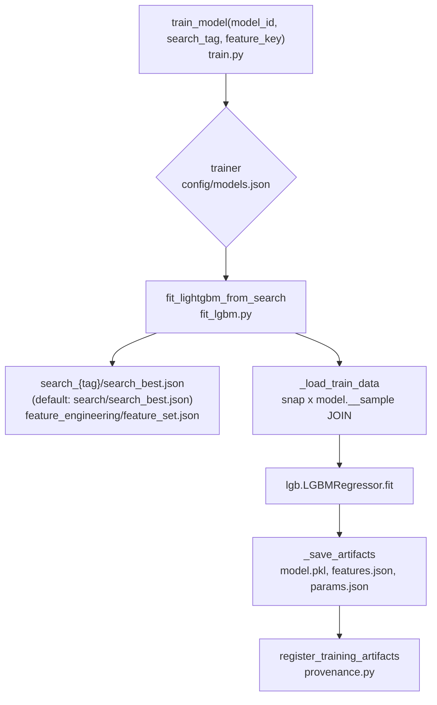
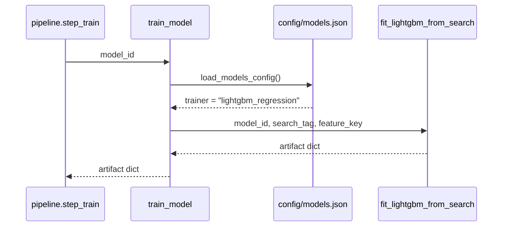
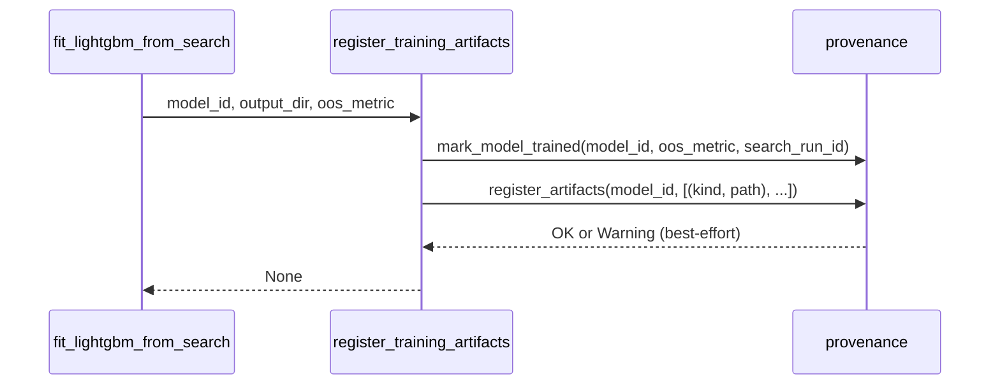
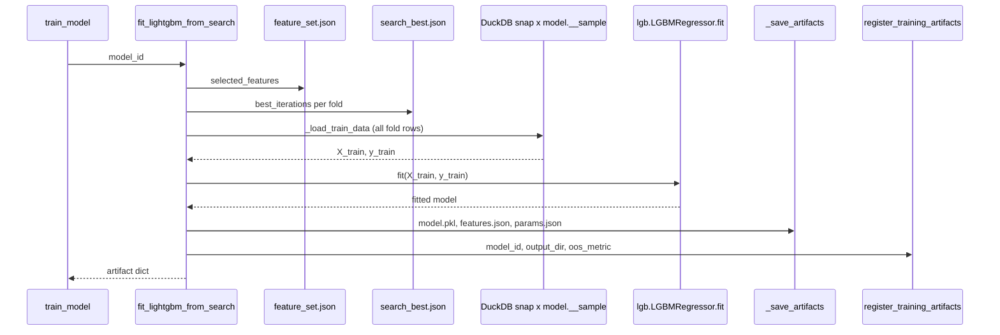

# 5510 — Training Submodule

A `src/modeling/training/` csomag a végső modell illesztéséhez és értékeléséhez
szükséges komponenseket tartalmazza: dispatcher, artifact-regisztráció és a végső LightGBM fit.
A korábbi `datasets.py`, `cv.py`, `metrics.py`, `training_windows.py`, `reports.py` modulok és a HTML riport epic_068-ban
törölve (git history: `73f2156`); a riportokat a `src/reports` builderek adják.

Forrás: `src/modeling/training/` — train.py, artifacts.py, fit_lgbm.py

Metodológiai háttér: [5600_model_training.md](../methodology_doc/5100_training.md)

---

## Overview

---

## `train.py` — Dispatcher

### `train_model(model_id, search_tag=None, feature_key="selected")`

Betölti a `config/models.json`-ból a modell `trainer` mezőjét, és a megfelelő
trainer implementációhoz delegál. Jelenleg csak `lightgbm_regression` támogatott.

| Paraméter | Típus | Default | Leírás |
|-----------|-------|---------|--------|
| `model_id` | `str` | — | Modell kulcs a `config/models.json`-ból |
| `search_tag` | `str \| None` | `None` | Opcionális search könyvtár tag (pl. `"joint"`, `"joint_reg_gp20"`). Ha meg van adva, a `search_{tag}/search_best.json` fájlból olvassa a search resultsot `search/search_best.json` helyett. Használandó pl. `search_joint` módban, ahol a long és short modell közösen keresett paraméterei a `search_joint/` könyvtárban vannak. |
| `feature_key` | `str` | `"selected"` | Feature set kulcs a `feature_set.json`-ban. Default: `"selected"` (az FE által kiválasztott feature-ök). Más értékkel (pl. `"top10"`) alternatív feature subset használható. |

Returns: `dict` — legalább `model_id`, `n_estimators`, `n_features`,
`selected_features`, `artifact_dir` mezőkkel.

Raises: `ValueError` ha `model_id` nem található vagy a trainer nem támogatott.

---

## `artifacts.py` — Artifact mentés és regisztrálás

### `register_training_artifacts(model_id, output_dir, oos_metric, search_run_id, asset_id)`

Best-effort provenance: beírja a training artifact file path-okat `reg.artifacts`-ba
és a modellt `trained`-nek jelöli `reg.models`-ben. Hiba esetén csak warning logot
ír — a disk-en lévő artifact fájlok maradnak az igazság forrása.

| Paraméter | Típus | Leírás |
|-----------|-------|--------|
| `model_id` | `str` | Modell kulcs |
| `output_dir` | `str \| Path` | Artifact könyvtár |
| `oos_metric` | `float \| None` | Out-of-sample objektív |
| `search_run_id` | `str \| None` | Search run link (auto-resolve ha None) |
| `asset_id` | `str \| None` | Asset kulcs |

**Standard artifact fájlok (`TRAINING_ARTIFACT_FILES`):**

| Kind | Fájlnév |
|------|---------|
| `model_pkl` | `model.pkl` |
| `features` | `features.json` |
| `params` | `params.json` |
| `metrics` | `metrics.json` |
| `cv_results` | `cv_results.csv` (regisztrációs lista eleme; a fájlt a jelenlegi fit nem feltétlen írja) |

---

## `fit_lgbm.py` — LightGBM Final Fit

### `fit_lightgbm_from_search(model_id, search_tag=None, feature_key="selected")`

A search artifact-okból (best_params + search_best + feature_set) olvas, majd a
snap ⋈ model.__sample JOIN-on keresztül betölti a training adatot, és egyetlen
végső LightGBM modellt illeszt (nincs CV sweep).

Az `n_estimators` = round(mean(fold best_iterations) × 1.1).

| Paraméter | Típus | Leírás |
|-----------|-------|--------|
| `model_id` | `str` | Modell kulcs a `config/models.json`-ból |
| `search_tag` | `str \| None` | `search_<tag>/` könyvtár (alapértelmezett: `search/`) |
| `feature_key` | `str` | Kulcs a `feature_set.json`-ban |

Returns: `dict` — `model_id`, `n_estimators`, `n_features`, `selected_features`,
`artifact_dir`.

**Fixált LightGBM paraméterek** (nem hangolhatók):

| Paraméter | Érték |
|-----------|-------|
| `objective` | `"regression"` |
| `boosting_type` | `"gbdt"` |
| `metric` | `"rmse"` |
| `subsample_freq` | `1` |
| `force_col_wise` | `True` |
| `verbosity` | `-1` |
| `n_jobs` | `4` |

**Megjegyzés:** Az offline predikció elkülönített lépés (`modeling.predict.predict_offline`) —
a `fit` lépés nem írja a snapshot-ot (t315 architektura).

---

## Kapcsolódó fájlok

| Fájl | Tartalom |
|------|----------|
| [5600_model_training.md](../methodology_doc/5100_training.md) | Training metodológia |
| [5520_search.md](5520_search.md) | Hyperparameter search kód-ref |
| [5530_pipeline_predict_provenance.md](5530_pipeline_predict_provenance.md) | Pipeline, predict, provenance kód-ref |
