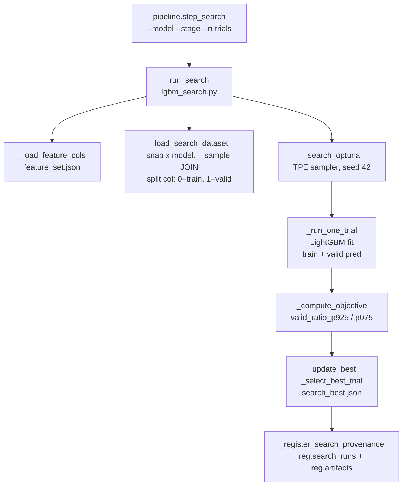
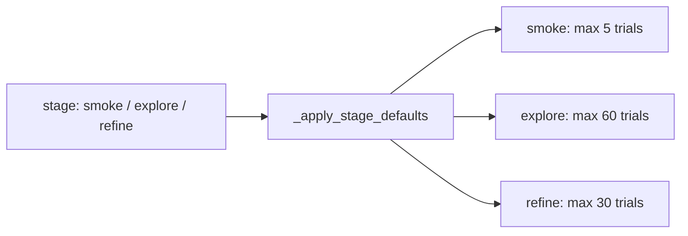
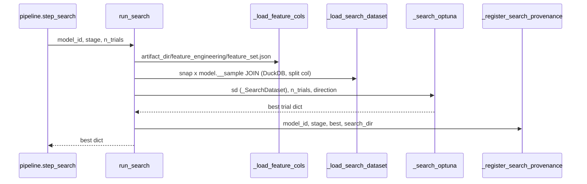
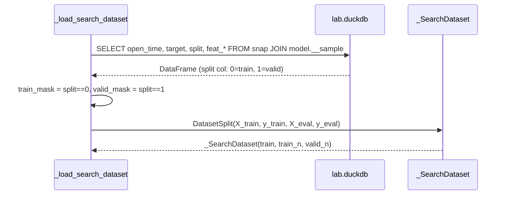

# 5520 — Hyperparameter Search

A `src/modeling/search/lgbm_search.py` valósítja meg a LightGBM hyperparameter
keresést fix train/valid split alapon. Objektív: `valid_ratio_p925` (long) / `valid_ratio_p075` (short) —
a score szerinti felső (alsó) 7,5% átlagos target-értéke osztva az összátlaggal. Optuna TPE (`optuna_study.db`),
max 100 trial, nincs patience-alapú korai leállás. Quantile objective (`alpha=0.925`) a fix LightGBM paraméterekben.

További belépési pontok: `run_gain_rank(model_id)` (gain szerinti feature rangsor -> `feature_set.json["gain_ranked"]`, joint search
bemenet) és `run_prune(model_id, feature_key, search_tag)` (nulla split-importance feature-ök elhagyása).

Forrás:
- [search/lgbm_search.py](../../src/modeling/search/lgbm_search.py)

→ _doc_/methodology_doc/5500_hyper_param_search.md

---

## Overview





---

## `run_search(model_id, stage, n_trials, timeout_hours, row_stride, retry_failed)`

A fő belépési pont. Betölti a feature listát, betölti az adatot a snap ⋈ model.__sample
JOIN-ból (split col alapján), majd Optuna TPE kereséssel iterál a trial-okon (max `_MAX_TRIALS=100`).

| Paraméter | Típus | Default | Leírás |
|-----------|-------|---------|--------|
| `model_id` | `str` | — | Modell kulcs a `config/models.json`-ból |
| `stage` | `str` | `"smoke"` | Keresési fázis: `smoke`, `explore`, `refine` |
| `n_trials` | `int` | `100` | Maximális trial szám (`_MAX_TRIALS=100` cap érvényesül) |
| `timeout_hours` | `float \| None` | `None` | Falióra korlát (nincs ha None) |
| `row_stride` | `int \| None` | `None` | Sub-sampling stride (None = 1 = minden sor) |
| `retry_failed` | `bool` | `False` | Korábban hibás trial-ok újrafuttatása |
| `feature_key` | `str` | `"selected"` | Kulcs a `feature_set.json`-ban |
| `feature_selection` | `str` | `"joint"` | `fixed` (feature_key lista) vagy `joint` (gain_ranked + `feature_k` Optuna paraméter); a pipeline `fixed`-et ad |
| `search_tag` | `str \| None` | `None` | `search_<tag>/` könyvtár |
| `direction` | `str` | `"long"` | `long` -> `ratio_p925`, `short` -> `ratio_p075` |

Returns: `dict` — legjobb trial rekord (`trial_no`, `params`, `objective_score`,
`valid_ratio_p925`, `valid_ratio_p075`, `train_valid_gap`, `spearman_rho`, stb.).



---

## Adatbetöltés — `_load_search_dataset`

A train/valid adatot a `snap."<snapshot_id>"` ⋈ `model."<model_id>__sample"` DuckDB
JOIN-nal olvassa `open_time`-on. A sample tábla tartalmazza: `open_time`, target,
`split` (0=train, 1=valid); a snapshot tartalmazza az összes `feat_*` oszlopot.



Raises: `ValueError` ha a `split` oszlop hiányzik (sampling mode nem `train_valid_split`),
vagy ha nincs train / valid sor.

---

## `_SearchDataset` és `DatasetSplit`

### `_SearchDataset` (frozen dataclass)

A keresés belső adatstruktúrája. Egyszer épül fel (`_load_search_dataset`),
minden trial újrahasználja — nincs ismételt DB hívás.

| Mező | Típus | Leírás |
|------|-------|--------|
| `train` | `DatasetSplit` | Pre-built train/valid mátrixok |
| `train_n` | `int` | Train sorok száma |
| `valid_n` | `int` | Valid sorok száma |

### `DatasetSplit` (frozen dataclass, ugyanebben a modulban)

| Mező | Típus | Leírás |
|------|-------|--------|
| `X_train` | `pd.DataFrame` | Feature mátrix (train) |
| `y_train` | `pd.Series` | Target vektor (train) |
| `X_eval` | `pd.DataFrame` | Feature mátrix (valid) |
| `y_eval` | `pd.Series` | Target vektor (valid) |

---

## Objektív függvény — rank-arány

```
long : objective_score = -valid_ratio_p925   (mean(y | score >= p92.5) / mean(y))
short: objective_score = -valid_ratio_p075   (mean(y | score <= p7.5)  / mean(y); két negatív szám hányadosa)
```

`_compute_ratio_p925` / `_compute_ratio_p075`: 0.0, ha a maszk üres vagy az összátlag nem pozitív (long) / nulla (short).
`_compute_decile_monotonicity`: a szomszédos score-decilis párok aránya, ahol az átlagos target nő.

A `_compute_objective` csomagolja az objektívet és az audit metrikákat:

| Mező | Leírás |
|------|--------|
| `objective_score` | `-penalized_ratio` (lower is better, Optuna minimize) |
| `valid_ratio_p925` / `valid_ratio_p075` | Valid rank-arányok |
| `penalized_ratio` | = a választott irány valid aránya (a korábbi gap_penalty kivezetve) |
| `train_ratio_p925` / `train_ratio_p075` | Diagnosztika |
| `train_valid_gap` | `train_ratio - valid_ratio` (overfit proxy) |
| `spearman_rho` | Spearman korreláció (valid) |
| `decile_monotonicity` | Szomszédos decilis párok monoton aránya (valid) |
| `valid_rmse`, `train_rmse`, `valid_mae`, `train_mae` | Hibametrikák |

A gap **nem** kemény cutoff — másodlagos preferencia az egyenlő teljesítményű jelöltek között.

---

## Legjobb trial kiválasztás — `_select_best_trial`

1. Kizárja az `objective_score` nélküli trial-okat
2. Növekvő `objective_score` (= csökkenő valid arány) szerint rendez
3. A top-5 jelöltből a legkisebb `|train_valid_gap|`-et választja

---

## Egy trial futtatása — `_run_one_trial`

Minden paraméter kombinációhoz: LightGBM fit a train spliten, early stopping-gal,
majd train + valid predikció és metrika számítás.

**Early stopping:** `lgb.early_stopping(_ES_ROUNDS=100)` — 100 round RMSE javulás nélkül megáll.

**Metrikák:** `train_/valid_ratio_p925`, `train_/valid_ratio_p075`, `train_/valid_rmse`, `train_/valid_mae`, `spearman_rho`,
`decile_monotonicity`, `best_iteration` (early stopping után), `top20_features` (gain importance).

Learning curve: `trial_curves/trial_NNNN.json` — lecompressálva `_CURVE_MAX_POINTS=100` pontra.

---

## Paraméter tér — `_suggest_optuna_params`

| Paraméter | Tartomány | Skála |
|-----------|-----------|-------|
| `num_leaves` | 3 – 63 (smoke: 31) | log |
| `max_depth` | -1, 2, 3, 4, 5, 6, 8 | kategorikus |
| `min_child_samples` | 200 – 8000 | log |
| `min_child_weight` | 1e-4 – 0.1 | log |
| `min_split_gain` | 0 vagy 1e-5 – 0.1 | log (20% eséllyel 0) |
| `reg_alpha` | 1e-3 – 10 | log |
| `reg_lambda` | 1 – 100 | log |
| `subsample` | 0.45 – 0.95 | lineáris |
| `colsample_bytree` | 0.35 – 0.95 | lineáris |
| `learning_rate` | 0.005 – 0.05 | log |
| `max_bin` | 63, 127 | kategorikus |
| `path_smooth` | 1e-3 – 10 | log |
| `extra_trees` | False, True | kategorikus |

---

## Resumable keresés — hash-alapú deduplication

Minden trial paraméterkombináció + `n_features` + `row_stride` SHA256 hash-t kap
(`_make_param_hash`, 16 karakter). A `search_trials.jsonl` és `failed_trials.jsonl`
fájlokból beolvassa a korábbi futások hash-eit — duplikált trial-t nem futtat újra.

---

## Output fájlok és `search_trials.jsonl` séma

| Fájl | Tartalom |
|------|----------|
| `search/search_best.json` | Legjobb trial teljes rekordja |
| `search/best_params.json` | Legjobb paraméter dict |
| `search/search_trials.jsonl` | Minden elvégzett trial kompakt rekordja |
| `search/search_summary.csv` | Összefoglaló CSV (trial × metric) |
| `search/trial_logs/trial_NNNN.json` | Per-trial teljes log |
| `search/trial_curves/trial_NNNN.json` | Learning curve pontok (train + valid RMSE) |
| `search/failed_trials.jsonl` | Hibás trial rekordok |
| `search/optuna_study.db` | Optuna SQLite study (ha Optuna fut) |

### `search_trials.jsonl` mezők (egy sor = egy trial)

| Mező | Típus | Leírás |
|------|-------|--------|
| `trial_no` | `int` | Szekvenciális trial szám |
| `param_hash` | `str` | 16 karakteres SHA256 hash (deduplication kulcs) |
| `params` | `dict` | Hyperparaméter dict |
| `objective_score` | `float` | `-valid_ratio` (lower is better) |
| `valid_ratio_p925` / `valid_ratio_p075` | `float` | Fő metrika irányonként |
| `train_ratio_p925` / `train_ratio_p075` | `float` | Diagnosztikai |
| `train_valid_gap` | `float` | `train_ratio - valid_ratio` (overfit proxy) |
| `spearman_rho` | `float \| null` | Spearman korreláció (valid) |
| `decile_monotonicity` | `float` | Monoton decilis arány (valid) |
| `valid_rmse` | `float` | RMSE (valid) |
| `train_rmse` | `float` | RMSE (train) |
| `valid_mae` | `float` | MAE (valid) |
| `elapsed_s` | `float` | Trial futási idő másodpercben |
| `best_iteration` | `int` | LGB best iteration |

---

## Kapcsolódó fájlok

| Fájl | Tartalom |
|------|----------|
| [5500_hyper_param_search.md](../methodology_doc/5000_hyper_param_search.md) | Search metodológia |
| [5510_training.md](5510_training.md) | Training kód-ref |
| [5530_pipeline_predict_provenance.md](5530_pipeline_predict_provenance.md) | Pipeline / predict / provenance kód-ref |
| [5300_create_sample.md](5300_create_sample.md) | Sampling kód-ref (train/valid split kimenet) |
