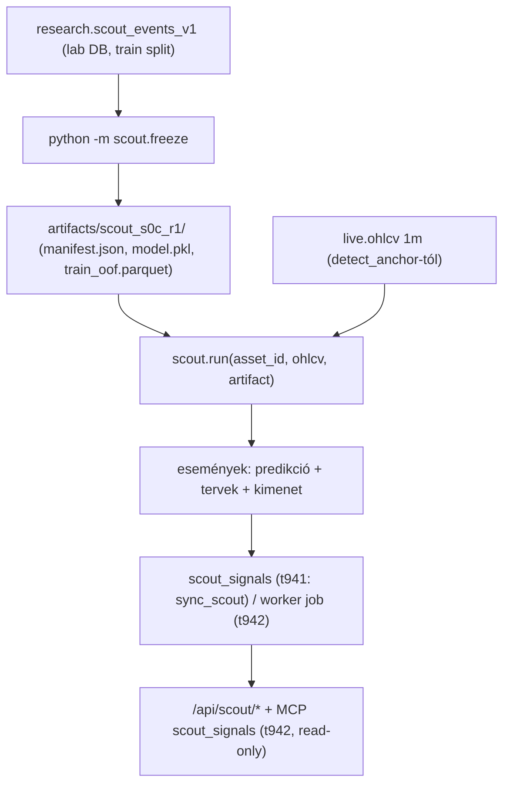

# 5800 — Impulse Scout runtime (`src/scout/`)

Az epic_073-ban kiválasztott Impulse Scout alapmodell (S0 + C logit, `W4h_H8h`, a15) **befagyasztott** artifactja és
éles futtató modulja (epic_074 / t940). Kísérleti, **NO-GO** státuszú: a UI-n „kísérleti – nem kereskedési jel”, a quant
modellbe nem kerül be. Módszertan: [5300](../methodology_doc/5300_impulse_scout.md); kutatási összefoglaló:
[impulse_scout](../research/impulse_scout.md).

## Overview



A modul **nem végez DB I/O-t**: a hívó (t941 sync / t942 worker job) tölti be az asset 1m OHLCV-jét (read-only) és
írja ki az eredményt. A kutatási kód (`reports.builders.wave_events`, `scout_events`, `scout_bench.rules`) importálva
van, nem duplikálva.

## Artifact — `artifacts/scout_s0c_r1/`

| Fájl | Tartalom |
|---|---|
| `manifest.json` | eseménydefiníció (variant, cell, `params_json`), modell (feature lista, standardizálás `mu`/`sd`, `coef`, `intercept`, `q_false_start`), küszöbök (top-20 % / 10 % = train OOF score 80. / 90. percentilise), szabályok (`default`, `r2_03`), költségek (`config/strategies.json` `costs` pillanatképe), runtime (`detect_anchor`, `live_start`, `holdout2_start`), train (assetek, n, t0/label_end tartomány, `frame_hash`, `fold_hash`, fold határok, `oof_auc`), fájl-sha256-ok, `freeze_hash` |
| `model.pkl` | a fittelt `scout_bench.ScalarLogit` (sklearn) — audit / keresztellenőrzés; a runtime a manifest együtthatóiból számol (pickle nélkül), a teszt 1e-12 pontossággal egyezteti |
| `train_oof.parquet` | `event_id, asset_id, t0, cv_block, label_class, oof_score` — a percentilis és a küszöbök forrása |

Befagyasztott értékek (r1): train n = 2170 (308 impulzus; SOL + BTC + ETH, `split = 'train'`, label_end ≤ 2026-02-01),
**train OOF AUC 0,6361** (= leaderboard 0,636), top20 küszöb 0,1879, top10 0,2106, `fold_hash` `0d90521c16be85de`,
`frame_hash` `0a723719fc86eedc` (mindkettő egyezik a `research."scout_leaderboard_v1__runs"` pooled futásaival),
`freeze_hash` `f0541e6d37ecfdab`. Az újrafagyasztás bitre azonos (determinista lbfgs, rögzített seed).

`load_artifact()` ellenőrzi a fájl-hash-eket, a `freeze_hash`-t és hogy a kódban lévő detektálási paraméterek
(`scout_events.scout_params("a15")` a `W4h_H8h` cellára szűkítve) azonosak-e a befagyasztottal — ha a `wave_events`
definíció változik, a runtime hibát dob (új verzió kell, pl. `scout_s0c_r2`).

## API

```python
from scout import load_artifact, run, OUTPUT_SCHEMA, IMMUTABLE_COLUMNS
art = load_artifact()                                  # artifacts/scout_s0c_r1/, hash-ellenőrzéssel
df = run("solusdt", ohlcv_1m, art)                     # since alapértelmezés: art.live_start (2026-11-01)
df = run("btcusdt", ohlcv_1m, art, since=datetime(2026, 11, 20))
```

| Függvény | Leírás |
|---|---|
| `load_artifact(root=None, *, verify=True) -> ScoutArtifact` | manifest + OOF eloszlás betöltése, ellenőrzés |
| `run(asset_id, ohlcv, art=None, *, since=None) -> pl.DataFrame` | detektálás → score → feloldás; `t0 >= since`, `since >= art.live_start` kötelező; `OUTPUT_SCHEMA` oszlopok, `t0` szerint rendezve |
| `detect(ohlcv, art, asset_id)` | `wave_events.build_events` a befagyasztott paraméterekkel, a cellára szűrve, `event_id` = `asset\|cell\|t0` |
| `score(events, art)` | `p_impulse / p_false_start / p_sideways`, `oof_percentile`, `top20`, `top10`, `scorable` |
| `resolve(events, minute_grid, art)` | tervek + kimenet szabályonként (`scout_bench.rules.simulate_rule_event`), `status`, `label_class`, `as_of` |

`ohlcv`: `open_time` (naiv UTC), `open, high, low, close, volume`; legalább `art.detect_anchor`-tól (2026-07-24) a
legutolsó lezárt bárig. Korábbi sorokat a runtime levágja; ha az input az anchor után (> 1 óra) kezdődik, hibát dob.

### Kimenet (`OUTPUT_SCHEMA`, eseményenként egy sor)

| Csoport | Oszlopok | Mikor ismert / változik |
|---|---|---|
| azonosítás, geometria | `event_id, asset_id, model_id, cell_id, t0, t_c, label_end, low_t0, close_tc, a_log, sigma_w, a_sigma, p_star, stop` | `t_c`-kor, immutable |
| feature-ök | `velocity_1h, pretrend_3d, log_sigma_1m, drop_depth, volume_ratio` (+ `a_sigma`), `scorable` | `t_c`-kor, immutable |
| predikció | `p_impulse, p_false_start, p_sideways, oof_percentile, top20, top10` | `t_c`-kor, immutable (null, ha `scorable = false`) |
| tervek | `entry`, `default_tp, default_sl`, `r2_03_tp, r2_03_sl` | `default_*` `t_c`-kor; `entry` és `r2_03_*` a `t_c`-kor nyíló bár megjelenésekor (set-once) |
| kimenet | `{default,r2_03}_outcome` (`tp`/`sl`/`timeout`/`invalid`), `_outcome_at`, `_exit_price`, `_net_bps`; `status` (`open`/`resolved`/`invalid`), `label_class` | `label_end = t_c + H` lezárulásakor egyszer |
| meta | `as_of` (az utolsó input bár zárása) | minden futáskor |

`IMMUTABLE_COLUMNS` = az `entry` előtti oszlopok. A `scored_at` (írás ideje) és a `backfilled` jelölés a t941 író
feladata — a runtime determinista, nem tartalmaz faliórát.

## Író: `scout_signals` (t941)

A runtime kimenetét a `data_handling.sync_tables.sync_scout.sync_scout(asset_id, art=...)` írja a live
`scout_signals` táblába (migráció v8; oszlopok = `OUTPUT_SCHEMA` + `scored_at`, `backfilled`). Az `IMMUTABLE_COLUMNS`
soha nem frissül, a set-once tervek csak NULL-ból töltődnek, a kimenet egyszer íródik `open` → `resolved`/`invalid`
átmenetkor; `backfilled = t_c < első éles írás ideje`. Részletek: [1200](1200_sync_tables.md) (`sync_scout.py`),
séma: [1000](1000_database.md#scout_signals). Kézi futtatás: `02_sync_pipeline.py --asset-id <a> --tables scout`.

## Élő futtatás és olvasás (t942)

- **Worker** ([8310](8310_worker.md#impulse-scout-lépés-epic_074--t942)): az auto-sync `sync_full` az OHLCV után futtatja a Scout assetekre (`manifest.train.assets` = SOL/BTC/ETH; BCH nem), új bár esetén, assetenként legfeljebb 5 percenként (`scout.min_interval_s`); az artifact folyamatonként egyszer töltődik. Önálló job: `sync_scout` (`params.asset_id`). Hiba nem buktatja a syncet; `immutable_mismatch` / `missing_in_run` > 0 → `SCOUT ALERT` a job logban.
- **API** ([8300](8300_api.md#impulse-scout-apiscout-epic_074--t942)): `GET /api/scout/signals`, `GET /api/scout/latest` (read-only, artifact meta a manifestből, `experimental` jelölés); MCP: `scout_signals` ([8320](8320_cq_mcp.md)).

## Konvenciók és döntések

- **Look-ahead:** egy esemény akkor létezik, amikor a `t_c − 1m`-kor nyíló bár lezárult; minden feature és a predikció
  csak `t_c`-ig lezárt bárokat használ (teszt: csonkolás `t_c`-nél, jövőbeli árak skálázása).
- **Determinizmus / inkrementalitás:** a detektálás a manifestben rögzített `detect_anchor`-tól fut (holdout-2 kezdet −
  8 nap: 7 nap σ-ablak + 1 nap greedy bemelegítés), így a greedy non-overlap lánc mindig ugyanott indul: ugyanaz az
  adat → ugyanazok az események, id-k és predikciók, függetlenül attól, mennyi régebbi történetet ad át a hívó vagy
  mikor fut. Egy korábbi „most”-ban futtatott hívás eseményei a későbbi futás prefixei, azonos immutable oszlopokkal
  (teszt). Költség: az anchor óta minden futás újradetektál (~176 ezer 1m sor ≈ 0,1–0,3 s / asset 2026-11-ben).
- **Feloldás = rules.py konvenció:** kimenet csak akkor, ha a teljes `H` ablak lezárult (`label_end <= as_of`); ha az
  ablakban bármelyik bár hiányzik, `status = invalid` (mint `simulate_rule_event` és a 3-osztályos címke). Nincs
  részleges „eddigi érintés” — ez feloldja a t938 eltérést (`first_touch` átugrotta a hiányzó bárokat). A `default`
  szabály kimenete és a kutatási `label_class` egymásnak megfelel (`tp`↔impulse, `sl`↔false_start, `timeout`↔sideways;
  azonos bárban stop elsőként). `outcome_at` = a kilépő bár zárási ideje (`t_c + bars_held`).
- **Nem score-olható esemény:** nem véges feature (pl. `pretrend_3d`, ha a `t0 − 3d` bár hiányzik) → predikció null,
  az esemény megmarad. Prefix-rés nem fordulhat elő: a jelölt definíciója (gördülő minimum teljes `min_periods`-szal)
  teljes `[t0 − B, t_c)` ablakot követel.
- **Holdout-2 higiénia:** a fit csak train adatot lát (`guard_no_holdout`); a runtime `since < live_start`
  (2026-11-01) esetén hibát dob, és a `since` előtti eseményeket a score / feloldás előtt eldobja.

## Fájlok

| Fájl | Szerep |
|---|---|
| `src/scout/__init__.py` | publikus API |
| `src/scout/runtime.py` | artifact betöltés, detect / score / resolve / run, `OUTPUT_SCHEMA` |
| `src/scout/freeze.py` | `fit_baseline` (a t938 `scout_live_score`-ból emelve; az re-exportálja), artifact írás, CLI |
| `src/scout/tests/test_runtime.py` | no look-ahead, determinizmus, feloldás, artifact integritás, élő SOL reprodukció |
| `src/data_handling/sync_tables/sync_scout.py` | `scout_signals` író (t941) — lásd [1200](1200_sync_tables.md) |
| `src/worker/scout_runner.py`, `src/worker/handlers/sync_scout.py` | worker lépés + `sync_scout` job (t942) — lásd [8310](8310_worker.md) |
| `src/api/routers/scout.py`, `src/api/services/scout.py`, `src/cq_mcp/tools_scout.py` | olvasó API + MCP tool (t942) — lásd [8300](8300_api.md) |

## Kapcsolódó dokumentumok

| Téma | Hivatkozás |
|---|---|
| Módszertan (eseménydefiníció, címke, foldok, küszöbök) | [5300_impulse_scout.md](../methodology_doc/5300_impulse_scout.md) |
| Modell életciklus (quant modellek) | [0004_model_lifecycle.md](0004_model_lifecycle.md) |
| Riport builderek (`scout_bench`, `scout_events`) | [8330_reports.md](8330_reports.md) |
