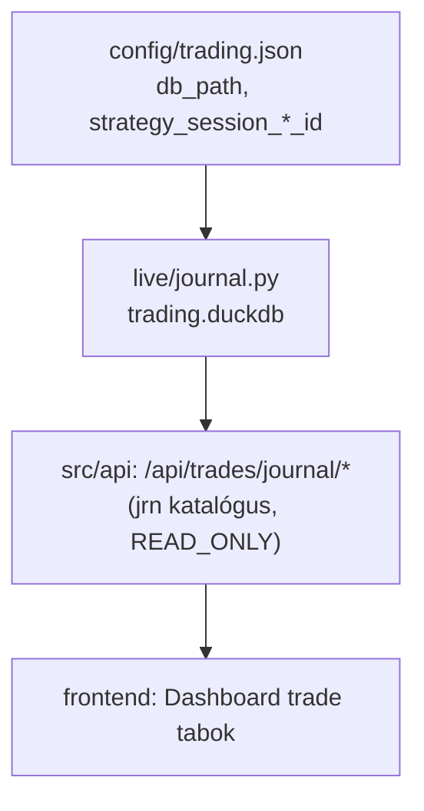

# 7000 - Trading (trade journal)

A `src/trading/` modulból epic_068 után kizárólag a **trade journal** maradt: `src/trading/live/journal.py`
(DuckDB, `config/trading.json` -> `db_path`, jelenleg `database/trading.duckdb`).

Az éles order-logika törölve (live `TradingService`, exchange kliens, state machine / decision engine, `01_run_service.py`);
a kód a git historyban él (commit `73f2156`). A strategy artifactok (`strategy_artifact.json`, rank lookup) továbbra is léteznek,
de nincs futó végrehajtó.

---

## Overview

## Felelősség

- A journal séma (`trading_runs`, `trading_signals`, `trading_positions`, `trading_orders`, `trading_errors`) és írási/olvasási API-ja.
- Az API a journalt READ_ONLY `jrn` katalógusként csatolja (`api.deps`); a tábla hiánya üres oldalt ad.

## Nem feladata

- Order placement, pozíció-kezelés (törölve).
- Strategy kalibráció (`src/strategy`), UI megjelenítés (`frontend/`).

## Fejezetek

| Szám | Fájl | Tartalom |
|------|------|----------|
| 7130 | [7130_trading_journal.md](7130_trading_journal.md) | Journal séma, write/read/export API |
| 8300 | [8300_api.md](8300_api.md) | `/api/trades/*` végpontok |
