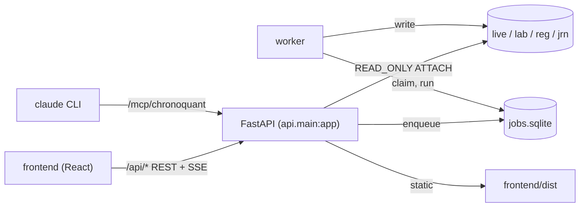

# 8300 — `src/api` (FastAPI BFF)

Kód-referencia az epic_068 BFF-hez. Architektúra-kontraktus: [`_doc_/_plans_/068_bff_ui.md`](../_plans_/068_bff_ui.md).
Futtatás: `scripts\start.ps1` (prod, :8600) / `scripts\dev.ps1` (`uvicorn --reload`), lásd [8360_scripts.md](8360_scripts.md).

## Szerkezet

| Fájl | Szerep |
|------|--------|
| `main.py` | `create_app()` factory: CORS (dev origin 5173), routerek, `/mcp/chronoquant` route, SPA fallback (`frontend/dist`, `/api/*` ismeretlen út = JSON 404) |
| `deps.py` | `get_conn` / `ro_connection`: kérésenként friss in-memory kapcsolat, `live`/`lab`/`reg` (+`jrn` journal) READ_ONLY ATTACH; zárolásnál 4 próba (0,2 s backoff), tartós zár = `DbBusyError` -> 503 `db_busy`; `db_state()` |
| `errors.py` | Egységes hibatest `{"detail", "code"}`: `not_found`, `no_data`, `bad_request`, `db_busy`, validációs hibák |
| `schemas.py` | Pydantic válaszmodellek (`Health`, `Status`, `CandlesResponse`, `ChartResponse`, `Page`, ...) |
| `routers/*.py` | Végpontok (lent) |
| `services/*.py` | Üzleti olvasó logika: `market`, `predictions`, `trades`, `strat`, `registry`, `reports`, `status`, `logs`, `binance` (csak olvasó, cache), `common` (`json_safe`, UTC ISO-Z) |
| `chat/runner.py`, `chat/persona_prompt.md` | A `claude` CLI headless futtatása (stream-json) és a persona |

Szabályok: az API **soha nem ír** DuckDB-be; írás/hosszú művelet = worker job. Időbélyegek UTC ISO-Z, NaN -> null.
Opcionális routerek (`OPTIONAL_ROUTERS = jobs, reports`) csak ha a modul létezik.

## Végpontok

| Metódus és út | Leírás |
|---------------|--------|
| `GET /api/health` | Életjel (a `start.ps1` ezt várja) |
| `GET /api/status` | Adatfrissesség, aktív modellek, worker és sync állapot, `db.state` (`ok`/`busy`) |
| `GET /api/market/config` | Chart konfig (TF-ek, limitek) |
| `GET /api/market/candles?hours=&tf=1m\|5m\|15m` | OHLCV gyertyák |
| `GET /api/market/chart?...&include_trade=true` | Fő grafikon összeállított adata (gyertya + predikció + trade jelölők) |
| `GET /api/market/tables` | Táblák állapota (sorszám, utolsó open_time) |
| `GET /api/predictions/history`, `/latest`, `/signals` | Predikció-idősor (max 14 nap), legfrissebb, jelek |
| `GET /api/trades/closed`, `/active` | Lezárt tradek (strat ledger vagy journal), nyitott pozíció |
| `GET /api/trades/journal/{positions,orders,signals,errors,runs}` | Trade journal oldalak (`jrn` katalógus; hiányzó tábla = üres oldal) |
| `GET /api/trades/binance` | Binance fill-ek (csak olvasás; hiba = 503 `binance_unavailable`) |
| `GET /api/equity?session=active`, `/api/equity/summary` | Kumulatív `fact_log_return` equity |
| `GET /api/strat/active`, `/sessions` | Aktív long/short stratégia kártyák, sessionök |
| `GET /api/strat/{session}/artifact` | `strategy_artifact.json` |
| `GET /api/strat/{session}/grid?top=&sort=` | Grid search eredmények |
| `GET /api/strat/{session}/{kind}` | `trades`/`equity`/`cutoffs`/`summary` oldal (limit, offset) |
| `GET /api/registry/active`, `/models/{id}`, `/models/{id}/features`, `/{table}` | Registry olvasás (whitelist táblák, `limit`, `offset`, `filter`) |
| `GET /api/logs/{source}?lines=` | `api` / `worker` log farok (`logs/<source>*.log`, max 2000 sor) |
| `POST /api/jobs` (202) | Job enqueue: `{kind, params}`; azonos kind queued/running = a meglévő jobot adja vissza (dedup) |
| `GET /api/jobs?status=&kind=&limit=` | Jobok listája |
| `GET /api/jobs/worker` | Worker élő-e (heartbeat <= 15 s), aktuális job |
| `GET\|PUT /api/jobs/auto-sync` | Automatikus percenkénti sync be/ki |
| `GET /api/jobs/{id}`, `DELETE /api/jobs/{id}` | Job lekérés; törlés = csak queued job cancel |
| `GET /api/jobs/{id}/log?from=` | Job log (offset-alapú) |
| `GET /api/jobs/{id}/events?from=` | SSE: status + log + done |
| `GET /api/reports?scope=&model_id=` | Riport manifestek (tartalom nélkül) |
| `GET /api/reports/{owner}/{slug}` | Manifest + markdown |
| `GET /api/reports/{owner}/{slug}/charts/{chart_id}`, `/tables/{table_id}` | Plotly JSON / tábla JSON (lazy, ETag + `max-age=60`) |
| `POST /api/chat` | Body `{message, session_id\|null}` -> SSE |
| `GET /api/chat/config` | Chat fejléc adatok (`model`, `timeout_s`, `tools`, `mcp_ok`, `binary_ok`, `max_concurrent`) |
| `/mcp/chronoquant` | MCP streamable HTTP (lásd [8320_cq_mcp.md](8320_cq_mcp.md)) |

## Chat (`/api/chat`)

- Futtatás: helyi, bejelentkezett `claude` CLI headless, stream-json (előfizetés; az `ANTHROPIC_API_KEY` env kiszűrve). Max 2 párhuzamos chat (különben 429 `busy`), hiányzó bináris = 503.
- Jogosultság: `--tools Read,WebSearch,WebFetch`, `--allowedTools` + `mcp__chronoquant`, `--disallowedTools Edit,Write,NotebookEdit,Bash`, `--permission-mode dontAsk`,
  a projekt/user settings nem töltődik be (a `.claude/settings*.json` bare Bash/Edit-et engedne és hookokat futtatna).
- SSE események: `session`, `delta`, `thinking`, `tool` (`{name, status: start\|done\|error, id, input?}`), `done`, `error`. Session resume a `session_id`-vel.
- Konfig: `utils.load_chat_config()` (`model`, `timeout_s`; opcionális `chat` szekció a `config/env.json`-ban). Persona: `chat/persona_prompt.md` (hangulat-workflow: `.agent/skills/tv_sentiment_skill.md`).

## Tesztek

`uv run pytest src/api` — `test_api_smoke.py`, `test_reports_api.py`, `test_binance_cache.py`, `chat/tests`.

## Eltérések a blueprinttől

Lásd a blueprint "Megvalósítás" szakaszát: `/api` prefix minden úton, a MCP szerver a `src/cq_mcp` csomagban (nem `src/api/mcp`), a `stream`/`status` SSE helyett job-szintű SSE (`/api/jobs/{id}/events`) és polling.
