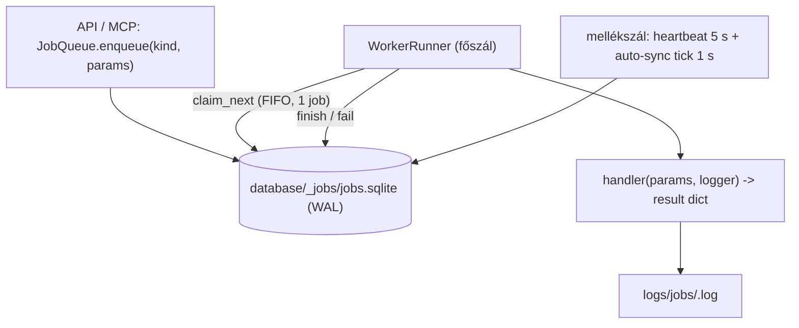

# 8310 — `src/worker` (job worker)

Külön processz: `python -m worker` (repo gyökérből, `PYTHONPATH=src`; a `scripts\_common.ps1` beállítja). Egyetlen író a DuckDB felé; az API csak enqueue-ol.

## Modulok

| Fájl | Szerep |
|------|--------|
| `__main__.py` | Belépési pont: log `logs/worker.log` (rotating 5 MB x3), SIGINT/SIGTERM leállítás, `recover_orphans` indulásnál |
| `queue.py` | `JobQueue` (SQLite WAL, műveletenként rövid kapcsolat). `JOB_KINDS = sync_full, sync_predictions, sentiment_refresh, sync_scout`; státuszok `queued`, `running`, `succeeded`, `failed`, `canceled`. Metódusok: `enqueue` (dedup: azonos kind queued/running = a meglévőt adja, `(job, deduplicated)`; `sync_full`/`sync_predictions`/`sync_scout` (`ASSET_KINDS`) esetén a kulcs `(kind, asset_id)`, a `params.asset_id` normalizálva, hiányában default asset), `get`, `list_jobs`, `cancel` (csak queued; `running`/`finished`/`not_found` jelzés), `claim_next`, `finish`, `fail`, `recover_orphans`, `cleanup` (200 job / 30 nap megtartás), settings (`auto_sync`), `register_worker` / `beat` / `worker_info` (élő: heartbeat <= 15 s) |
| `runner.py` | `WorkerRunner`: főciklus 1 s poll, job log csatolás (`job_logging`), eredmény/hiba mentés; heartbeat 5 s |
| `assets.py` | Asset-segédek (API/MCP/scheduler közös): `configured_asset_ids`, `require_asset` (`UnknownAssetError`), `sync_asset_ids` (auto-sync assetek), `display_asset_ids` (UI sorrend: `config/assets.json` `display_order`, csak a `list_assets` használja; a scheduler/Scout a konfigurált sorrendet tartja), `list_assets`; Scout: `scout_config` (`config/trading.json` opcionális `scout` blokk), `scout_model_id`, `scout_manifest`, `scout_asset_ids` |
| `scheduler.py` | Auto-sync: percenkénti `sync_full` enqueue **minden sync-aktív assetre** (default elöl; a worker egyszerre egy jobot futtat, tehát egymás után), `ohlcv_sync_delay_seconds` (`config/trading.json`, alap 3 s) késleltetéssel a perchatár után; állapot a `settings` táblában (default asset: `auto_sync_last_minute`, többi: `auto_sync_last_minute:<asset>`) |
| `logs.py` | `job_log_path`, `job_logging`, `read_log` (offset), `cleanup_logs` |
| `handlers/sync_full.py` | OHLCV -> funding -> Scout -> features -> predictions sync (a régi UI sync portja; minden lépés saját DuckDB kapcsolat, stdout a job logba). A funding lépés (`sync_funding(only_if_due=True)`, epic_074 / t939) csak esedékes elszámoláskor hív Binance-t, és hibája **nem** buktatja a jobot (warning). Modell nélküli asseten a predictions lépés no-op (`sync_predictions` warning + return). Az OHLCV + funding után a **Scout lépés** (`scout_runner.maybe_run_scout`, epic_074 / t942) fut — sosem buktatja a jobot; eredménye a payload `scout` kulcsa (`status`: `ok` + számlálók / `skipped` + `reason` / `failed` + `error`) |
| `handlers/sync_scout.py` | Önálló `sync_scout` job (`params.asset_id`): Scout forward-log egy assetre, **throttle nélkül**; nem Scout asset = `NotScoutAssetError` (a job `failed`, a tábla nem jön létre). Eredmény: `ScoutSyncResult.to_dict()` + `elapsed_s` (+ `alert`) |
| `scout_runner.py` | `get_artifact()` (a befagyasztott `scout_s0c_r1` lustán, folyamatonként egyszer, hash-ellenőrzéssel; ~0,75 s), `run_scout` (→ `data_handling.sync_tables.sync_scout.sync_scout(asset, art=..., attempts=3, wait_s=1)`), `maybe_run_scout` (auto-sync lépés), `is_due` / `min_interval_s` (throttle) |
| *(sync_full hibatűrés, t947)* | Ha a job az OHLCV után, a feature-írás előtt bukik (DuckDB-zár, restart), a következő `sync_full` `sync_features` hívása a feature-tail + 1 perctől pótol (catch-up a `data_handling`-ben, a handler változatlan); a predictions a pred-tail + 1 perctől indul. Belső lyukak: `02_sync_pipeline.py --repair-gaps` |
| `handlers/sync_predictions.py` | Predikció back-fill az utolsó tárolt predikciótól az utolsó OHLCV gyertyáig |
| `handlers/sentiment_refresh.py` | `sentiment.tv_report.fetch.run_fetch`; params `hours` (1..720, alap 24), `pages` (1..5, alap 3), `symbol` (alap `BTCUSD`); kimenet `data/tv_report/` |

## Asset-onkénti sync

- Sync jobok `params.asset_id`-val (alap: default asset); a handlerek ezzel dolgoznak (`load_asset_config(asset_id)`).
- **Sync-aktív asset** (auto-sync): konfigurált asset, amelynek van live DuckDB fájlja ÉS van `config/trading.json` `assets.<id>` blokkja (`utils.trading_asset_ids`). Új asset a bootstrap után kerül az auto-syncbe; kézi `POST /api/jobs` `params.asset_id`-val bármely konfigurált assetre mehet.
- **Modell nélküli (data-only) asset:** üres blokk (`"btcusdt": {}`) is sync-aktívvá tesz — így fut a BTC/ETH (epic_074 / t939; modell az epic_075-ben). A session id-k `None`-ok (az API ezt „nincs aktív session”-ként kezeli), a predictions lépés no-op; a scheduler a trading.json-t tickenként olvassa, újraindítás nem kell. Előfeltétel: a bootstrap (`targets,features,funding`) a blokk felvétele **előtt** fusson le, mert a `feat_ohlcv_quant` append-only (a live sync csak a tábla vége után ír).
- Aktív assetek (2026-11-23): `solusdt`, `bchusdt`, `btcusdt`, `ethusdt` (a worker egymás után futtatja őket percenként).
- Egy hosszú (pl. bootstrap) sync job a FIFO miatt várakoztatja a többi asset syncjét.

## Impulse Scout lépés (epic_074 / t942)

- **Scout assetek** (`assets.scout_asset_ids`): a `config/trading.json` `scout.assets` felülírása, különben a befagyasztott artifact tanító assetjei (`manifest.train.assets` = `solusdt`, `btcusdt`, `ethusdt`), a konfigurált assetekre szűkítve. **BCH kimarad** — `sync_scout` ott nem fut (a `ensure_tables` különben létrehozná a táblát).
- **Auto-sync** (`sync_full`-on belül, az OHLCV + funding lépés után): csak ha (1) Scout asset, (2) az OHLCV lépés új 1m bárt szúrt be, (3) az asset utolsó Scout-próbálkozása óta eltelt `scout.min_interval_s` (alap **300 s**; a próbálkozás ideje hibánál is rögzül, így hibás állapot nem pörög percenként). A throttle állapot folyamaton belüli (újraindítás után az első új bárnál azonnal fut).
- **CPU:** egy futás az `detect_anchor` óta újradetektál (~0,7 s / asset 2026-11-ben) → 3 assetre ~2 s / 5 perc. A throttle csak az írási késést (`scored_at − t_c`, max ~5 perc + 1 perc) növeli; a predikció determinisztikus, a kimenet (H = 8 h) előtt íródik.
- **Hibatűrés:** bármely hiba (artifact-hash, DB-zár a 3×1 s újrapróbálás után, séma-drift) csak WARNING a job logban, a `sync_full` folytatódik (`scout.status = failed`).
- **Riasztás:** `immutable_mismatch > 0` vagy `missing_in_run > 0` → ERROR `SCOUT ALERT <asset>: ...` a job logban + `alert: true` az eredményben (determinista runtime mellett 0 várt).
- **Kézi:** `POST /api/jobs {kind: "sync_scout", params: {asset_id}}` (API: nem Scout asset = 400), dedup `(kind, asset_id)`.
- Konfig (opcionális, `config/trading.json`): `"scout": {"model_id": "scout_s0c_r1", "assets": [...], "min_interval_s": 300}` — hiányában a fenti alapértékek.

## Kontraktus

- A handler szignatúra: `handler(params: dict, logger: logging.Logger) -> dict`. Új job kind: `JOB_KINDS` + `handlers.default_handlers()` + (opcionális) API/MCP belépő.
- DuckDB-zár: az írás idejére az API `db_busy` (503) állapotot jelez, a frontend az utolsó jó adatot mutatja.
- Indítás/leállítás: `scripts\start.ps1` / `stop.ps1` (PID: `logs/worker.pid`).

## Tesztek

`uv run pytest src/worker` — `test_queue.py`, `test_runner.py`, `test_jobs_api.py`, `test_assets.py`, `test_sync_full_funding.py` (funding lépés: due-mód, nem-fatális hiba), `test_scout_runner.py` (Scout asset-lista, throttle, nem-fatális hiba, riasztás, `sync_scout` job + API).
