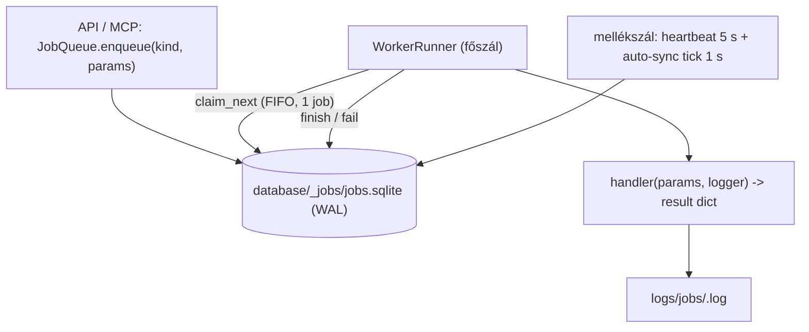

# 8310 — `src/worker` (job worker)

Külön processz: `python -m worker` (repo gyökérből, `PYTHONPATH=src`; a `scripts\_common.ps1` beállítja). Egyetlen író a DuckDB felé; az API csak enqueue-ol.

## Modulok

| Fájl | Szerep |
|------|--------|
| `__main__.py` | Belépési pont: log `logs/worker.log` (rotating 5 MB x3), SIGINT/SIGTERM leállítás, `recover_orphans` indulásnál |
| `queue.py` | `JobQueue` (SQLite WAL, műveletenként rövid kapcsolat). `JOB_KINDS = sync_full, sync_predictions, sentiment_refresh`; státuszok `queued`, `running`, `succeeded`, `failed`, `canceled`. Metódusok: `enqueue` (dedup: azonos kind queued/running = a meglévőt adja, `(job, deduplicated)`), `get`, `list_jobs`, `cancel` (csak queued; `running`/`finished`/`not_found` jelzés), `claim_next`, `finish`, `fail`, `recover_orphans`, `cleanup` (200 job / 30 nap megtartás), settings (`auto_sync`), `register_worker` / `beat` / `worker_info` (élő: heartbeat <= 15 s) |
| `runner.py` | `WorkerRunner`: főciklus 1 s poll, job log csatolás (`job_logging`), eredmény/hiba mentés; heartbeat 5 s |
| `scheduler.py` | Auto-sync: percenkénti `sync_full` enqueue, `ohlcv_sync_delay_seconds` (`config/trading.json`, alap 3 s) késleltetéssel a perchatár után; állapot a `settings` táblában |
| `logs.py` | `job_log_path`, `job_logging`, `read_log` (offset), `cleanup_logs` |
| `handlers/sync_full.py` | OHLCV -> features -> predictions sync (a régi UI sync portja; minden lépés saját DuckDB kapcsolat, stdout a job logba) |
| `handlers/sync_predictions.py` | Predikció back-fill az utolsó tárolt predikciótól az utolsó OHLCV gyertyáig |
| `handlers/sentiment_refresh.py` | `sentiment.tv_report.fetch.run_fetch`; params `hours` (1..720, alap 24), `pages` (1..5, alap 3), `symbol` (alap `BTCUSD`); kimenet `data/tv_report/` |

## Kontraktus

- A handler szignatúra: `handler(params: dict, logger: logging.Logger) -> dict`. Új job kind: `JOB_KINDS` + `handlers.default_handlers()` + (opcionális) API/MCP belépő.
- DuckDB-zár: az írás idejére az API `db_busy` (503) állapotot jelez, a frontend az utolsó jó adatot mutatja.
- Indítás/leállítás: `scripts\start.ps1` / `stop.ps1` (PID: `logs/worker.pid`).

## Tesztek

`uv run pytest src/worker` — `test_queue.py`, `test_runner.py`, `test_jobs_api.py`.
