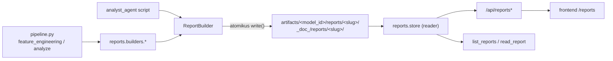

# 8330 — `src/reports` (riport-formátum és builderek)

Egységes riport-formátum a modell- és általános elemzésekhez; az egykori `.ipynb` + Quarto + HTML lánc helyett (epic_068).
Kontraktus: [`_doc_/_plans_/068_bff_ui.md`](../_plans_/068_bff_ui.md) §3. Író: pipeline-lépések és az analyst_agent; olvasó: API, MCP, frontend.



## Mappa-szerkezet

```
<root>/<slug>/
  manifest.json
  report.md
  charts/<chart_id>.json
  tables/<table_id>.json
```

| Scope | Gyökér | `owner` az API-ban |
|-------|--------|--------------------|
| `model` | `artifacts/<model_id>/reports/` | a `model_id` |
| `general` | `_doc_/reports/` | `general` (foglalt, modell-id nem lehet) |

- `slug`/`id`: `^[a-z0-9][a-z0-9_-]{0,63}$`; modell-id (`OWNER_RE`): `^[A-Za-z0-9][A-Za-z0-9_.-]{0,127}$`. Path traversal ellen `InvalidReportPath`.
- A pipeline fix slugjai: `01_sampling`, `02_feature_engineering`, `03_hyperparameter_search`, `04_strategy`; általános: pl. `target_regime` (`target_yearly_regime` a `_doc_/reports/`-ban).

## `manifest.json` (`schema.Manifest`, `schema_version: 1`)

Mezők: `id`, `title`, `scope` (`model`\|`general`), `model_id`, `created_at`, `updated_at`, `order` (lista-sorrend), `summary`, `tags`, `source`
(`{kind, step, generator, git_sha}`), `content{markdown, charts[{id,title,file,height}], tables[{id,title,file}]}`. Ismeretlen mező tűrt (előre-kompatibilis).

## Fájlok

- `report.md`: GFM; beágyazás önálló sorban `{{chart:<id>}}` / `{{table:<id>}}`. Nincs nyers HTML, nincs képfájl.
- `charts/<id>.json`: Plotly `{data, layout, config?}`. Sanitizing: trace-enként max `MAX_TRACE_POINTS=5000` pont (vékonyítás), gyertya max `MAX_CANDLE_POINTS=2000`, idők UTC ISO, template nélkül (a frontend ad témát).
- `tables/<id>.json`: `{columns:[{key,label,type,digits?}], rows:[[...]], total_rows, truncated}`; `type`: int\|float\|pct\|str\|datetime\|bool; max `MAX_TABLE_ROWS=2000`; `*_pct`/`*_rate` oszlopnév = pct.

## API

| Modul | Belépők |
|-------|---------|
| `builder.ReportBuilder(scope, slug, title, *, model_id, order, summary, tags, source, root)` | `add_markdown(text)`, `add_chart(id, fig, *, title, height=420, placeholder=True, max_points)`, `add_table(id, df, *, title, columns=None, placeholder=True)` (pandas/polars), `write()` -> `Path` (determinisztikus, atomikus: tmp mappa + rename, manifest utoljára) |
| `store` | `reports_root`, `report_dir`, `list_reports(scope, model_id)`, `read_report(owner, slug)`, `read_chart`, `read_table`, `table_json`; hibák: `ReportNotFound`, `InvalidReportPath`; `FileBlob` (ETag mtime+size) |
| `theme` | Paletta (`LONG`, `SHORT`, `ACCENT`, `NEUTRAL`, `BLUE`, `ORANGE`, `AMBER`, `SEQUENCE`), `base_layout()` |

## Builderek (`reports.builders`)

| Modul | Slug | Hívja | Bemenet |
|-------|------|-------|---------|
| `sampling.build(model_id, artifact_dir, root)` | `01_sampling` | `pipeline analyze` | `model."<id>__sample"` + snapshot |
| `feature_engineering.build(model_id, artifact_dir, snapshot_id, *, write_selection, root)` | `02_feature_engineering` | `pipeline feature_engineering` (írja a `feature_set.json`-t) és `analyze` (nem) | `snap ⋈ model.__sample` |
| `hyperparameter_search.build(...)` | `03_hyperparameter_search` | `pipeline analyze` | `search/` artifactok |
| `strategy.build(...)` | `04_strategy` | `pipeline analyze` | `strategy/strategy_artifact.json` + `strat.*` |
| `target_regime.build(root)` | `target_regime` (general) | kézi | live target adatok |
| `feature_groups` | — | FE builder segéd | feature-csoportosítás és leírás (`assign_group`, `feature_description`) |
| `_common` | — | segéd | `direction_of`, `artifact_dir_of`, `source_info`, `read_live`, `themed`, `vrect`, `fmt` |

## Tesztek

`uv run pytest src/reports` (`test_builder_store.py`, `test_builders.py`).
