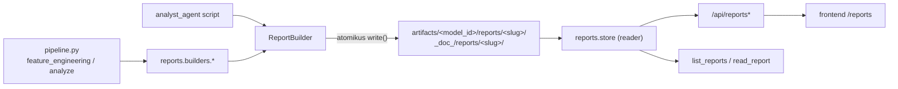

# 8330 — `src/reports` (riport-formátum és builderek)

Egységes riport-formátum a modell- és általános elemzésekhez; az egykori `.ipynb` + Quarto + HTML lánc helyett (epic_068).
Kontraktus: [`_doc_/_plans_/068_bff_ui.md`](../_plans_/068_bff_ui.md) §3. Író: pipeline-lépések és az analyst_agent; olvasó: API, MCP, frontend.

**Asset-kontextus (epic_069):** a builderek a modell assetjét a `utils.model_asset_id(model_id)`-ből veszik (lab/live DB, sampling riport "Asset" sor, `feature_set.json` `asset_id`); `read_live(..., asset_id=)`. A riport-lista elemei `asset_id`-t kapnak (`artifacts/<model_id>/manifest.json`, általános riport = null), az API `/api/reports` ez alapján szűrhető az UI-ban.



## Mappa-szerkezet

```
<root>/<slug>/
  manifest.json
  report.md
  charts/<chart_id>.json
  tables/<table_id>.json
```

| Scope | Gyökér | `owner` az API-ban |
|-------|--------|--------------------|
| `model` | `artifacts/<model_id>/reports/` | a `model_id` |
| `general` | `_doc_/reports/` | `general` (foglalt, modell-id nem lehet) |

- `slug`/`id`: `^[a-z0-9][a-z0-9_-]{0,63}$`; modell-id (`OWNER_RE`): `^[A-Za-z0-9][A-Za-z0-9_.-]{0,127}$`. Path traversal ellen `InvalidReportPath`.
- A pipeline fix slugjai: `01_sampling`, `02_feature_engineering`, `03_hyperparameter_search`, `04_strategy`; általános: pl. `target_regime` (`target_yearly_regime` a `_doc_/reports/`-ban).

## `manifest.json` (`schema.Manifest`, `schema_version: 1`)

Mezők: `id`, `title`, `scope` (`model`\|`general`), `model_id`, `created_at`, `updated_at`, `order` (lista-sorrend), `summary`, `tags`, `source`
(`{kind, step, generator, git_sha}`), `content{markdown, charts[{id,title,file,height}], tables[{id,title,file}]}`. Ismeretlen mező tűrt (előre-kompatibilis).

## Fájlok

- `report.md`: GFM; beágyazás önálló sorban `{{chart:<id>}}` / `{{table:<id>}}`. Nincs nyers HTML, nincs képfájl.
- `charts/<id>.json`: Plotly `{data, layout, config?}`. Sanitizing: trace-enként max `MAX_TRACE_POINTS=5000` pont (vékonyítás), gyertya max `MAX_CANDLE_POINTS=2000`, idők UTC ISO, template nélkül (a frontend ad témát).
- `tables/<id>.json`: `{columns:[{key,label,type,digits?}], rows:[[...]], total_rows, truncated}`; `type`: int\|float\|pct\|str\|datetime\|bool; max `MAX_TABLE_ROWS=2000`; `*_pct`/`*_rate` oszlopnév = pct.

## API

| Modul | Belépők |
|-------|---------|
| `builder.ReportBuilder(scope, slug, title, *, model_id, order, summary, tags, source, root)` | `add_markdown(text)`, `add_chart(id, fig, *, title, height=420, placeholder=True, max_points)`, `add_table(id, df, *, title, columns=None, placeholder=True)` (pandas/polars), `write()` -> `Path` (determinisztikus, atomikus: tmp mappa + rename, manifest utoljára) |
| `store` | `reports_root`, `report_dir`, `list_reports(scope, model_id)`, `read_report(owner, slug)`, `read_chart`, `read_table`, `table_json`; hibák: `ReportNotFound`, `InvalidReportPath`; `FileBlob` (ETag mtime+size) |
| `theme` | Paletta (`LONG`, `SHORT`, `ACCENT`, `NEUTRAL`, `BLUE`, `ORANGE`, `AMBER`, `SEQUENCE`), `base_layout()` |

## Builderek (`reports.builders`)

| Modul | Slug | Hívja | Bemenet |
|-------|------|-------|---------|
| `sampling.build(model_id, artifact_dir, root)` | `01_sampling` | `pipeline analyze` | `model."<id>__sample"` + snapshot |
| `feature_engineering.build(model_id, artifact_dir, snapshot_id, *, write_selection, root)` | `02_feature_engineering` | `pipeline feature_engineering` (írja a `feature_set.json`-t) és `analyze` (nem) | `snap ⋈ model.__sample` |
| `hyperparameter_search.build(...)` | `03_hyperparameter_search` | `pipeline analyze` | `search/` artifactok |
| `strategy.build(...)` | `04_strategy` | `pipeline analyze` | `strategy/strategy_artifact.json` + `strat.*` |
| `target_regime.build(root)` | `target_regime` (general) | kézi | live target adatok |
| `feature_groups` | — | FE builder segéd | feature-csoportosítás és leírás (`assign_group`, `feature_description`) |
| `sr_detection.build(root, *, df_1m, params, asset_id)` | `sr_trendline_detection` (general) | kézi: `uv run python -m reports.builders.sr_detection` | live `ohlcv` 1m (read-only) + `sync_tables._levels_polars` |
| `wave_event_dataset.build(root, *, df_1m, params, asset_id)` (`wave_events.py`) | `wave_event_dataset` | kézi: `uv run python -m reports.builders.wave_event_dataset` (v2 alap, `--version v1`) | live `ohlcv` 1m (read-only) -> lab DB `research."wave_events_v2"` (+ `__funnel`, `__meta`); v2 = 5200 módszertan (first-touch címke, `cv_block`), a riport csak train-példákat mutat (OOS: darabszám) |
| `wave_image_clusters.build(root, *, df_1m, events, asset_id, ...)` | `wave_image_clusters` (general) | kézi: `uv run --group research python -m reports.builders.wave_image_clusters` (~26 perc, CPU) | lab DB `research."wave_events_v2"` (`load_events(split="train")`, csak W4h_H8h) + live `ohlcv` 1m a train végén levágva; 5200 v2: kép-embedding (AE) + k-means, k-Shape/DTW baseline; riport: centroid/medoid képek, kimenet-tölcsér, k-választás (leíró, in-sample arányok) |
| `wave_image_model` | — | könyvtár (research csoport: torch, tslearn) | `build_prefixes`, `fit_render`/`render_images` (JKX-stílusú kép), konvolúciós AE (`fit_embedding`, `embed`), `fit_clusterer`/`assign`, `fit_fold` (purged CV fold: AE + k-means csak a fold-train eseményeken, a teszt-fold csak transzformálódik), `fit_raw_clusterer` (k-Shape/DTW), `select_k` (OOF log-loss + stabilitás); minden `fit_*` csak `split == 'train'` sort fogad el |
| `wave_predictiveness_gate.build(root, *, df_1m, events, cell, cfg, n_perm, cache_dir, asset_id)` | `wave_predictiveness_gate` (general) | kézi: `uv run --group research python -m reports.builders.wave_predictiveness_gate` (~7 perc fold-fit + ~2,5 perc gyorsítótárból, CPU; `--cache-dir`) | `load_events(split="train")` (csak W4h_H8h) + 1m a train végén levágva; 5200 v2 go/no-go (t920): Modell A (S0+C) vs B (+AE latens) logisztikus (C=0,1), per-fold AE/k-means csak fold-train-en (`wave_image_model.fit_fold`), összevont OOF ΔAUC, nap-blokkos permutáció (N=1000, teljes címke-függő refit), nap-blokk bootstrap CI, blokk-előjel, kalibráció; klaszter/C/GBM érzékenység nem döntési; eredmény: NO-GO (p=0,2617) |
| `wave_oos_eval` (`run_cell(cell, df_1m, ev_train, ev_oos, p, cfg, cache_dir)`, `load_1m_capped`, `assert_no_holdout`) | `wave_oos_eval` (general) | kézi: `uv run --group research python -m reports.builders.wave_oos_eval --out <dir> --cache-dir <dir>` (W4h_H8h ~135 mp gyorsítótárból, W4h_H4h ~564 mp) | t928: leíró, post-hoc, egyszeri OOS kiértékelés (nem gate); A/B modell egyszer illesztve az összes train eseményen, OOS-ra csak predikció; küszöb/kvintilis a train OOF-ból; holdout-2 nem töltődik be (1m SQL `open_time < holdout2_start` + `assert_no_holdout`); kimenet `oos_eval.json` |
| `scout_bench` (csomag: `frame`, `folds`, `models`, `metrics`, `stats`, `trades`, `runner`, `report`; `run_benchmark(frame, registry, bars, *, prefix_data, seed, n_perm, n_boot, spa_boot, costs)`, `persist(res, *, models=None)`, `go_no_go(row, min_events=)`, `report.build(res, root, history=)`) | `scout_leaderboard` (general) | kézi: `uv run --group research python -m reports.builders.scout_bench.report [--n-perm 1000] [--no-persist]` (SOL adapterrel ~1 perc, CPU) | Impulse Scout közös benchmark keret (epic_073 t931, 5300): multi-asset esemény-keret (`asset_id`; adapter: SOL `wave_events_v2`, t930 `scout_events_v1` ugyanazzal az oszlop-szerződéssel), közös naptári 6 blokkos purged+embargós foldok (hash), modell-interfész (`ScoutModel.fit/predict_proba` 3 osztályra, `REGISTRY`, `ModelSpec(hypothesis=H1..H3 -> elsődleges, round=1)`), baseline `S0C_logit` (C=0,1; t920 AUC 0,6647 reprodukálva), metrikák (AUC, ΔAUC nap-klaszter bootstrap CI, 3-oszt. log-loss, top 20/10% **elsődleges nézet: teszt-foldon belüli rangsor** (`metrics.fold_rank_select`, `ceil(q·n_fold)` jelzés foldonként, címke nélkül; oszlopok `n_top*/prec_top*/lift_top*`, `topq_view = fold_rank`; epic döntés 2026-11-21, t932) + másodlagos fold-train percentilis-küszöb (`*_trthr` oszlopok `n_top*_trthr`-rel), kalibráció, blokk/asset bontás, legjobb blokk nélkül), nap-csomagos permutáció (teljes refit, Holm), Hansen SPA (stacionárius bootstrap, nap-összegzett bináris log-loss; p = mean(T* >= T), így ha egy modell sem jobb a baselinenél, T = 0 és p = 1), triple-barrier szimuláció (költség: `config/strategies.json` `costs`, same-bar = stop; `trade20/10` = elsődleges szelekció, `trade20t/10t` = train-küszöb), go/no-go (5300 A1–A7 + B az elsődleges nézettel: `gate_*`, `go_status`, `go_failed`), `topq_blocks:<model>` tábla; lab DB `research."scout_leaderboard_v1"` + `__runs` (`persist(res)`: a run összes sora `run_id` szerint cserélve; `persist(res, models=[...])`: csak a megadott modellek sorai, delete+insert modell-név szerint — párhuzamos modell-futások nem írják felül egymást; hiányzó oszlopok `ALTER TABLE ADD`, egy tranzakció, lock-retry) |
| `scout_leaderboard` (t936 lezáró futtató + riport: `compute_oof`, `stage_oof`, `StoredOOF` / `replay_registry`, `evaluate`, `stage_eval`, `ROUND2_RULES`, `update_round1_rows`, `persist_eval`, `build(ev, root)`, `refresh_round1_reports(ev, root)`, `patch_table`) + `scout_bench.universe` (`logloss_spa`, `joint_holm`, `apply_universe`, `event_pnl`, `pnl_spa`, `studentized_best`) + `scout_bench.rules` (`TradeRule`, `DEFAULT_RULE`, `simulate_rule_event`, `simulate_rule`) | `scout_leaderboard` (general; a t931 `scout_bench.report` kimenetét felülírja) | kézi: `uv run --group research python -m reports.builders.scout_leaderboard --stage oof\|eval\|report\|refresh\|all [--no-persist] [--root DIR]` (OOF ~5-10 perc CPU, eval ~1-2 perc) | Impulse Scout leaderboard lezárása (epic_073 t936, 5300): (1) mind a 7 1. körös modell OOF-ja újraszámolva a közös foldokon (determinisztikus; ellenőrzés a tárolt AUC-val), cache `data/scout_leaderboard/oof_round1.parquet` (gitignored) + lab DB `research."scout_oof_v1"`; (2) a tárolt OOF visszajátszása egyetlen `run_benchmark` futásban (`StoredOOF`, eredeti név / hipotézis / config-hash): **univerzum SPA** (6 modell a baseline ellen, nap-összegzett bináris log-loss), **H1–H3 együttes Holm** a tárolt N = 1000 permutációs p-kből, kapuk újra (`go_no_go`: `gate_spa` csak a kiválasztott SPA-legjobbra, a többinél None + `not_spa_best`; `gate_econ` a felső 20% ÉS 10% szimulációra); a round-1 sorok SPA / Holm / kapu oszlopai `UPDATE`-tel frissülnek a `research."scout_leaderboard_v1"`-ben (a metrikák és a t931 SOL baseline sor változatlan); (3) **2. kör**: 12 előre regisztrált kereskedési szabály a baseline S0 + C score-ján (`scout_bench.rules`: σ_W / ATR / P* / low[t0] / félút szintek, időkorlát, részleges kilépés + break-even, break-even trigger; konzervatív bar-on belüli sorrend, költség a `config/strategies.json`-ból, az alap szabály == `trades.simulate_event`); **stratégia-SPA** 26 stratégián (7 modell × felső 20 / 10% + 12 változat), benchmark: nincs kereskedés és a baseline alap szabálya; lab DB `research."scout_universe_v1"` (stratégiánként: nettó bp + nap-klaszter CI, hit / stop / timeout, break-even, blokk / asset bontás, SPA p, gazdasági kapuk); riport: 1. kör leaderboard + kapuk + permutáció-források, 2. kör táblák, equity görbék, blokk / asset stabilitás, stratégia-univerzum; `refresh`: a scout_lgbm / scout_rocket / scout_hazard / scout_foundation riportok SPA / Holm / kapu értékeinek helyben frissítése (JSON táblák + dátumozott „t936 frissítés” szakasz a report.md végén) |
| `scout_events` (könyvtár: `build_dataset(dfs, variants, flow)`, `build_asset`, `build_flow`, `persist(ds)`, `load_scout(variant, with_flow)`, `scout_params(variant)`, `mask_holdout2`) + `scout_events_report.build(root, *, dfs, store)` | `scout_events` (general) | kézi: `uv run --group research python -m reports.builders.scout_events_report [--no-store] [--root DIR]` (~1 perc) | live `ohlcv` 1m + trades / taker_buy (SOL, BTC, ETH, read-only) -> lab DB `research."scout_events_v1"` (+ `_a125`, `_a10`, `__funnel`, `__meta`, `scout_flow_v1`); epic_073 t930, 5300: a `wave_events` v2 logika assetenként, `tau_min`, közös naptári CV-blokkok, A-küszöb változatok, holdout-2 címkék NULL; riport (csak train): darabszám asset × osztály × blokk, események/nap, impulzus-arány A/σ_W szerint, 5300 minimum-ellenőrzés, asset-közi egyidejűség (±4h), order-flow eloszlások / egyváltozós AUC, train példák, holdout-2 megvalósíthatóság (csak darabszám) |
| `scout_models_lgbm` (modell-könyvtár + futtató + riport: `ScoutLGBM` (`ScoutModel`), `SPEC` / `register(registry)` (importkor a `sb.REGISTRY`-be is), `CONFIG`, `FEATURES` / `GROUPS`, `build_features(fr, grids, flow)`, `event_features`, `context_features`, `load_inputs()`, `run(n_perm, n_boot, spa_boot, persist_lab)`, `fold_importance`, `build_report(res, imp, root)`) | `scout_lgbm` (general) | kézi: `uv run python -m reports.builders.scout_models_lgbm [--n-perm 1000] [--no-persist] [--root DIR]` (N=1000 teljes refit ~4 óra terhelt 4 magon; egy CV ~14 s) | Impulse Scout Modell 1 (epic_073 t932, 5300 P1 / H1, 1. kör, előre rögzített konfig, nincs CV-hangolás): LightGBM 3 osztályos `multiclass` (300 fa, lr 0,03, 7 levél, mélység 3, min. 40 eset/levél, bagging 0,8, feature 0,7, L2 5; natív `lgb.train`, 1 szál, determinisztikus) 50 `t_c`-ig ismert jellemzőn: S0 + C + `drop_depth_sigma`, visszapattanás-alak (`σ_W` egység: csúcs, visszaesés, csúcs-pozíció, út-hatékonyság, R², félidős arány, utolsó 15 perc, késői re-teszt, rv-arány), esés-szakasz (tető-pozíció, R², utolsó óra, legnagyobb 1m esés), a 20 `scout_flow_v1` order-flow oszlop (`flow_key`), S/R távolság (3 napos csúcs / A, 7 napos csúcs, `low[t0]` vs előző 7 napos mélypont), napszak (sin/cos, hétvége), BTC-kontextus (1h/4h/24h hozam a BTC 24 órás 1m volatilitásával, 24h/7d rv-arány). Adat: `sb.load_scout_events()` (a15, train), 1m bar és flow sorok `< 2026-02-01` vágással (holdout-2 nem töltődik). `run_benchmark` (baseline + `scout_lgbm_r1`), lab DB-be csak a saját sor (`persist(res, models=[...])`); riport: összevetés, go/no-go feltételek, ΔAUC permutációs null, blokk/asset/kalibráció, jellemző-fontosság (6 fold gain-részesedés ± szórás, csoportonként), szimuláció |
| `scout_models_hazard` (modell-könyvtár: `HazardModel` (`ScoutModel`), `expand_person_period`, `time_bin`, `cif_from_hazards`, `three_class_from_cif`, `spec()` / `registry()`, `load_frame()`, `load_bars(assets)`, `persist_model_rows(res)`) + `scout_hazard_report.run(n_perm, n_boot, persist_lab, root)` / `build(res, curves, root)` | `scout_hazard` (general) | kézi: `uv run python -m reports.builders.scout_hazard_report [--n-perm 1000] [--no-persist] [--root DIR]` (N=1000 teljes refit ~40-60 perc, CPU) | Impulse Scout Modell 3 (epic_073 t934, 5300 P3 / H3, 1. kör, rögzített konfig): diszkrét idejű versengő kockázatok (impulzus vs hamis indulás, oldalazás cenzorált H=480-nál), 16 × 30 perces sáv, személy-periódus kiterjesztés a fold-train eseményein belül, multinomiális logit (L2, C=0,1) S0 + C + 4 flow kovariánson (`scout_flow_v1`: `vol_decline_rel`, `trades_rel_decline`, `qv_logz_prefix`, `tb_ratio_rebound`) + sáv-dummy-k; 3 osztály = (CIF_imp(H), CIF_fs(H), 1 − összeg). Adat: `sb.load_scout_events()` + flow csak a train `flow_key`-ekre, 1m bar SQL-szűrővel `< oos_start` (holdout-2 nem töltődik). A `scout_bench.run_benchmark`-ot hívja (baseline + `scout_hazard_r1`), lab DB-be **csak a saját sort** írja (`research."scout_leaderboard_v1"` delete+insert `(run_id, model)` szerint, hiányzó oszlopok `ALTER TABLE`-lel) + `__runs`; riport: összevetés a baseline-nal, CIF-görbék a score-kvintilisek szerint (megfigyelt vs becsült = időbeli kalibráció), hazard-alak, együtthatók, blokk/asset bontás, szimuláció |
| `scout_models_rocket` (modell-könyvtár: `MiniRocketModel`, `InceptionModel` (`ScoutModel`), `RocketPrefix`, `event_prefix`, `build_prefix(fr, bars, tbb)`, `load_bars(assets)`, `minirocket_fit` / `minirocket_transform` (saját numpy MiniRocket), `fold_basis`, `ridge_loo`, `rocket_spec()` / `inception_spec()` / `register(registry)` / `registry()`, `permutation_null_parallel`, `ROCKET_CONFIG` / `INCEPTION_CONFIG`) + `scout_rocket_report` (`stage_bench`, `stage_perm`, `stage_final`, `build(res, root, perm_seconds_x1=, prefix_x=)`) | `scout_rocket` (general) | kézi: `uv run --group research python -m reports.builders.scout_rocket_report --cache-dir DIR [--stage bench\|perm\|final\|all] [--n-perm 1000] [--n-perm-x1 100] [--workers 3] [--no-persist] [--root DIR]` (bench N=1000 ~0,5-1 óra, perm X1 N=100 több óra terhelt 4 magon) | Impulse Scout Modell 2 (epic_073 t933, 5300): **P2 MiniRocket (H2, 1. kör, rögzített konfig)** és **X1 InceptionTime (kísérleti)** a nyers prefixen: a `[t0 − B, t_c − 1m]` nyitású 1m bar-ok (mind `t_c`-ig zárul) 5 perces bar-okra (L = 96), csatornák `close_sigma = log(close/low[t0])/σ_W` (amplitúdó megmarad), `log_vol_rel = log1p(vol/(5·vol7d_mean_1m))`, `taker_imb = taker_buy_base/volume − 0,5`. MiniRocket: 84 mag × dilatációk, többváltozós csatorna-kombinációk, ~10k PPV; a címkefüggetlen transzformáció + fold-train Gram-sajátfelbontás `(seed, fold-train sorok)` kulcson cache-elve (`RocketPrefix.cache`) → a permutáció teljes refitje csak a fejet tanítja újra; fej: one-hot ridge, `alpha` pontos LOO-hibával (10⁰…10⁷), multinomiális kalibrátor a LOO-kimeneteken. InceptionTime: 3 modul, 8 szűrő, magok 15/7/3, max 25 epoch, early stopping a fold-train utolsó 20%-án (időrend), 1 szál, determinisztikus; saját, csökkentett permutációs null (`permutation_null_parallel`, ugyanazok a permutációk, mint a keretben). Adat: `sb.load_scout_events()` (train), 1m bar SQL-szűrővel `< oos_start`. Lab DB-be csak a két saját sor (`sb.persist(res, models=[...])`) |
| `scout_models_foundation` (modell-könyvtár: `FoundationEmbedding`, `FoundationHead` (`ScoutModel`), `load_pipeline()`, `embed_series` / `embed_prefix(pipe, x)`, `pool_states`, `load_or_embed(frame, x, cache_dir)`, `fit_pca` / `pca_transform` / `fold_pca`, `emb_spec()` / `emb_s0c_spec()` / `registry()`, `permutation_null(fr, folds, fe, n_perm)`, `EMBED_CONFIG` / `HEAD_CONFIG`) + `scout_foundation_report.run(n_perm, n_boot, persist_lab, root, cache)` / `build(res, fe, root, extra=)` / `rebuild()` | `scout_foundation` (general) | kézi: `uv run --group research python -m reports.builders.scout_foundation_report [--n-perm 200] [--no-persist] [--rebuild] [--cache-dir DIR] [--root DIR]` (első futás: ~191 MB HF letöltés + embedding ~2 perc; N=200 fej-refit permutáció ~10 perc, CPU) | Impulse Scout Modell 4 (epic_073 t935, 5300 **X2, kísérleti**, hipotézis nélkül): befagyasztott **Chronos-Bolt-small** (`amazon/chronos-bolt-small` @ `772f3d25d38a`, `chronos-forecasting` a `research` uv csoportban) embedding a `[t0 − B, t_c − 1m]` 1m prefixről (L = 480, a t933 `build_prefix` lépésköz 1-gyel), csatornák `close_sigma`, `log_vol_rel` külön-külön; a patch-token encoder-állapotok átlaga (`[REG]` nélkül, 2 × 512 dim) + a példány-normalizálás `loc` / `log scale` skalárjai (az amplitúdó megmarad). Az embedding címkefüggetlen → eseményenként egyszer, cache: `data/scout_foundation/emb_<hash>.npz` (gitignored; a train-időszaki 1m bar-ok parquet-cache-e ugyanitt). Fej (rögzített): fold-train standardizálás → fold-train PCA 64 (címkefüggetlen, foldonként cache) + 4 loc/scale (+ 6 S0C a `scout_chronos_s0c_r1` változatban) → multinomiális L2 logit (C = 0,1). Két leaderboard sor: `scout_chronos_r1`, `scout_chronos_s0c_r1`; saját nap-csomagos permutációs null (a keret `permutation_null`-ja, csak fej-refit, N = 200). Lab DB-be csak a két saját sor (`scout_models_hazard.persist_model_rows`, delete+insert `(run_id, model)`) |
| `_common` | — | segéd | `direction_of`, `artifact_dir_of`, `source_info`, `read_live`, `themed`, `vrect`, `fmt` |

## `sr_detection` — S/R detektor vizuális ellenőrzése (epic_071 / t911)

Általános riport (`scope=general`, `order=20`) a [`_levels_polars`](1200_sync_tables.md#_levels_polarspy-epic_071--t910) detektor kimenetéről, SOLUSDT s/m/l léptékeken. Módszertan és definíciók: [1700_features_sr_trendline.md](../methodology_doc/1700_features_sr_trendline.md). A forward-arányok **nyers** értékek (placebo nélkül), nem döntési alap; az értékelés a t913 feladata.

**Belépési pont:** `build(root=None, *, df_1m=None, params=None, asset_id=None) -> Path | None` — `None`, ha nincs OHLCV. `df_1m` tesztnek / újrafelhasználásnak; alapértelmezés a live `ohlcv` (`load_ohlcv_1m(asset_id=None, *, tries=10, delay=3.0)`, `readonly_query.open_readonly_connection`, zárolásnál újrapróba). `params` alapértelmezés: `levels_detector` config.

**Példa-kiválasztás:** `select_examples(cands, per_category=3, min_gap=7 nap)` — kategóriánként round-robin `l → m → s`, egy objektum legfeljebb egyszer, a kulcsesemények legalább 7 nap távolságra. A jelöltek rangsora determinisztikus (érintésszám, MFE, idő).

**Kimenet:** `_doc_/reports/sr_trendline_detection/` (`manifest.json`, `report.md`, `charts/`, `tables/`).

| Elem | Típus | Tartalom |
|------|-------|----------|
| `params` | tábla | detektor paraméterek a configból |
| `scale_summary`, `level_touch_dist`, `line_summary`, `line_touch_dist`, `event_counts`, `event_yearly` | tábla | darabszámok, érintés- és élettartam-eloszlás, eseményszámok |
| `forward_raw`, `active_levels_now`, `examples` | tábla | nyers forward-arányok, aktív szintek, 12 példa |
| `event_monthly` | chart | események / hó (log) |
| `overview_4h_m_l`, `overview_1h_s` | chart | áttekintő gyertyák a detektált objektumokkal |
| `ex01`–`ex12` | chart | kinagyított példák |

**Újragenerálás:** repo gyökérből `uv run python -m reports.builders.sr_detection` (~35 s). Azonos adat + config → azonos példák; új adatnál a példák és az ablakok eltolódnak.

## Tesztek

`uv run pytest src/reports` (`test_builder_store.py`, `test_builders.py`, `test_sr_detection.py`, `test_wave_events.py`, `test_wave_image_clusters.py`, `test_wave_oos_eval.py` (3 teszt: holdout-2 nem töltődik be, OOS címkék nem hatnak a pontszámra, táblák konzisztenciája), `test_wave_predictiveness_gate.py` (11 teszt: fold-train-only illesztés, nap-blokkos permutáció, OOF szivárgásmentesség, null == teljes refit, gate-logika), `test_scout_events.py` (17 teszt szintetikus 2-asset 1m adaton: asset-onkénti look-ahead (csonkolás), order-flow csak `t_c`-ig (bar-átírás `t_c` után), kézzel számolt flow értékek, holdout-2 címkék NULL + holdout-2 árak nem változtatják a címkézett sorokat, regresszió a `wave_events` v2 logikához (szintetikus + a valós SOL `wave_events_v2` tábla), közös CV-blokkok, `tau`, persist körút, riport-táblák), `test_scout_bench.py` (21 teszt: asset-közi fold-szivárgás + azonos foldok + hash, purge/embargó, determinizmus, baseline == sima logit, metrikák toy-adaton, nap-csomagos permutáció struktúra, Holm/SPA, költség-olvasás a configból, triple-barrier kézi bar-okon (same-bar = stop), holdout-guard, registry-szabályok, adapter, fold-rangos top-q (foldonkénti darabszám, címke-mentes, determinisztikus döntetlen), elsődleges + másodlagos top-q oszlopok, go/no-go az elsődleges nézettel (t936: SPA-kapu csak a kiválasztott legjobbra, B kapu felső 20% és 10%), modell-szintű persist (párhuzamos sorok megmaradnak, séma-evolúció); nem kell torch), `test_scout_lgbm.py` (3 teszt szintetikus 1m rácson: a t932 jellemzők (saját asset + BTC-kontextus) nem változnak a `t_c` utáni bar-ok átírására, de reagálnak a prefixen belüli változásra; H1 / 1. kör spec, nincs címke-oszlop a jellemzők között; 3 osztályos, determinisztikus kimenet), `test_scout_hazard.py` (10 teszt szintetikus adaton: idősáv-határok, személy-periódus kiterjesztés kézi esettel + tulajdonságok (sorszám, egy esemény-sor, cenzorálás), CIF kézi számítással, CIF-összeg ≤ 1 és monoton, determinizmus, a pontozott sorok címkéje nem hat a becslésre, kovariáns-lista `t_c`-ig ismert, H3 / 1. kör spec, csak-saját-sor persist ideiglenes DuckDB-n), `test_scout_rocket.py` (10 teszt szintetikus adaton: prefix alak és kézi érték, a `t_c`-nél / után nyíló bar-ok és a `t0 − B` előtti bar nem hatnak a prefixre (az utolsó prefix-bar igen), rés-kitöltés, MiniRocket alak + determinizmus + seed-függés, a zárt alakú LOO-ridge = brute-force újraillesztés, MiniRocket / InceptionTime 3 osztályos determinisztikus kimenet, a cache címkefüggetlen (azonos sorok → azonos bázis, új címkén új fej), H2 / X1 spec, előkészítetlen keret elutasítása), `test_scout_universe.py` (13 teszt szintetikus adaton: az alap szabály == `trades.simulate_event` 300 véletlen pályán és kereten, σ_W / ATR szintek a belépőhöz, időkorlát + a harness-szel azonos érvényesség, részleges kilépés + break-even (kézi lábak), break-even trigger konzervatív, szabály-validáció; univerzum log-loss SPA (valódi többlet vs zaj), Holm hiányzó p = 1, `apply_universe` (SPA csak a legjobbra, Holm, kapuk), `event_pnl` / `pnl_spa` / `studentized_best`, a riport-tábla patcher 3 tábla-alakra), `test_scout_foundation.py` (12 teszt + 1 nehéz: token-pool `[REG]` nélkül, determinisztikus előjel-rögzített PCA, fej alak / determinizmus (mindkét változat), a fold-PCA cache címkefüggetlen, a pontozott sorok címkéje nem hat, nyers prefix elutasítása, embedding hamis pipeline-nal (csatorna-elrendezés, loc = a σ-normált prefix átlaga), a `t_c`-nél / után nyíló bar-ok nem hatnak az embeddingre, cache körút + alak-ellenőrzés, X2 kísérleti spec, benchmark + fej-refit permutáció determinizmusa + csak-saját-sor persist; a valós Chronos-Bolt teszt csak `CQ_HEAVY_TESTS=1` mellett fut (~191 MB letöltés)) (`importorskip` torch/tslearn: `uv run --group research pytest src/reports`) — szintetikus 1m adat, rövidített lookback-paraméterek).
