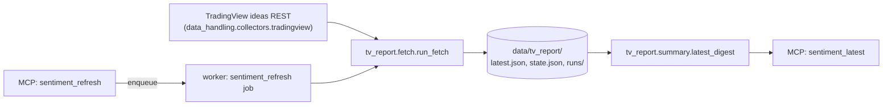

# 8340 — `src/sentiment` (TradingView hangulat)

A `research/tv_report` két működő scriptjéből és a tradingview collectorból lett csomag (t896). Háttér és eredmények: `_doc_/research/tv_report.md`,
`_doc_/research/tradingview_author_skill.md`. A chat-workflow: `.agent/skills/tv_sentiment_skill.md`.

| Modul | Szerep |
|-------|--------|
| `tv_report/paths.py` | Kimeneti helyek: `output_dir()` = `data/tv_report/` (gitignore), `latest_path()`, `state_path()` (dedup állapot), `runs_dir()`; `DEFAULT_SYMBOL = "BTCUSD"` |
| `tv_report/fetch.py` | `run_fetch(...)`, `clean_idea`, CLI: `uv run python -m sentiment.tv_report.fetch --symbol BTCUSD --pages 1 --hours 24 [--out PATH]` (100 ötlet/oldal; 4-8 s oldalak között) |
| `tv_report/summary.py` | `latest_digest(max_ideas=20, desc_chars=400)`: long/short/új darabszám, riport kora, legfrissebb ötletek rövidítve |
| `tv_report/author_backtest.py` | Szerző-szintű TP/SL backtest CLI (`discover`, `run`) — csak CLI, nem érhető el a chatből |

A worker `sentiment_refresh` job paraméterei: `hours` (1..720), `pages` (1..5), `symbol`. Az MCP `sentiment_refresh` ugyanezt enqueue-olja (dedup).

## Tesztek

`uv run pytest src/sentiment` (`tv_report/tests/test_fetch.py`).
