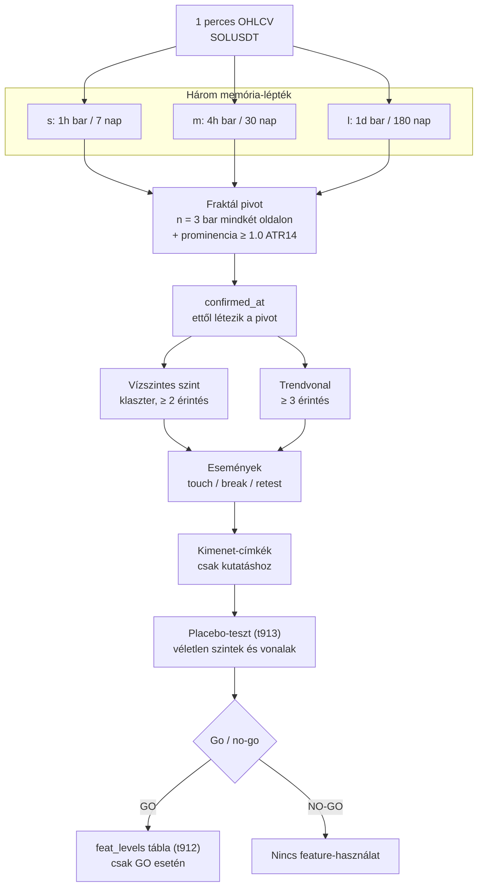
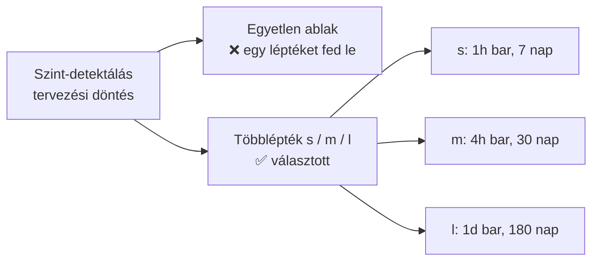
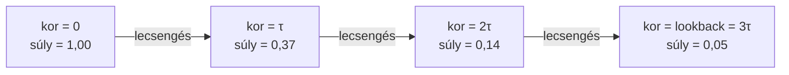
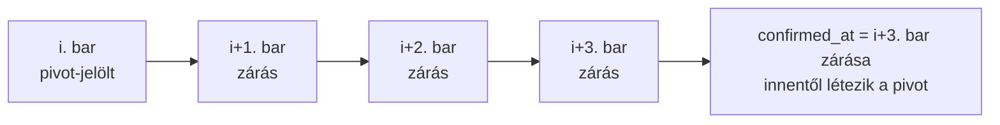
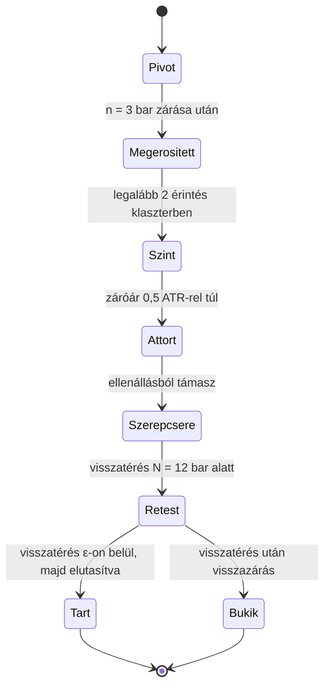
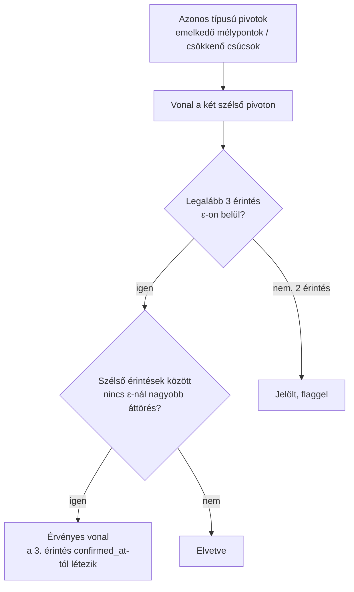
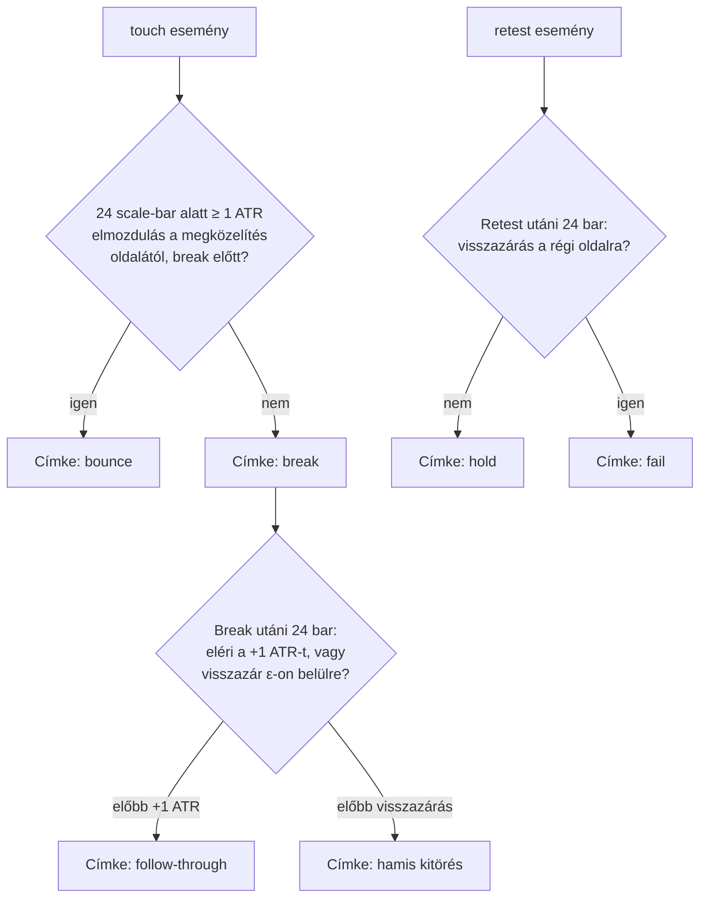
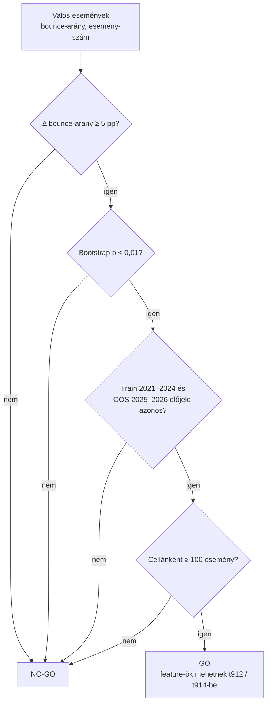

# 1700 — Feature Layer: Támasz/ellenállás és trendvonal detektálás (módszertan)

## Overview

Ez a szegmens a vízszintes támasz/ellenállás (S/R) szinteket, a trendvonalakat és a hozzájuk kapcsolódó eseményeket (érintés, kitörés, visszateszt) rögzíti SOLUSDT 1 perces adatból. A detektálás három memória-léptéken fut (s = 1h, m = 4h, l = 1d), a pivotok csak a megerősítésük időpontjától léteznek, és az eredmények először **kutatási eszközként** szerepelnek: feature-ként csak a placebo-teszt (t913) go döntése után kerülhetnek a modellbe. A dokumentum a számok megnézése **előtt** rögzíti a definíciókat, paramétereket és a go/no-go küszöböket.

Hatókör-elhatárolás: a meglévő SR Levels feature-ök (→ `1500_features_kontextus.md`) rolling high/low és előző session high/low távolságokat mérnek ATR-egységben. Ezek nem pivot-alapú szintek, nincs bennük klaszterezés, érintés-számlálás vagy trendvonal. Az új detektor **nem helyettesíti** őket, hanem külön szerkezeti réteget ad.

---

## Üzleti és módszertani háttér

### Miért kritikus ez a lépés?

A S/R és trendvonal definíciók határozzák meg az összes későbbi eseményt: ha egy szint vagy vonal definíciója az eredményt látva születik, a placebo-teszt és a go döntés értéktelen lesz, mert a mérés a hangolt szabályt méri a valós adaton. Két hiba különösen veszélyes:

1. **Look-ahead a detektálásban:** egy pivot a jövőbeli bar-okat használja a megerősítéséhez. Ha a feature a `confirmed_at` előtt már látja a pivotot, a modell a jövőt látja, és a kimutatott előny hamis lesz (a champion modellnél ugyanez a szivárgás-elv a t-1 lag és az embargo mechanizmusban jelenik meg, → `3000_sampling.md`).
2. **Utólagos paraméterhangolás:** ha a paramétereket a vizuális ellenőrzés (t911) után változtatjuk, a későbbi placebo-teszt már szelekciós torzítást mér. Ezért a paraméterek **a t911 előtt rögzítettek** és a dokumentum ezt a fagyasztást írja elő.

### Miért ezt a megközelítést?

| Megközelítés | Előny | Hátrány | Státusz |
|--------------|-------|---------|---------|
| Többlépték pivot-alapú detektálás fix paraméterekkel | Szerkezeti (megerősített pivotokból épül), több időtávon fut, a paraméterek az adat megnézése előtt rögzítettek | Több paraméter, átfedő léptékek kezelése szükséges | ✅ Választott |
| Egyetlen lookback ablak | Egyszerű, egy paraméter | Vagy zajos (rövid), vagy késői és elmosódó (hosszú); nincs léptékek közti összevetés | ❌ Elvetett — ok: egy ablak egy léptéket fed le, a memória valódi léptékét nem tudjuk mérni |
| Meglévő SR Levels (rolling high/low, előző session H/L) | Már létezik, nincs új kód | Nem pivot-alapú, nincs klaszter, nincs trendvonal, nincs érintés-számlálás | ❌ Elvetett mint helyettesítő — ok: más információt hordoz; kiegészítő marad |
| Kernel-simítás a teljes mintán (Lo–Mamaysky–Wang stílus) | Sima csúcs/mélypont becslés | A teljes mintát használja, így a kutatásban is look-ahead | ❌ Elvetett — ok: a megerősítés utáni, csak múltbeli adatot használó pivot ezt pótolja |
| Kézi rajzolt szintek | Emberi intuíció | Nem reprodukálható, nem placebo-tesztelhető | ❌ Elvetett — ok: a go döntéshez determinisztikus definíció kell |
| Fix százalékos távolságú szintek (pl. 1%) | Egyszerű | Nem ATR-normált; eltérő volatilitás-rezsimben más a jelentése | ⚠️ Fontolóra vehető — feltétel: placebo-bázisként használható |

### Léptékek és memória: miért több lépték, és hogyan mérjük a szint erejét

Egy szint "erejét" nem az határozza meg, hogy hány érintése volt összesen, hanem az, hogy milyen nemrégiben. A szint-erő exponenciálisan lecsengő súlyozott összeg:

$$S(t) = \sum_{k \in \text{érintések}} \exp\left(-\frac{t - t_k}{\tau}\right), \qquad \tau = \frac{\text{lookback}}{3}$$

A `t − t_k` kor a léptéken belüli bar-ban értendő. A `τ = lookback / 3` választás azt jelenti, hogy a lookback végén egy érintés súlya már csak `exp(−3) ≈ 0,05`, tehát a régi érintés hatása a lookback-en belül fokozatosan, nem hirtelen tűnik el.

| Lépték | Bar mérete | Lookback | Lookback bar-ban | τ (bar) | Súly a lookback végén |
|--------|-----------|----------|------------------|---------|-----------------------|
| s | 1h | 7 nap | 168 | 56 | 0,05 |
| m | 4h | 30 nap | 180 | 60 | 0,05 |
| l | 1d | 180 nap | 180 | 60 | 0,05 |

**Miért több lépték:** az s lépték az intraday szerkezetet (órák–napok), az m a swing-szerkezetet (napok–hetek), az l a nagy, több hónapos szinteket és a trendvonalakat ragadja meg. Egy ablak egyikre sem optimalizált. A három lépték eredményei külön futnak; a memória valódi hossza a t913 memória-görbéből derül ki, nem ebből a dokumentumból.

**Szabály:** egy szint a saját léptékén belül él. Az összevonás (ugyanaz a szint több léptéken) nem történik meg; a duplikáció a t913 eseményszámában kezelendő (feltételezés — validálásra vár).

### Pivot és megerősítés: mikor létezik egy pivot?

Fraktál pivot: az i. bar csúcs (vagy mélypont) akkor pivot, ha magasabb (alacsonyabb) mint a bal oldali és jobb oldali `n = 3` bar, és a kilengése legalább `1,0 · ATR14(lépték)`. A jobb oldali bar-ok miatt a pivot csak a jobb oldal lezárása után ismert.

**Szabály:** a pivot minden olyan számításban csak a `confirmed_at` időpont után szerepelhet, amely már csak múltbeli bar-okból dolgozik. A pontos időbélyeg definíció a Spec-pontosítások szakaszban van.

### Vízszintes szint: klaszterezés, érintés és szerepcsere

Egy szint több pivot klasztere: a csúcsok és mélypontok együtt, `0,25 · ATR` tűréssel klaszterezve. Szint akkor érvényes, ha legalább 2 érintése van. Ha az árat a szint áttöri, a szint nem szűnik meg: az ellenállás tamasszá válik (szerepcsere / role flip).

**Kerek szám flag:** a SOL ár 10 többszörösei elsődleges, az 5 többszörösei másodlagos flag. A flag nem önálló szint, csak a klaszter jellemzője.

### Trendvonal: meredekség, érintések és érvényesség

Trendvonal azonos típusú pivotokon át húzódik: emelkedő mélypontok adnak támasz-vonalat, csökkenő csúcsok ellenállás-vonalat. Érvényes vonal legalább 3 érintéssel rendelkezik `ε = 0,25 · ATR` sávon belül. Két érintéssel jelölt (flag), de nem érvényes vonal. Az érvényesség másik feltétele: a két szélső érintés között egyetlen záróár sem esik `ε`-nál nagyobb mértékben a vonal túloldalára.

### Eseménytípusok és kimenet-címkék (csak kutatáshoz)

Három eseménytípus: **touch** (az ár `ε`-on belül van, a megközelítés oldaláról), **break** (záróár legalább `0,5 · ATR`-rel a szint/vonal túloldalán), **retest** (break után `N = 12` scale-bar belül az ár visszatér `ε`-on belülre).

Kimenet-címkék a kutatási eseményhez, **soha nem feature**:

A `bounce`, `break`, `follow-through`, `hamis kitörés`, `hold` és `fail` címkék csak a t913 eseménytanulmány oszlopai. A `break` és `retest` ágak feltételei (+1 ATR, visszazárás) a spec-ben nem szerepeltek, ezeket a dokumentum rögzíti (feltételezés — validálásra vár).

### Placebo-teszt és go/no-go küszöbök (t913)

A valós bounce-arányt véletlen kontrollokkal hasonlítjuk össze, azonos statisztikai szerkezettel:

- **Placebo szint:** minden valós eseményhez véletlen szint, amelynek távolsága az esemény-bar árától ATR-egységben a valós szintek távolság-eloszlásából származik; az irány véletlen. Lépték szerint külön.
- **Placebo vonal:** a valós vonalak meredekség-eloszlásából húzott véletlen meredekségű vonal, a valós pivot időpontjához kötve, véletlen árszinten.
- **Bootstrap:** eseményszintű blokk-bootstrap, blokk = 1 nap (feltételezés — validálásra vár), kétoldalas p-érték a valós és placebo különbségre.

| Kritérium | Küszöb | Ha nem teljesül |
|-----------|--------|-----------------|
| Δ bounce-arány (valós − placebo) | ≥ 5 százalékpont | NO-GO |
| Bootstrap p-érték (kétoldalas) | < 0,01 | NO-GO |
| Előjel: train (2021–2024) és OOS (2025–2026) | azonos | NO-GO |
| Minimum esemény-szám cellánként | ≥ 100 (feltételezés — validálásra vár; nincs a spec-ben) | a cella nem értékelhető, NO-GO |

**NO-GO esetén:** a feature-ök nem kerülnek be a challenger modellbe (t912 és t914 nem indul ezekre), a t913 riport a negatív eredményt rögzíti. Egy cellára adott GO nem jelenti az egész detektor GO-ját.

### Look-ahead szabályok és t-1 lag (t912 előkészítés)

| # | Szabály | Ellenőrzés |
|---|---------|-----------|
| 1 | Pivot csak `confirmed_at` után szerepel bármely számításban | Egységteszt: minden pivot `confirmed_at` ≥ pivot-bar záróideje + n bar |
| 2 | Szint-erő a t időpontban csak `confirmed_at ≤ t` érintéseket súlyoz | Szintetikus adaton: a jövő érintés nem változtatja a múltbeli értéket |
| 3 | A feature a t perc értékéhez a t−1 perc záróáig ismert állapotot használja (a meglévő t-1 lag konvenció) | A feature-tábla minden sorában a forrás-időbélyeg < a sor időbélyege |
| 4 | ATR(lépték) a `confirmed_at`-ig ismert bar-okból számolódik | Ugyanaz, mint 1. |
| 5 | Kimenet-címkék (bounce / break / retest kimenetek) csak a t913 eseménytanulmányban léteznek | A feature-lista nem tartalmaz címke-oszlopot |

### Paraméter alapértékek és indoklásuk

A táblázat a t909 spec-ben szereplő minden paramétert tartalmaz. Egyik érték sem változott az eredeti spec-hez képest.

| Paraméter | Alapérték | Indoklás | Forrás / státusz |
|-----------|-----------|----------|------------------|
| Lépték s | 1h bar, 7 nap (168 bar) | Intraday szerkezet; az 1 perces adatból aggregált első szint | Spec 1. pont |
| Lépték m | 4h bar, 30 nap (180 bar) | Swing-szerkezet; a 4h bar kiszűri a perc-zajt, a 30 nap elég sok pivot-hoz | Spec 1. pont |
| Lépték l | 1d bar, 180 nap (180 bar) | Több hónapos szintek és trendvonalak; ~6 hónap elég hosszú a nagy szintekhez, rövid a rezsimváltáshoz | Spec 1. pont |
| τ (szint-erő) | lookback / 3 | A lookback végén a súly `e^-3 ≈ 0,05`, így a lecsengés a lookback-en belül fokozatos | Spec 1. pont |
| Pivot n | 3 bar mindkét oldalon | Fraktál-definíció; kisebb n sok zajpivotot ad, nagyobb n késlelteti a megerősítést | Spec 2. pont |
| Pivot prominencia | ≥ 1,0 · ATR14(lépték) | ATR-normált, hogy léptékek és árszintek összehasonlíthatók; kiszűri a kis kilengéseket | Spec 2. pont |
| Klaszter tolerancia | 0,25 · ATR(lépték) | Nagyjából a bar-zaj nagyságrendje; szorosabb: minden pivot külön szint, lazább: a szintek elmosódnak | Spec 3. pont |
| Min. érintés (szint) | 2 | Egy érintés nem szint; a 2 a legkisebb megerősítés | Spec 3. pont |
| Kerek szám flag | 10 többszöröse (elsődleges), 5 (másodlagos) | Pszichológiai és megbízási klaszter; flag, nem önálló szint | Spec 3. pont — ár-rezsim függő, lásd kockázatok |
| Trendvonal min. érintés | 3 (2 = jelölt flag) | A harmadik érintés az első valódi visszaigazolás; két pont mindig illeszthető | Spec 4. pont |
| Trendvonal ε | 0,25 · ATR(lépték) | Azonos a klaszter toleranciával: egy szabad paraméterrel kevesebb | Spec 4. pont |
| Touch ε | 0,25 · ATR(lépték) | Azonos a klaszter toleranciával | Spec 5. pont |
| Break küszöb | záróár ≥ 0,5 · ATR a szint/vonal túloldalán | A rövid kiugrás nem számít áttörésnek; a fél ATR a bar-zaj fölött van | Spec 5. pont |
| Retest ablak N | 12 scale-bar (s: 12h, m: 48h, l: 12 nap) | A "friss" áttörés időtávja léptékenként arányos | Spec 5. pont |
| Bounce küszöb | ≥ 1 · ATR elmozdulás, 24 scale-bar belül | 1 ATR értelmes elmozdulás; 24 bar (s: 24h, m: 4 nap, l: 24 nap) rövid horizont minden léptékre | Spec 6. pont |
| Go: Δ bounce-arány | ≥ 5 pp | Alatta a különbség kereskedési értéke bizonytalan, a díj és csúszás miatt nincs fedezete | Spec 7. pont |
| Go: p-érték | < 0,01 (bootstrap, kétoldalas) | Szigorúbb a 0,05-nél a többszörös tesztelés miatt; a korrekció kérdése nyitott, lásd kockázatok | Spec 7. pont |
| Go: előjel-stabilitás | train (2021–2024) és OOS (2025–2026) azonos | Egyetlen rezsim nem elég; a két időszak eltérő piaci körülmények | Spec 7. pont |
| Min. esemény-szám | ≥ 100 / cella | Bootstrap-stabilitás | Feltételezés — validálásra vár |

**Megjegyzés az OOS időszakról:** az OOS 2025–2026 naptári időszak. (Javítva 2026-11-19: a champion modell — `lgbm_solusdt_{l,s}_fw60_2101_2607` — train ablaka 2021-01-01 – 2026-01-31, valid ablaka 2026-02-01 – 2026-07-31; a korábbi "2025-05-01 – 2026-05-31" érték téves volt. A t913 a 2025-05-01 határt használta, ami átfed a champion train-nel; a konklúziót nem érinti, mert a train időszakon is 0 GO.) A detektor nem modell, így a naptári felosztás helyes; az egybeesés érdekében a t913-ban az OOS felosztása a champion valid kezdetéhez igazítható (döntés — user).

#### Spec-pontosítások (nincs értékváltozás)

1. **`confirmed_at` időbélyeg:** a spec szerinti `pivot_time + n bar` egyértelmű kell legyen. Ha a `pivot_time` a pivot-bar nyitóideje, a `+ n bar` a jobb oldali utolsó bar nyitóidejét adja, nem a zárását, tehát egy bar-nyi look-ahead marad. Pontos definíció: `confirmed_at` = a pivot-bar nyitóideje + `(n+1)` bar hossz = az `i+n`. bar záróideje. Egyenértékű megfogalmazás: ha a `pivot_time` a pivot-bar záróideje, akkor `confirmed_at = pivot_time + n bar`.
2. **Bounce iránya:** az elmozdulás a megközelítés oldalától mért távolság (ellenállásnál lefelé, támasznál felfelé), nem abszolút érték.
3. **Break/follow-through és retest/hold definíciók:** a spec-ben nem szerepeltek; a kimenet-címkék szakaszban rögzítettük (feltételezés — validálásra vár).
4. **Placebo-definíció és bootstrap:** a spec csak a szándékot írta le; a részletes definíciót a placebo szakasz rögzíti (blokk = 1 nap, kétoldalas p, feltételezés).

### Ismert kockázatok és korlátok

| Kockázat | Tünet | Mitigáció |
|----------|-------|-----------|
| Paraméter-hangolás a t911 vizuális ellenőrzése után (szelekciós torzítás) | A paraméter-változás után a t913 eredménye javul, de a változás oka a látott mintázat | A paraméterek a t911 előtt fagyasztva; változtatás csak új verzióként, a t913 újrafut. **Nyitott döntés — user.** |
| OOS szennyeződés: a t911 riport a 2025–2026 mintát is mutatja | A user a teljes mintát látja, az OOS már nem tiszta | Döntés: a riport train-re korlátozása, vagy az OOS-t "kontaminált" jelöléssel kezelni. **Nyitott döntés — user.** |
| Többszörös tesztelés: ~18 cella (3 lépték × 2 irány × 3 eseménytípus), cellánként p < 0,01 | Véletlenül is átmehet 1–2 cella | Holm vagy Bonferroni korrekció, vagy a White (1999) reality-check szellemű teszt. A spec szerinti p < 0,01 marad, a korrekció módja döntés kérdése. **Nyitott döntés — user.** |
| Átfedő események autokorrelációja: ugyanaz a touch-sorozat sok bar-on át | A bootstrap p-érték túl optimista | Blokk-bootstrap (blokk = 1 nap) és eseményszintű dedup (cooldown). Feltételezés — validálásra vár. |
| Lépték-átfedés: ugyanaz a szint több léptéken | Duplikált események, torzított cella-méret | Szint a saját léptékén él; a duplikáció a t913 eseményszámában kezelendő (feltételezés). |
| Kerek szám rezsim: a 10 USDT lépcső más jelentésű alacsony és magas árnál | Alacsony árnál túl sűrű, magasnál ritka flag | Ár-arányos lépcső vagy ATR-alapú rács, ha az ár tartósan elmozdul. Felülvizsgálati pont. |
| Look-ahead a megerősítésben | Túl magas bounce-arány, főleg pivot-közeli eseményeknél | `confirmed_at` szabály (1. szabály) és egységteszt; Spec-pontosítás 1. |
| Placebo gyengesége: a véletlen szintek nem őrzik a rezsim-függést | A placebo bounce-aránya túl alacsony vagy túl magas | Rezsim-stratifikált placebo (feltételezés — validálásra vár). |
| Átvihetőség: a forrás-cikkek FX és részvénypiacokra készültek, nem kriptóra | A SOL-on mért hatás más mechanizmusból eredhet | Csak kiindulópont; a go döntés kizárólag a saját adaton születik. |

### Validációs checklist

- [ ] Minden pivotnál ellenőrizhető: `confirmed_at` ≥ a pivot-bar záróideje + n bar, és a feature soha nem használ `confirmed_at` utáni adatot
- [ ] A paraméterek verziózottak, és a t911 előtti értékekkel megegyeznek (fagyasztás dokumentálva)
- [ ] Minden érvényes szint legalább 2 érintést tartalmaz; minden érvényes vonal legalább 3 érintést, és a szélső érintések közti záró-szabály teljesül (egységteszt)
- [ ] Placebo: a véletlen szintek távolság-eloszlása és a véletlen vonalak meredekség-eloszlása a valós eloszlást kvantilisekben reprodukálja
- [ ] A go döntés előtt rögzítve a többszörös tesztelés korrekciójának módja
- [ ] A train és OOS eredmény külön riportolva, az előjel-egyezés ellenőrizve
- [ ] A kimenet-címkék nem kerülnek a feature-listába (oszlop-szintű ellenőrzés)

### Források

- Osler, C. L. (2000): *Support for Resistance: Technical Analysis and Intraday Exchange Rates*. FRBNY Economic Policy Review, 6(2). https://www.newyorkfed.org/research/epr/00v06n2/0007osle — a placebo-szint módszer forrása a ticket szerint; a konkrét placebo-eljárás részleteit a forrásban még nem ellenőriztük (validálásra vár).
- Osler, C. L. (2001): *Currency Orders and Exchange-Rate Dynamics: Explaining the Success of Technical Analysis*. FRBNY Staff Report 125. — stop-loss és take-profit klaszterek, kerek számok.
- Lo, A. W., Mamaysky, H., Wang, J. (2000): *Foundations of Technical Analysis*. Journal of Finance, 55(4). — pivot-alapú és simítás-alapú mintázat-detektálás; a kernel-simítás look-ahead problémája innen elvetve.
- Sullivan, R., Timmermann, A., White, H. (1999): *Data-Snooping, Technical Trading Rule Performance, and the Bootstrap*. Journal of Finance, 54(5). — többszörös tesztelés és bootstrap-alapú korrekció; a go küszöb értelmezésének alapja.

Kapcsolódó dokumentumok: `1500_features_kontextus.md` (meglévő SR Levels), `3000_sampling.md` (embargo és t-1 lag logika), `7000_validacios_elvek.md` (mérési fegyelem).
