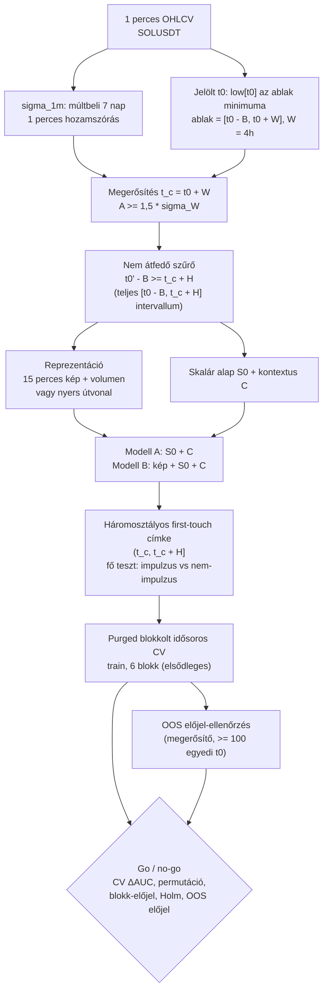
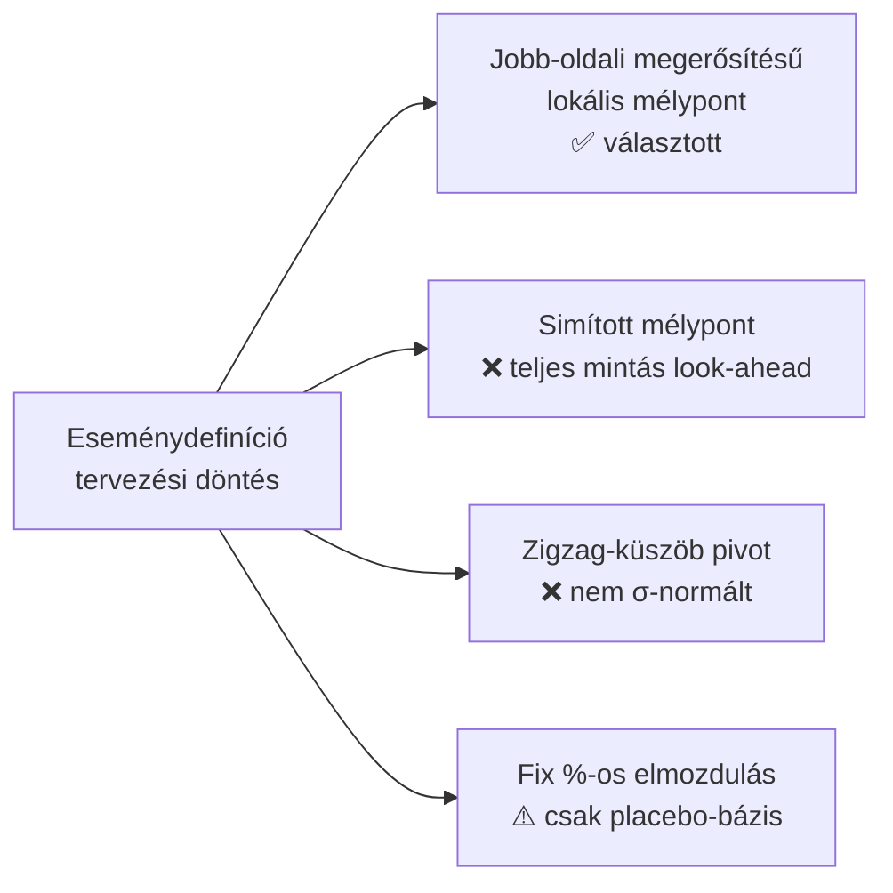
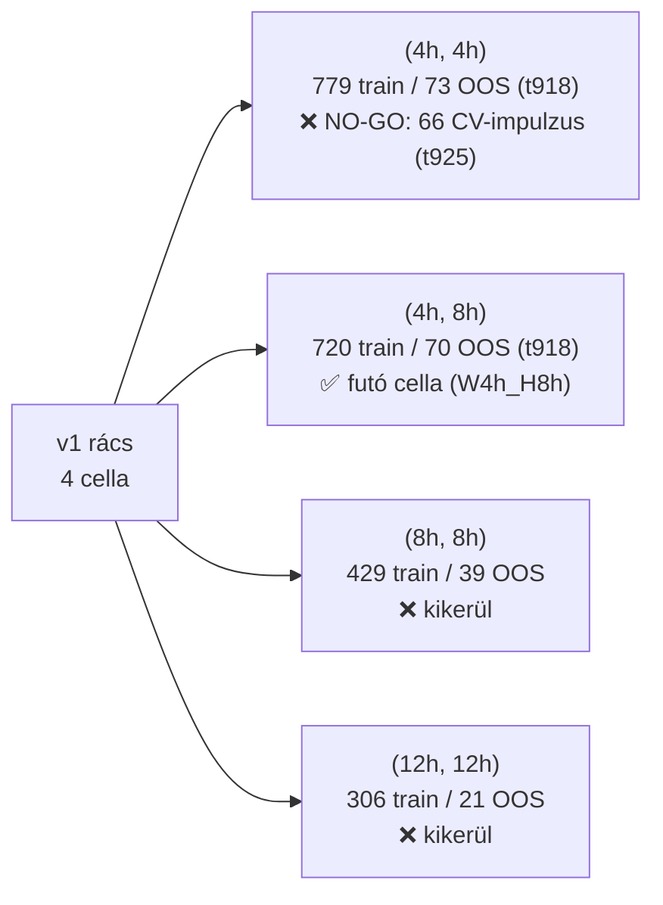
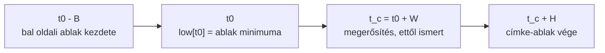
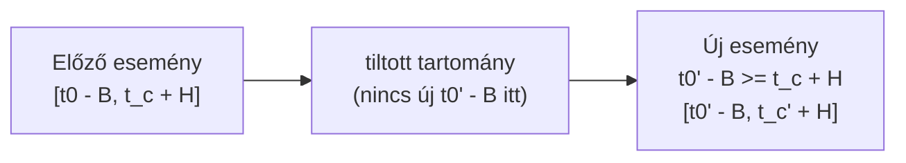
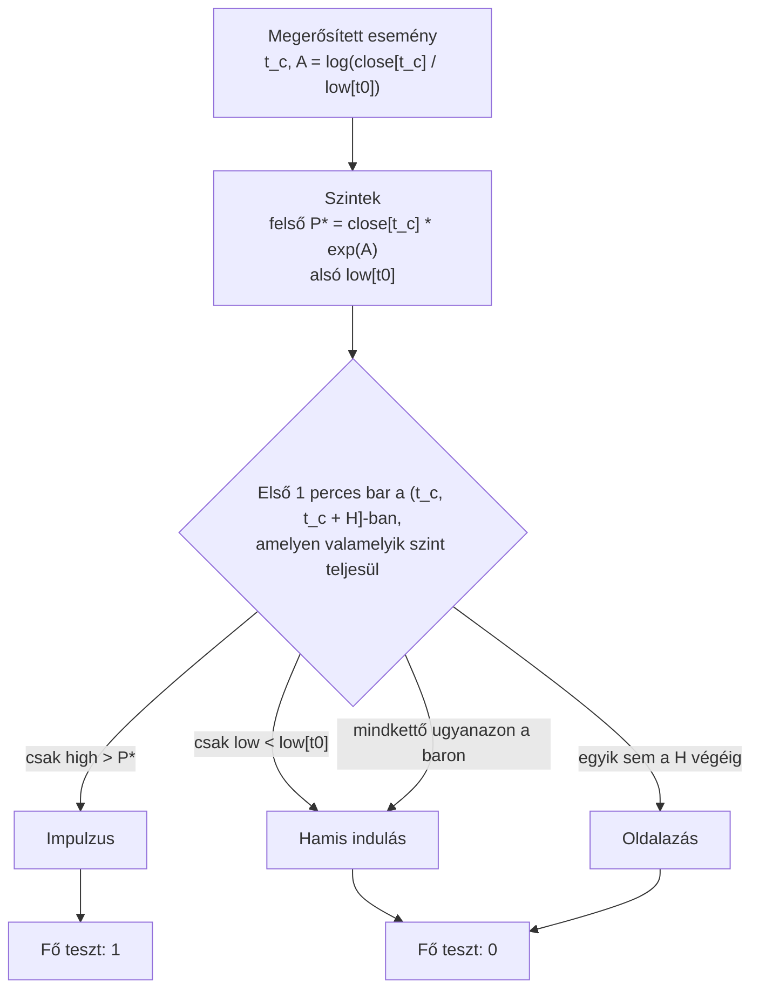
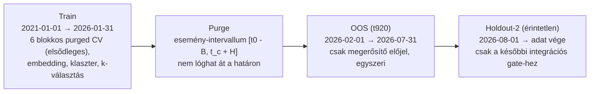
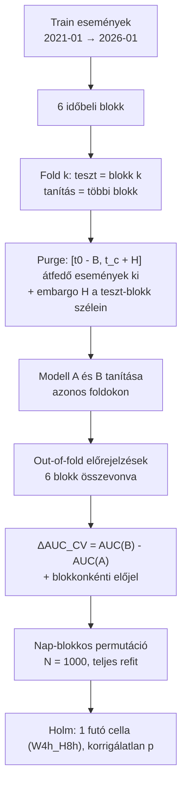
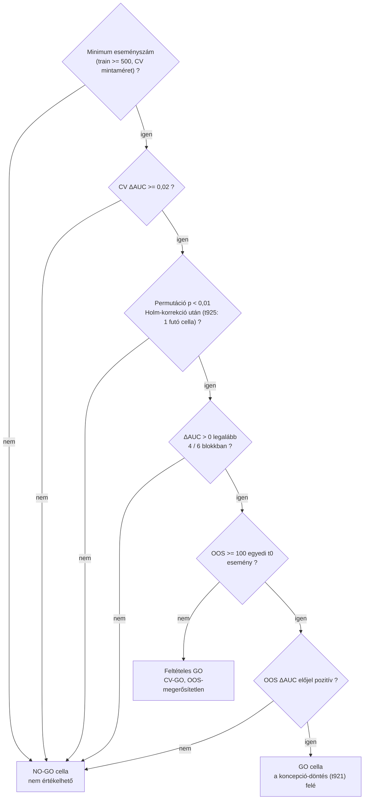

# 5200 — Hullámkezdet-modell: kép-alapú impulzus előrejelzés (módszertan, v2)

## Overview

Ez a dokumentum egy új modell-koncepció **módszertanát** rögzíti, amely egy megerősített lokális mélypontból induló visszapattanás alakjából próbálja megbecsülni, hogy a következő `H` időszakban **impulzus** (felfelé lendület, a 3. hullám analógja) következik-e. A koncepció független a meglévő LightGBM quant modelltől; a kapcsolódási pontok (közös train-ablak, későbbi gate vagy feature) csak külön döntéssel és új, érintetlen holdout-tal léphetnek életbe.

**Verzió: v2 (2026-11-20).** A v1 az adatok megnézése **előtt** készült; a v2 a t918 eseményszám-eredményei után, a user döntésével (epic_072, A opció) született. A v2 szabályai szintén a t925 adatkészlet és a modell-értékelés **előtt** rögzítettek. További változtatás csak új verzióként (v3) lehetséges, a teljes pipeline újrafutásával, és az indoklás ebbe a dokumentumba kerül.

Az esemény-definíció és a címke egy lehetséges, egyszerűsített Elliott-hullám-olvasatra épül (1–3. hullám), de nem hullámszámlálás: a modell egy szabályalapú proxy-t tesztel, nem egy hullámszámlálót.

---

## Változásnapló: v1 → v2

| Elem | v1 | v2 | Indoklás |
|------|----|----|----------|
| (W, H) rács | 4 cella: (4h,4h), (4h,8h), (8h,8h), (12h,12h) | **2 cella:** W = 4h, H ∈ {4h, 8h} | A t918 eseményszámai: (4h,4h) 779 train / 73 OOS; (4h,8h) 720 / 70; (8h,8h) 429 / 39; (12h,12h) 306 / 21. A 8h/12h cellák a 500-as train-minimum alatt vannak, és cellánként 21–73 OOS esemény nem ad értékelhető OOS-tesztet. A küszöböt nem csökkentjük utólag, ezért a cellák kikerülnek. |
| Címke | bináris (impulzus / korrekció), al-jelölés csak leíró | **háromosztályos first-touch** (impulzus / hamis indulás / oldalazás); a fő teszt bináris marad | A t918 v1 bináris címkéjén a minták ~85%-a oldalazás volt, így a "korrekció" osztály nagyrészt nem-esemény, és elmosta a valódi hamis indulásokat. A first-touch sorrend azt is méri, melyik szint érkezik előbb. |
| Elsődleges bizonyíték | egyszeri OOS ΔAUC (2026-02 → 2026-07) | **purged, blokkolt idősoros CV a train-en** (6 blokk) | Az OOS cellánként 21–73 esemény: a hozzá kötött küszöb és p-érték statisztikailag instabil. A train 700+ eseménye megbízhatóbb bizonyíték. |
| OOS szerepe | döntési feltétel (ΔAUC ≥ 0,02, előjel) | **csak megerősítő előjel-ellenőrzés**, feltétel: ≥ 100 **egyedi t0** esemény (nem cella-összeg) | Kevés esemény mellett csak az irány vizsgálható, a nagyság nem. A v2 döntés (2026-11-20): a két 4h-s cella t0-i szinte azonosak, a cella-összeg ugyanazt az eseményt kétszer számolná. |
| Holdout-2 | érintetlen | érintetlen (változatlan) | — |
| Nem-átfedés | `t0' >= t_c + H` | **a teljes `[t0 - B, t_c + H]` intervallum nem-átfedése** (`t0' - B >= t_c + H`) | Az epic döntése és a kód ezt követi; a v1 szöveg csak a címke-ablakot védte, az új esemény kép-ablaka (`B`) még belenyúlhatott az előző címke-ablakába. |
| Holm család | 8 cella (4 × 2 reprezentáció) | **2 cella** (a két 4h-s (W, H) cella, ATR-kép modell) | A rács szűkült; a nyers útvonal csak klaszter-baseline. |
| White Reality Check | másodlagos robusztusság | elhagyva a döntési szabályból | 2 cellán a Holm elegendő; a WRC leíró kiegészítésként sem döntési. |
| k-választás CV | hónap-blokkos, 5 blokk | ugyanaz a **6 blokkos** purged CV | Egyetlen blokk-szerkezet az egész pipeline-ban. |
| Min. eseményszám | train ≥ 500/cella; OOS ≥ 150 cellánként (≥ 50 / ≥ 50) | train ≥ 500/cella; CV-ben blokkonként és pozitív/negatív szinten minimumok; OOS ≥ 100 egyedi t0 (csak előjel) | Lásd a go/no-go szekciót. |
| Döntésnapló (2026-11-20, t925 után) | — | Az OOS-minimum egyedi t0-ra; W4h_H4h NO-GO; a Holm-család 1 cella (W4h_H8h), korrigálatlan p; holdout-2 érintetlen | t925 számok: egyedi OOS t0 = 75 (< 100 → OOS-előjel nem fut, legjobb eredmény feltételes GO); W4h_H4h CV-ben 66 train impulzus (< 100 → NO-GO); holdout-2 jelenleg 44 egyedi esemény, tiszta OOS-próba csak elég esemény után. |

---

## Üzleti és módszertani háttér

### Miért kritikus ez a lépés?

Az eseménydefiníció és a címke határozza meg, mit tanul meg a modell. Ha a mélypont-definíció a jövőbeli bar-okat használja, vagy ha a címke-küszöb az eredmény látása után születik, a mért előrejelző-erő a szivárgást vagy a hangolást méri, nem a piaci szerkezetet. Az epic_071 (S/R placebo-tanulmány) megmutatta, hogy a nyers arányok (például 58–66%-os "visszapattanás") a volatilitásból és a címke-küszöbből származhatnak, nem a vizsgált mintázatból. Ezért ez a dokumentum minden mérés előtt rögzíti a baseline-t, a placebo-logikát és a go/no-go feltételeket.

### Miért ezt a megközelítést?

| Megközelítés | Előny | Hátrány | Státusz |
|--------------|-------|---------|---------|
| Jobb-oldali megerősítésű lokális mélypont (ablak-minimum, t_c-ig ismert) | Nincs look-ahead; egyetlen paraméter (W) és szűk rácsa van; a megerősítés időpontja egyértelmű | A mélypont csak W idő után ismert, így a jóslás késleltetett | ✅ Választott |
| Simított mélypont (kernel-regresszió, Lo–Mamaysky–Wang 2000 stílus) | Sima, jól definiált extrémumok | A teljes mintát használja, a simítás a jövőbeli bar-okból is dolgozik | ❌ Elvetett — ok: a kutatásban is look-ahead |
| Zigzag-küszöb pivot (%-os visszafordulás) | Ismert az ágazat (ZigZag-alapú pivot-motor a 1-2-1-2 kutatásban) | %-alapú és nem volatilitás-normált; a küszöb határozza meg a pivotokat, így a rezsim-váltáskor torzít | ❌ Elvetett — ok: nem ATR/σ-normált |
| Fix %-os elmozdulás, mint esemény | Egyszerű | Nem skálázódik a volatilitással; ugyanaz a probléma, mint az epic_071 fix-távolságos szintjeinél | ⚠️ Fontolóra vehető — feltétel: placebo-bázisként használható |

### Rács: W = 4h, H ∈ {4h, 8h}

A v2 két cellát vizsgál: **(4h, 4h)** és **(4h, 8h)**. Mindkettő `W = 4h` megerősítési ablakot és `B = W = 4h` bal oldali ablakot használ, így a kép azonos (8 órás) szakaszt mutat; a két cella csak a címke-horizontban (`H`) tér el. A (8h, 8h) és (12h, 12h) cella kikerült: a t918 szerint a train-eseményszámuk (429, illetve 306) a 500-as minimum alatt van, az OOS-szám (39, illetve 21) pedig önmagában is kevés. A rács előre rögzített, a kikerülés eseményszám-alapú, nem eredmény-alapú. **Döntés (2026-11-20, t925 után):** a (4h, 4h) cella NO-GO, mert az összevont CV-mintában csak 66 train impulzus van (minimum 100). A t919/t920 ezért csak a W4h_H8h cellán fut; a Holm-család 1 cella, így a p-érték korrigálatlan (Holm = identitás).

### Esemény: megerősített lokális mélypont és look-ahead

**Definíció.** Legyen `t0` egy 1 perces bar nyitóideje, `low[t0]` a bar mélypontja. A `t0` jelölt, ha `low[t0]` az ablak minimuma, ahol az ablak a `t0` előtti `B` és a `t0` utáni `W` időtartam. A megerősítés időpontja `t_c = t0 + W`, és a `t_c`-ig lezárt bar-okat használjuk. Tehát:

- a bal oldali szakasz (`B`): bar-nyitóidő `t0 - B` és `t0`, záróidő legfeljebb `t0`;
- a jobb oldali szakasz (`W`): a `t0` utáni bar-ok, záróidő legfeljebb `t_c`;
- `t_c` a jobb oldali utolsó 1 perces bar záróideje; `t_c` után semmi nem használható a döntésben.

**Szabály:** a jellemzők (kép, skalár) csak a `[t0 - B, t_c]` bar-okból épülnek, a címke csak a `(t_c, t_c + H]` ablakból. A két ablak nem fedheti egymást a címke-oldalon.

**Minimális visszapattanás.** Az esemény csak akkor érvényes, ha a `t_c`-ig tartó elmozdulás:

`A = log(close[t_c] / low[t0]) >= 1,5 * sigma_W`

ahol `sigma_W = sigma_1m * sqrt(W / 1 perc)`, és `sigma_1m` az `1 perces` log-hozamok szórása a `t0` **előtti** 7 napban (csak `close <= t0` bar-ok). Ez a definíció csak múltbeli adatot használ.

**Nem átfedő szabály (v2, javított).** Egy cellán belül az események időrendben (greedy) kerülnek kiválasztásra. Minden elfogadott esemény **teljes esemény-intervalluma** `[t0 - B, t_c + H]`; két elfogadott esemény intervalluma **nem fedheti egymást**. Egy jelölt `t0'` tehát csak akkor fogadható el, ha az előzőleg elfogadott esemény `t_c + H` záró-időpontja után kezdődik az új esemény teljes intervalluma:

`t0' - B >= t_c + H` (az előzőleg elfogadott eseményre)

Ez szigorúbb a v1 `t0' >= t_c + H` szabályánál: a v1 csak a címke-ablakot védte, így az új esemény kép-ablaka (`[t0' - B, t0']`) beleérhetett az előző címke-ablakba, és az új esemény jellemzői az előző esemény jövőbeli áraiból épültek volna. Ha több jelölt van a tiltott tartományban, az első megerősített mélypont nyer. A szabály kódja és az epic-döntés ugyanezt az intervallum-alapú nem-átfedést követi.

### Címke: háromosztályos first-touch, bináris fő teszt

Az Elliott-elmélet szerint a 3. hullám soha nem a legrövidebb az 1., 3., 5. hullám közül, és gyakran az 1. hullám többszöröse. A minimális szabályt használjuk: a 3. hullám legalább akkora, mint az 1. hullám. A címkézés egy 1:1 vetítés és két szint közül az **előbb megütött** szint (first-touch) határozza meg az osztályt.

- az 1. hullám proxy: `A` (log-elmozdulás `low[t0]`-tól `close[t_c]`-ig);
- a felső szint (célszint): `P* = close[t_c] * exp(A)`, azaz a megerősítési árról `A` log-egységgel feljebb;
- az alsó szint: `low[t0]` (a mélypont-szint, Elliott-logikában a 2. hullám tiltott szintje);
- a címke a `(t_c, t_c + H]` ablak 1 perces bar-jain, időrendben megy végig; az első olyan bar dönt, amelyen valamelyik szint teljesül:
  - **impulzus:** `high > P*` (a felső szintet előbb ütötte meg);
  - **hamis indulás:** `low < low[t0]` (az alsó szintet ütötte meg előbb);
  - **oldalazás:** az ablak végéig egyik szint sem teljesült.

**Tie-break (ugyanazon az 1 perces baron mindkét szint):** ha egyetlen 1 perces baron egyszerre teljesül `high > P*` és `low < low[t0]`, a bar belső sorrendje az OHLC adatból nem állapítható meg. **Konzervatív szabály: az esemény hamis indulás.** Indok: nem ismerjük, melyik szint érkezett előbb, és az impulzus-állítás csak biztosan előbb megütött célszinttel tehető; a szabály nem fúj fel impulzus-találatokat. A szabály előre rögzített, a gyakoriságát a t925 riportja közli (a hamis indulás osztályon belül).

**Fő teszt (bináris):** `impulzus = 1`, `nem-impulzus = 0` (hamis indulás + oldalazás összevonva). A go/no-go döntés kizárólag erre a bináris célra vonatkozik. A háromosztályos címke **másodlagos és leíró**: osztály-eloszlás cellánként és blokkonként, az osztályok jellemző-eloszlása, kép-klaszterek osztály-összetétele. Háromosztályos modell-teljesítményből (pl. multiclass log-loss) go/no-go döntés nem származtatható.

**Egyszerűsítés korlátai.** (1) A `t_c` nem feltétlenül a 2. hullám mélypontja; a modell a megerősítési árat használja a 2. hullám proxyjaként. (2) A 1:1 vetítés nem a Fibonacci-arányokat méri. (3) A bináris fő teszt a hamis indulást és az oldalazást összevonja; ez szándékos, mert a v1 tapasztalat szerint az oldalazás dominál (~85% a v1 bináris címkében), és külön osztályként a leíró elemzésben látszik. (4) A first-touch sorrend csak 1 perces felbontásig ismert; a tie-break szabály a felbontás korlátját kezeli. (5) A `W` és `H` ugyanazon léptékhez tartozik, de a valós hullámok hossza nem skálázódik ilyen egyszerűen.

### Képformátum: 15 perces OHLC + volumen, ATR- és A-normálás

- **Időfelbontás:** 15 perces bar-ok. Csak azok a 15 perces bar-ok szerepelnek, amelyek záróideje `<= t_c`; az utolsó, részben lezárt 15 perces bar kimarad (legfeljebb 14 perc információ-veszteség).
- **Kép-ablak:** `[t0 - B, t_c]`, azaz `2W = 8h` hosszú (`B = W = 4h`), így a kép pontosan az eseményt definiáló szakaszt mutatja.
- **Kép-stílus:** OHLC-gyertya kép + alsó volumen-sáv, a Jiang–Kelly–Xiu (2023) kép-konvenciójához hasonlóan. A JKX konkrét ablak- és rácshosszait a forrásban még nem ellenőriztük (feltételezés — validálásra vár).
- **Árskála (elsődleges):** az árak `low[t0]`-hoz viszonyítva, `ATR14(15m)`-mel normálva, a `t_c`-ig ismert ATR-rel.
- **Árskála (diagnosztikai):** az árak `A`-val normálva (a `low[t0]` → 0, a `close[t_c]` → 1 értékre kerül). **Ez a skála a célhoz közeli információt tartalmaz** (a célszint is ebben a skálában van), ezért csak ellenőrző változatként fut, nem tesztcella.
- **Volumen-skála:** az 1 perces volumen 7 napos, `t0`-t megelőző átlaghoz viszonyítva.
- **Nyers útvonal (baseline):** a `[t0 - B, t_c]` záróár-sorozat z-normalizálva (az ablak saját átlaga és szórása, csak a `t_c`-ig ismert adatból). Ez a DTW / k-Shape baseline bemenete; a v2 modell-tesztben nem külön cella.

### Előzmény-kontextus és skalár alap

Két réteg:

- **Skalár alap S0 (baseline, a teszt viszonyítási pontja):**
  - `A / sigma_W` (rebound-méret σ-ban);
  - sebesség: az utolsó 1 óra záróár-elmozdulása, `sigma_1m * sqrt(60)`-nel normálva;
  - előzmény-trend: `log(close[t0] / close[t0 - 3 nap]) / sigma_W` (normalizált);
  - volatilitás: `log(sigma_1m)` a 7 napos ablakból.
- **Kontextus C (mindkét modellben benne van):**
  - esés-mélység: `log(max high[t0 - B, t0] / low[t0])`;
  - volumen-arány: a `[t0 - B, t_c]` átlagos volumene / a 7 napos átlag.

A **Modell A** (alap) = `S0 + C`. A **Modell B** (kép) = `S0 + C + képbeágyazás`. A ΔAUC mindig B − A, azonos tanuló-algoritmussal (elsődlegesen regularizált logisztikus regresszió; gradiens-boosting csak érzékenységi ellenőrzés). Mindkét modell ugyanarra a bináris fő célra tanul.

**Szabály:** a kép-modellnek a skalár alapot kell felülmúlnia. Ha A és B között nincs inkrementális különbség, a kép nem ad új információt, akkor sem, ha a nyers kép-AUC magas.

### Időbeli felosztás: train (elsődleges bizonyíték), OOS (megerősítő) és érintetlen holdout

- **Train** = `2021-01-01 → 2026-01-31`: megegyezik a LightGBM champion (fw60) train-ablakával (a modell-registry szerint). Így a koncepció nem lát több train-adatot, mint a champion, és később közös train-ablak mellett is összevethető. **Ez az elsődleges bizonyíték forrása** (purged blokkolt CV).
- **OOS** = `2026-02-01 → 2026-07-31`: ugyanaz a naptári ablak, mint a champion valid-ablaka. A v2-ben **csak megerősítő előjel-ellenőrzés**, egyszer, a t920-ban értékelhető; nem hangolhat semmit, és küszöb-értékhez sem kötött (lásd go/no-go). Mivel a champion ezt az ablakot már valid-ként használta, ha később a koncepció a champion-be kerülne, ez az ablak már nem lenne tiszta; ezért a holdout-2 külön védett.
- **Holdout-2** = `2026-08-01 → adat vége`: **érintetlen** marad (v2-ben is). Jelenleg 44 egyedi esemény (t925); tiszta OOS-próba csak elég esemény után, külön döntéssel. Csak akkor nyitható, ha a user külön döntést hoz a champion-integrációról.
- **Purge:** egy esemény csak akkor kerül be egy splitbe, ha a teljes `[t0 - B, t_c + H]` intervalluma abban van. A határt átlógó eseményeket el kell dobni. Ez szigorúbb, mint a champion 240 perces embargója, és tükrözi az események változó hosszát.
- **Vizuális ellenőrzés:** a t918/t925 leíró riport és az UI-ban megjelenő példa-események csak train-időszakból mutathatnak példát. Az OOS-t csak a t920 nézi.

### Elsődleges bizonyítás: purged, blokkolt idősoros CV a train-en

A train-időszak (2021-01-01 → 2026-01-31) **6 egymást követő, időben összefüggő blokkra** oszlik (blokkhatárok az esemény-idők alapján, előre rögzítve, közel egyenlő naptári hosszal). Minden blokk egyszer teszt-blokk; a modell a többi blokk eseményein tanul.

- **Purge (teljes intervallumra):** a teszt-blokkba tartozás a teljes `[t0 - B, t_c + H]` intervallum alapján dől el; az a train-esemény, amelynek intervalluma a teszt-blokk időtartományával (a határon átnyúlva) átfed, **kikerül a tanításból**. A blokkhatárt átlógó események sehova nem kerülnek.
- **Embargo:** a purge-on felül a teszt-blokk mindkét széle körül `H` hosszú sáv tiltott a tanító-eseményeknek (a címke-ablakok autokorrelációjának kezelésére). Az embargo hossza `H`, cellánként: (4h → 4h, 8h → 8h). Feltételezés: a `H` elégséges autokorreláció-ellen; érzékenységi ellenőrzés: `2H`.
- **Összehasonlítás:** Modell A (skalár alap) vs Modell B (kép) **ugyanazokon a foldokon**, azonos tanuló-algoritmussal. Statisztika: a `6` out-of-fold előrejelzés összevont AUC-ja mindkét modellre; `ΔAUC_CV = AUC(B) − AUC(A)`. Blokkonkénti ΔAUC a stabilitás-diagnosztikához.
- **Permutációs teszt:** a train-címkéket **naptári nap-blokkonként** permutáljuk (megőrzi a napi piaci rezsimet és az események napi klaszterezését), minden permutációnál a teljes CV-pipeline újrafut (embedding fix, a két modell újratanul), és az összevont `ΔAUC_CV`-t számoljuk. `N = 1000` permutáció; `p = (1 + #{null >= megfigyelt}) / 1001`. Ha a teljes refit költsége indokolatlan, csökkentett N csak dokumentált kivételként (jelezve a riportban), a küszöb nem változik.
- **Holm-korrekció** a **2 cellára** (a (4h,4h) és (4h,8h) ATR-kép Modell B vs A permutációs p-értékei). Ez az elsődleges döntési szabály. **v2 döntés után (t925):** a (4h,4h) NO-GO, így a család 1 cella (W4h_H8h), a p-érték korrigálatlan; a Holm itt identitás.
- **Skálázás:** az A-normált kép és a nyers útvonal nem része a Holm-családnak (diagnosztika / baseline).

### Klaszterezés: k-választás és embedding

- **k tartomány:** `k ∈ {4, …, 10}`, előre rögzítve.
- **k-választás:** kizárólag train-en belüli, a fenti **6 blokkos purged CV** out-of-fold log-loss alapján. A valid/OOS nem vesz részt a választásban.
- **Embedding és klaszter:** az autoencoder és a klaszter-illesztés csak train-eseményeken fut. OOS-ra a befagyasztott embedding és a legközelebbi centroid alkalmazandó.
- **Stabilitás-riport:** klaszter-stabilitás foldok között (Jaccard vagy centroid-koszinusz) kötelezően közlendő. Az epic_065 tanulsága: a train-ben látott irány-szeparáció a valid mintán gyakran gyengül vagy megfordul; ezért a stabilitás nem opcionális.
- **k-Shape / DTW baseline:** a nyers útvonal-klaszterezés ugyanazokkal a szabályokkal fut (Paparrizos–Gravano 2015 k-Shape, shape-based distance a z-normalizált sorozaton).

### Go / no-go: CV-alapú elsődleges, OOS megerősítő

**Minimum eseményszám (cellánként, a döntés előfeltétele):**

- **Train:** ≥ 500 esemény a cellában (a t918: (4h,4h) 779, (4h,8h) 720 → teljesül).
- **CV-ben:** blokkonként ≥ 40 teszt-esemény; az összevont out-of-fold mintában ≥ 100 impulzus és ≥ 100 nem-impulzus. Feltételezés — validálásra vár (az impulzus-arány a t925-ben mérendő); ha a cella nem éri el, NO-GO (nem küszöb-csökkentés). A t925 szerint a (4h,4h) cella 66 train impulzust ad (< 100): **NO-GO**.
- **OOS (csak az előjel-ellenőrzéshez):** ≥ 100 **egyedi t0** esemény (nem cella-összeg: a két 4h-s cella t0-i szinte azonosak, a cella-összeg ugyanazt az eseményt kétszer számolná). A t925 szerint az egyedi OOS-esemény-szám **75** (< 100). Ha < 100: az OOS-ellenőrzés **nem fut le**, a cella-döntés "CV-GO, OOS-megerősítetlen" státuszba kerül, és küszöb nem csökken. A legjobb elérhető eredmény tehát a feltételes GO (csak a W4h_H8h cellán, és csak ha a CV-feltételek 1–4 teljesülnek).

**Cella-szintű go-feltételek (mind teljesülnie kell, sorrendben):**

1. A minimum eseményszám (fent) teljesül.
2. `ΔAUC_CV >= 0,02` (összevont out-of-fold, Modell B − A).
3. Permutációs p-érték `< 0,01` **Holm-korrekció után** a 2 cellán (v2 döntés után: 1 futó cella, W4h_H8h; korrigálatlan p).
4. **Blokk-előjel:** a blokkonkénti ΔAUC pozitív a 6 blokkból legalább 4-ben (feltételezés — validálásra vár; a cél, hogy egyetlen időszak ne hordozza az eredményt).
5. **OOS megerősítő előjel (csak ha ≥ 100 egyedi t0 esemény):** az OOS-on mért `ΔAUC` előjele pozitív (a futó W4h_H8h cella mintáján nem-negatív). **Nincs OOS küszöb, nincs OOS p-érték, nem hangolható rajta semmi.** Negatív előjel esetén a cella NO-GO, mert a CV-eredmény nem erősödött meg. Ha az OOS-ellenőrzés nem futhatott le (< 100 egyedi t0 esemény), a döntés legfeljebb "feltételes GO" (CV-GO, OOS-megerősítetlen), és ezt a t921 külön kezeli.

**Szabály:** a go-döntés egy cellára vonatkozik. Egy GO cella nem jelenti az egész koncepció GO-ját; az összesített döntést a t921 hozza, a másik cella eredményével együtt. A holdout-2 a go/no-go döntésben sem szerepel. A v2 döntés után a (4h,4h) cella NO-GO, így a t921 egyelőre egyetlen (W4h_H8h) cella eredményére épülhet.

### Paraméter alapértékek és indoklásuk

| Paraméter | Alapérték | Indoklás |
|-----------|-----------|----------|
| Bal oldali ablak `B` | `B = W = 4h` | Szimmetrikus: a mélypont a megelőző esést és a megerősítő rebound-ot is ugyanazon időtávon méri. Alternatíva `B = 2W` elvetve: kevesebb esemény és erősebb trend-függés. |
| (W, H) rács | `(4h, 4h)`, `(4h, 8h)` | v2 döntés (epic_072, 2026-11-20): a 8h/12h cellák eseményszáma a train-minimum alatt (t918). t925: a (4h,4h) NO-GO (66 CV-impulzus); t919/t920 csak W4h_H8h-n fut. |
| Min. visszapattanás | `A >= 1,5 * sigma_W` | Epic-döntés. A zaj-szint felett lévő, de még nem extrém rebound-okat tartja meg. |
| Volatilitás-ablak `sigma_1m` | 7 nap (10 080 bar), csak `close <= t0` | Elég sok bar a stabil becsléshez, és elég rövid a rezsimváltáshoz. 30 napot elvetettünk (lassú), 1 napot (zajos). |
| Volatilitás-skálázás | `sqrt(W / 1 perc)` | Függetlenségi feltevés. Ismert gyengeség (lásd kockázatok). |
| Megerősítés tie-break | legkorábbi azonos mélypont | Determinisztikus szabály. |
| Nem átfedő szabály | `t0' - B >= t_c + H` az előző elfogadott eseményre (greedy, időrendi; teljes `[t0 - B, t_c + H]` intervallum nem-átfedése) | Az események kép- és címke-ablakai ne fedjék egymást; egyezik a kóddal és az epic-döntéssel. |
| Impulzus-szorzó | `1,0` (`P* = close[t_c] * exp(A)`) | Epic-döntés; a minimális Elliott-szabály (3. ≥ 1.) 1:1 vetítése. |
| Címke | háromosztályos first-touch: impulzus / hamis indulás / oldalazás | v2 döntés; a fő teszt bináris (impulzus vs nem-impulzus), a 3 osztály leíró. |
| Same-bar tie-break | ha egy 1 perces baron `high > P*` és `low < low[t0]` egyszerre → **hamis indulás** | Konzervatív szabály: a bar belső sorrendje ismeretlen; az impulzus csak biztosan előbb megütött célszinttel állítható. |
| Kép-időfelbontás | 15 perc, utolsó teljes bar záróideje `<= t_c` | 1 perces zajt elkerül; a 15 perces záróidő megfelel a megerősítési szabálynak. |
| Kép-hossz | `2W = 8h` | A kép az eseményt definiáló szakaszt mutatja (B + W). |
| Árskála | ATR14(15m) a `t_c`-ig | Volatilitás-normált; összehasonlítható a cellák között. |
| Volumen-skála | 7 napos átlag, csak múltbeli | Rezsimtől független volumen-arány. |
| Előzmény-trend | 3 nap | Elegendő a napi trend megragadására, nem függ a kép-ablaktól. |
| Elsődleges bizonyíték | purged, blokkolt idősoros CV, train, 6 blokk | v2 döntés; az OOS kevés eseménye miatt. |
| Embargo | `H` a teszt-blokk szélein (érzékenység: `2H`) | Feltételezés — validálásra vár. |
| Permutációk száma | 1000 (nap-blokkos, teljes CV-refit) | p < 0,01 eléréséhez legalább 100 — a 1000 a Holm-korrekció melletti stabilitáshoz kell. |
| Holm család | 1 cella (v2, t925 után) | W4h_H8h; a (4h,4h) NO-GO miatt kiesett, így korrekció nélküli p-érték (Holm = identitás). A nyers útvonal és az A-normált kép nem része. |
| Go: ΔAUC | `>= 0,02` (CV, összevont out-of-fold) | Epic-döntés mértéke, de v2-ben a CV-n mérve; a kép-többlet legalább ekkora legyen a skalár alap fölött. |
| Go: p-érték | `< 0,01` (Holm után; t925 után 1 cella, korrigálatlan) | Epic-döntés; a többszörös tesztelés miatt Holm-korrigált. |
| Go: blokk-előjel | ΔAUC > 0 legalább 4 / 6 blokkban | Feltételezés — validálásra vár. Egyetlen időszak nem elég. |
| Go: OOS megerősítés | előjel pozitív; csak ha ≥ 100 egyedi t0 esemény (t925: 75, nem fut) | v2 döntés; nincs küszöb, nincs p-érték. |
| Min. eseményszám | train ≥ 500/cella; CV: blokkonként ≥ 40 teszt-esemény, összevontan ≥ 100 pozitív és ≥ 100 negatív; OOS ≥ 100 egyedi t0 (csak előjel) | A train-szám t918-ban mérve (779, 720). A CV-minimumok feltételezések — validálásra vár. Ha a cella nem éri el, NO-GO (nem küszöb-csökkentés). |
| Train | 2021-01-01 → 2026-01-31 | Champion train-ablak; nincs több train-adat, mint a champion. |
| OOS | 2026-02-01 → 2026-07-31 | Champion valid-ablak; csak megerősítő előjel, egyszeri. Champion-integráció esetén nem tiszta. |
| Holdout-2 | 2026-08-01 → adat vége | Érintetlen; csak külön döntés után nyitható. |
| Purge | teljes `[t0 - B, t_c + H]` intervallum | A határt átlógó események kizárva. |
| Blokk-bootstrap / permutáció-blokk | 1 nap | Napi autokorreláció kezelése. |
| k-tartomány | 4 … 10 | Epic-döntés; a k-választás csak train-en belül, a 6 blokkos purged CV-vel. |

### Ismert kockázatok és korlátok

| Kockázat | Tünet | Mitigáció |
|----------|-------|-----------|
| Look-ahead a megerősítésben vagy a σ-ban | Túl magas AUC, különösen a t0-hoz közeli eseményeknél | Egységteszt: minden jellemző csak `t_c`-ig zárt bar-okból; `sigma_1m` csak `close <= t0`. |
| Célszivárgás az A-normált képen | A kép-modell AUC-ja mesterségesen magas az A-normált változatnál | Az A-normált kép csak diagnosztika, nem része a családnak. |
| Oldalazás-dominancia (~85% a v1 bináris címkében) | Nagy osztály-egyensúlytalanság, a fő teszt pozitív osztálya ritka | A fő teszt AUC-alapú (arányérzéketlen); a 3 osztály leíró riportja; a CV-ben pozitív/negatív minimumszám. |
| Same-bar kétértelműség | Az 1 perces bar mindkét szintet érinti, a sorrend ismeretlen | Konzervatív tie-break (hamis indulás); a gyakoriság közlendő; ha jelentős, érzékenységi ellenőrzés (impulzus-tie-break). |
| Cellák közötti függés | A (4h,4h) és (4h,8h) események nagyrészt ugyanazok; a két teszt nem független | Egyedi t0 számolás (cella-összeg nem használható); W4h_H4h NO-GO, egy cella fut. |
| Kevés OOS esemény | Az OOS ΔAUC zajos | Az OOS csak előjel-ellenőrzés, küszöb nélkül; nincs OOS-ra hangolás. t925: 75 egyedi t0 < 100, az ellenőrzés nem fut. |
| Autokorreláció és napi klaszterezés | Túl optimista p-érték | Nap-blokkos permutáció, purge + embargo a CV-ben. |
| CV-szivárgás (átfedő intervallumok a foldok között) | Felfújt out-of-fold teljesítmény | Purge a teljes `[t0 - B, t_c + H]` intervallumra + embargo `H`; a nem-átfedő szabály az eseményeken belül is véd. |
| sqrt-idő skálázás (`sigma_W`) | Fat tail és volatilitás-klaszterezés miatt a küszöb rossz skála | Érzékenységi variáns (pl. eltérő volatilitás-becslés); elsődlegesen az 1,5-ös szorzó szerint fut. |
| A 1:1 vetítés nem valódi 2. hullám | A címke nem Elliott-számlálás | A koncepció neve és a dokumentum egyértelműen proxy-t ír le. |
| Klaszter-instabilitás (epic_065 tanulság) | Train-szeparáció az OOS-en gyengül vagy megfordul | Stabilitás-riport kötelező; k-választás csak train-CV-vel. |
| Többszörös tesztelés | Véletlen cella átmegy | Egy futó cella (W4h_H8h), korrigálatlan p; a cella-kiesés eseményszám-alapú volt. A fő védelem a blokk-előjel feltétel és a nap-blokkos permutáció. |
| OOS-kontamináció (epic_071 tanulság) | A látott OOS már nem tiszta | Vizuális ellenőrzés csak train-re; OOS csak egyszer, megerősítésre; holdout-2 védett. |
| Erős skalár alap | A kép nem ad inkrementális értéket | Ez érvényes NO-GO eredmény, nem hiba. |
| Közös train-ablak a champion-nal | Később integrációnál a valid már nem tiszta | Holdout-2; integrációs döntés csak új tiszta ablakkal. |
| Nem kereskedési költség | A go nem jelenti, hogy a jel díj után is nyereséges | A költség-szűrés külön gate (a t921 döntésben). |

### Kapcsolódó és forrásokkal alátámasztott kiindulópontok

- **Lo, A. W., Mamaysky, H., Wang, J. (2000):** *Foundations of Technical Analysis: Computational Algorithms, Statistical Inference, and Empirical Implementation.* Journal of Finance, 55(4). — lokális extrémumok és mintázat-detektálás; a kernel-simítás look-ahead problémája innen elvetve.
- **Jiang, G., Kelly, B., Xiu, D. (2023):** *(Re-)Imag(in)ing Price Trends.* Journal of Finance, 78(6). — OHLC + volumen képek konvolúciós előrejelzéshez; a kép-konvenció részleteit a forrásban még nem ellenőriztük (feltételezés — validálásra vár).
- **Sullivan, R., Timmermann, A., White, H. (1999):** *Data-Snooping, Technical Trading Rule Performance, and the Bootstrap.* Journal of Finance, 54(5). — többszörös tesztelés háttere (a v2-ben a döntési szabály Holm, a WRC nem része).
- **Paparrizos, J., Gravano, L. (2015):** *k-Shape: Efficient and Accurate Clustering of Time Series.* SIGMOD. — shape-based klaszterezés z-normalizált sorozatokon; a nyers útvonal baseline-ja.
- Belső kontextus: `1700_features_sr_trendline.md` (placebo-tanulság és mérési fegyelem), `6500_cluster_regime_methodology.md` (epic_065 instabil klaszterei), `3000_sampling.md` (embargo és t-1 lag logika), `7000_validacios_elvek.md` (mérési fegyelem), `_doc_/research/elliott_waves/` (1-2-1-2 kutatás, ZigZag-alapú pivot-motor).

### Validációs checklist

- [ ] Minden eseménynél ellenőrizhető: `t_c` ≥ a jobb oldali utolsó bar záróideje, és minden jellemző csak `close <= t_c` bar-okat használ (egységteszt).
- [ ] `sigma_1m` csak `close <= t0` bar-okból számolódik (egységteszt).
- [ ] A címke-ablak `(t_c, t_c + H]` és a kép-ablak `[t0 - B, t_c]` nem fedi egymást a címke-oldalon.
- [ ] A nem-átfedő szabály a teljes `[t0 - B, t_c + H]` intervallumra teljesül: két elfogadott esemény intervalluma nem fed át (`t0' - B >= t_c + H`).
- [ ] A first-touch címke 1 perces bar-sorrendben számolt; a same-bar kettős érintés hamis indulás (tie-break), és a gyakorisága rögzítve.
- [ ] A kimeneti címkék (impulzus, hamis indulás, oldalazás) nem szerepelnek a jellemzők között (oszlop-szintű ellenőrzés).
- [ ] A train, OOS és holdout-2 időszak határait a purge-szabály szerint az esemény-intervallumok nem lépik át.
- [ ] A CV 6 időbeli blokkal fut, purge a teljes intervallumra + embargo `H`; Modell A és B azonos foldokon.
- [ ] A permutáció nap-blokkonként fut, teljes CV-refittel; a p-érték Holm-korrigálva a 2 tervezett cellán (t925 után 1 cella: korrigálatlan p).
- [ ] Az OOS csak megerősítő előjel-ellenőrzés, egyszer, ≥ 100 egyedi t0 esemény mellett (cella-összeg nem számít); semmit nem hangolunk rajta.
- [ ] A holdout-2 érintetlen (jelenleg 44 egyedi esemény; tiszta OOS-próba csak elég esemény után).
- [ ] A vizuális riport (t918/t925) csak train-eseményeket mutat; az OOS nem látott a döntés előtt.
- [ ] Minden cella eseményszáma rögzítve; a minimum alatti cella NO-GO (t925: W4h_H4h, 66 CV-impulzus).
- [ ] Az OOS-minimum egyedi t0-ra számolt; a doksiban nincs cella-összeg-alapú OOS-definíció (t925: 75 < 100, az OOS-ellenőrzés nem fut).

---

## Rögzített döntések (v2)

1. **Rács:** csak `W = 4h`, `H ∈ {4h, 8h}` (user, A opció, 2026-11-20); t925 után csak W4h_H8h fut (W4h_H4h NO-GO: 66 CV-impulzus < 100).
2. **Címke:** háromosztályos first-touch; fő teszt bináris; same-bar kettős érintés = hamis indulás.
3. **Bizonyítás:** train purged blokkolt CV (6 blokk) az elsődleges; OOS csak megerősítő előjel (≥ 100 egyedi t0 esemény, nem cella-összeg); holdout-2 érintetlen.
4. **Többszörös teszt:** Holm a 2 tervezett cellán; t925 után 1 futó cella, korrigálatlan p; a White Reality Check kikerült a döntési szabályból.
5. **Nem-átfedés:** teljes `[t0 - B, t_c + H]` intervallum.
6. **Számozás:** `5200` (változatlan).
7. **OOS-minimum:** egyedi t0 (nem cella-összeg); t925: 75 < 100 → az OOS-előjel-ellenőrzés nem fut, a legjobb elérhető eredmény feltételes GO.
8. **Holdout-2:** érintetlen; jelenleg 44 egyedi esemény, tiszta OOS-próba csak elég esemény után, külön döntéssel.

**Felülvizsgálandó feltételezések (új verzióként):** a CV-minimumok (blokkonként ≥ 40, összevontan ≥ 100 / ≥ 100), a blokk-előjel küszöb (4 / 6), az embargo hossza (`H`), a permutációk száma (1000, ha túl drága: dokumentált kivétel).
