# 5300 — Impulse Scout: önálló, több-asset impulzus-előrejelző modellcsalád (módszertan, v1)

## Overview

Ez a dokumentum az **Impulse Scout** (model ID prefix: `scout_`) **módszertanát** rögzíti. A Scout egy önálló modellcsalád, amely egy megerősített lokális mélypont (`t_c = t0 + W`) után azt becsüli, hogy a következő `H` időszakban **impulzus**, **hamis indulás** vagy **oldalazás** következik-e (first-touch címke). A Scout **nem a fw60 quant modell feature-je**. Hosszú távon a kereskedési döntés három, egymástól független forrásból állna össze: a quant modellből (fw60), az Impulse Scoutból és a hírek/sentiment jelből. Ez a dokumentum csak a Scoutra vonatkozik; az integrációról (gate, feature, súlyozás) külön döntés és külön, érintetlen holdout kell.

A Scout az `5200_wave_start_image_model.md` (v2) eseménydefiníciójára és címkéjére épül. Az epic_072 tanulsága: a kép-koncepció nem adott a skalár alap fölött zajtól megkülönböztethető többletet (permutációs p = 0,2617), de a **skalár alap (S0 + C) valódi jelet hordoz** (SOL, W4h_H8h: train CV AUC 0,665; post-hoc OOS AUC 0,717; felső 20% precizitás 27% / 38% az 16% / 14% alap mellett). Az epic_073 két kérdést tesz fel: (1) több asset (SOL + BTC + ETH) összevonásával elég minta lesz-e ahhoz, hogy a skalár alap fölött **bármilyen** modellcsalád valódi többletet mutasson; (2) ha igen, kereskedési szimulációban díjak után is marad-e élvezhető él.

**Verzió: v1 (2026-11-21).** A szabályok a BTC/ETH eseményadatkészlet (t930), a benchmark keret (t931) és minden modell-értékelés **előtt** rögzítettek. Az elsődleges összehasonlítások listája, a döntési küszöbök és a holdout-2 szabályai ezután csak új verzióként (v2) módosíthatók, a teljes pipeline újrafutásával, az indoklással ebben a dokumentumban. A `(feltételezés — validálásra vár)` jelölésű tételek a dokumentum végén gyűjtve szerepelnek.

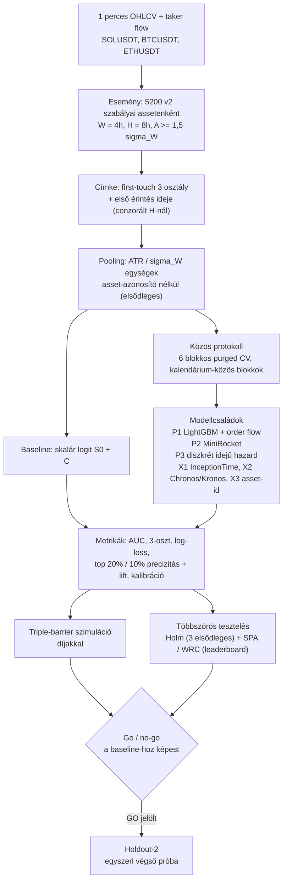

---

## Kapcsolat az 5200 v2-vel

| Elem | 5200 v2 (SOL, kép-modell) | 5300 v1 (Scout) | Indoklás |
|------|---------------------------|-----------------|----------|
| Asset | SOLUSDT | **SOLUSDT + BTCUSDT + ETHUSDT** (pooling) | A SOL W4h_H8h cellában 117 train impulzus van: ez a minta-méret nem elég modellek közötti, 0,02 ΔAUC-nagyságú különbség kimutatásához. |
| Esemény, címke | első érintés, 3 osztály | **ugyanaz** + az első érintés **ideje** (`τ`) | A `τ` kell a versengő kockázat / hazard modellhez és a kereskedési szimulációhoz. A fő osztályozási szabály változatlan. |
| Elsődleges cella | W4h_H8h (a W4h_H4h NO-GO) | **W4h_H8h**; a W4h_H4h csak leíró, kísérleti cella | A H4h-ban az impulzus-arány alacsony (SOL: 8,5%); háromszoros asset-mintával sem lesz elsődleges. |
| Baseline | Modell A = S0 + C | **S0 + C skalár logit**, ugyanaz a jellemzőkészlet, ugyanaz a regularizáció, pooled | A mérce nem változik: minden modellnek ezt kell felülmúlnia. |
| Teszt | 1 cella, 1 összehasonlítás (kép vs skalár) | **3 előre regisztrált elsődleges összehasonlítás** + sok kísérleti modell | A modell-sokaság miatt többszörös tesztelés-védelem szükséges. |
| Split-határok | train 2021-01-01 → 2026-01-31; OOS 2026-02-01 → 2026-07-31; holdout-2 2026-08-01 → | **ugyanazok**, mindhárom assetre | Közös naptári ablak, a champion train-ablakával egyező. |
| OOS státusz | megerősítő előjel (nem futott) | a SOL OOS **már látott** (t928) → nem tiszta; **leíró, post-hoc** szerep | Lásd az "Időbeli felosztás" szekciót. |
| Holdout-2 | érintetlen | **érintetlen**, egyetlen végső próba, szigorú szabályokkal | Lásd a "Holdout-2" szekciót. |

---

## Üzleti és módszertani háttér

### Miért kritikus ez a lépés?

A Scout három okból igényel a modell-építés előtt rögzített módszertant.

1. **Az előző kutatások tanulsága következetes:** a nyers vagy leíró különbségek (klaszterenkénti impulzus-arányok, S/R szintek "visszapattanás-aránya") a volatilitásból és a címke-küszöbből származnak, nem a vizsgált szerkezetből (epic_071, epic_072). Ezért minden modellt ugyanazon az erős skalár alapon kell mérni, azonos foldokon, permutációs nullával.
2. **Sok modell, kevés esemény:** az epic_072-ben egyetlen összehasonlítás is csak p = 0,2617-et ért el 117 impulzus mellett. Ha 4–7 modellcsaládot és azok változatait próbáljuk ugyanazon a mintán, a "legjobb modell" kiválasztása önmagában torzít (data snooping). A védelem: előre regisztrált, rövid elsődleges lista, és a teljes leaderboardra kiterjedő korrekció.
3. **A mért erő nem egyenlő a kereskedhető erővel:** egy 0,02-es ΔAUC díjak után lehet veszteséges. Ezért a go/no-go két szintű: statisztikai (jobb-e a baseline-nál) és gazdasági (díjak után pozitív-e a szimulált kereskedés). Csak mindkettő együtt teszi a Scoutot a három döntési forrás egyikévé.

### Miért ezt a megközelítést?

| Megközelítés | Előny | Hátrány | Státusz |
|--------------|-------|---------|---------|
| Önálló Scout modell, pooled SOL + BTC + ETH | ~háromszoros minta, közös szerkezet tanulható | Az assetek eseményei korreláltak; a rezsimek assetenként eltérhetnek | ✅ Választott |
| Scout mint feature a fw60 LGBM-ben | Egyszerű integráció | Összemossa a két forrás hibáit; a champion valid-ablaka már nem tiszta; a három forrás függetlensége elvész | ❌ Elvetett — user döntés (2026-11-21) |
| Assetenkénti külön modell | Nincs pooling-torzítás | SOL-on 117 impulzus; BTC/ETH-on is hasonló, tehát egyiken sem értékelhető | ⚠️ Csak referencia (assetenkénti S0 + C) |
| Pooled modell asset-azonosítóval | Az asset-specifikus alapráta kezelhető | Az azonosító felszívja a ritka jel egy részét, és a nem látott assetre nem általánosít | ⚠️ Kísérleti változat (X3) |
| Egyetlen modellcsalád (csak LightGBM) | Olcsó, gyors | Nem derül ki, hogy a sorozat-szerkezet vagy a túlélés-elemzés ad-e többletet | ❌ Elvetett — a cél a családok kontrollált összevetése |

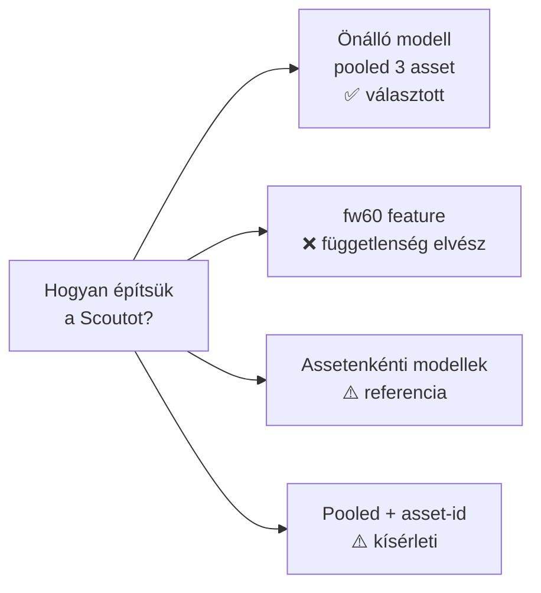

### Esemény, címke és az első érintés ideje

Az **esemény-definíció, a σ-skálázás, a megerősítési szabály, a nem-átfedő szabály, a first-touch szintek és a same-bar tie-break** pontosan az 5200 v2 szerint érvényes, **assetenként külön** alkalmazva (az asset saját 1 perces σ-ja, saját ATR-je, saját nem-átfedő greedy szűrője). A pooled adatkészlet az assetenkénti események egyesítése; két asset eseményei **nem** szűrik egymást (egyidejű események megengedettek, de lásd a függőség-kezelést).

**Elsődleges cella:** W = 4h, B = 4h, H = 8h. A W4h_H4h leíró cella marad (az impulzus-arány alacsony, a modell-összehasonlítás nem erre épül). A 8h/12h cellák nem kerülnek vissza.

**Címke (kimenet).** Minden eseményhez két érték tartozik:

- **osztály:** impulzus / hamis indulás / oldalazás (5200 v2 first-touch);
- **első érintés ideje `τ`:** az első szint-teljesülés ideje a `t_c` után (perc), oldalazásnál cenzorált: `τ = H`. A same-bar kettős érintés hamis indulás marad.

A fő osztályozási cél bináris (impulzus vs a többi); a másodlagos cél a 3 osztály valószínűsége; a hazard családnál a `τ` a tanulási cél része. A `τ` **nem jellemző**, a `t_c` után keletkezik; csak célváltozó és szimulációs bemenet.

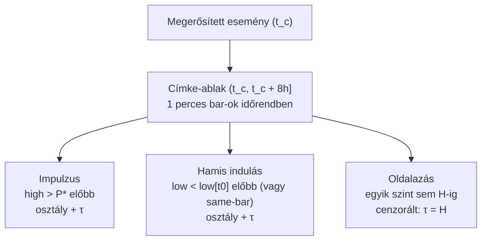

### Több asset összevonása: normalizálás és az asset-azonosító

**Normalizálás.** A pooled modell csak akkor tanulhat közös szerkezetet, ha a bemenetek dimenzió- és szintmentesek:

- árak és ár-jellemzők: `low[t0]`-hoz viszonyítva, **`σ_W` vagy ATR14(15m) egységben**, az asset saját, `t_c`-ig (a σ esetén `t0`-ig) ismert értékével;
- volumen- és aktivitás-jellemzők: az asset saját 7 napos, múltbeli átlagához viszonyítva;
- order flow jellemzők: eleve arányok (pl. agresszív vételi hányad, kumulált delta a volumenhez viszonyítva), nem abszolút darabszámok;
- a nyers prefix (sorozat-modellekhez): `low[t0]`-hoz viszonyított, `σ_W` egységű záróár-sorozat. **Az amplitúdót megőrizzük** (az 5200 nyers útvonala a saját z-normálással elveszítette; az epic_072 szerint a jel éppen a visszapattanás relatív mérete), a z-normált alak csak kísérleti változat.

**Asset-azonosító: az elsődleges modellekben NINCS.** Indoklás: (1) a σ_W-normálás célja, hogy az assetek eseményei ugyanabból az eloszlásból származzanak, az azonosító ennek hiányát ismerné be; (2) az azonosító a 3 asset alaprátáit tanulná meg, ami ritka jel esetén túlillesztésre ad lehetőséget; (3) a Scoutnak később új assetre is alkalmazhatónak kell lennie. **Biztosítékok:** a pooled eredményt **assetenként is** jelentjük (AUC, kalibráció, top-20% precizitás), az assetenkénti alapráta-eltéréseket külön táblázat mutatja, és referenciaként fut az **assetenkénti S0 + C** is, hogy a pooling kárát mérjük. Az **asset-azonosítós változat (X3)** kísérleti: ha az alapráta-eltérés nagy és az X3 szignifikánsan jobb, az v2 döntést indokol.

**Egyetlen közös küszöb-szabály.** A top-q% jelzések rangsorolása a pooled score-on történik (nem assetenként), mert a Scout célja egyetlen, assetek közötti rangsor.

### Közös protokoll: foldok, purge, embargo, asset-közi függőség

**A 6 blokkos purged CV (5200 v2 szerint, kiterjesztve).**

- A train (2021-01-01 → 2026-01-31) **6 egymást követő, időben összefüggő blokk**, **egész napos határokkal**, közel egyenlő naptári hosszal. **A blokkhatárok a három assetre közösek** (a kalendárium, nem az asset eseményei határozzák meg).
- **Purge:** az a train-esemény (bármelyik assetből), amelynek teljes `[t0 − B, t_c + H]` intervalluma a teszt-blokk időtartományával átfed, kikerül a tanításból. Mivel a blokkok közös naptári sávok, ez az asset-közi purge is: egy másik asset ugyanabban az időben lévő eseménye sem maradhat a tanító halmazban a teszt-blokk határán.
- **Embargo:** a teszt-blokk mindkét szélén `H` (8h) sáv, minden assetre (érzékenység: `2H`).
- **Azonos foldok minden modellnek:** ugyanazok a blokkhatárok, ugyanazok a purge-olt tanító halmazok; csak a tanuló változik. A fold-szerkezet a t931 benchmark-keretben egyszer generálódik és hash-sel rögzített.
- **Belső hangolás** (hiperparaméter, korai leállás): kizárólag a fold tanító halmazán belül, beágyazott, szintén purge-olt időbeli felosztással. A teszt-blokk soha nem hangol.
- **Out-of-fold (OOF) előrejelzések:** a 6 teszt-blokk predikciói összevonva adják a pooled OOF mintát; minden metrika ezen számolódik, a blokkonkénti és assetenkénti bontás diagnosztika.

**Asset-közi függőség.** BTC, ETH és SOL mozgása erősen korrelál: egy lokális mélypont és az utána jövő impulzus gyakran **ugyanazon a napon, több assetnél egyszerre** jelentkezik. Következmény: az események **nem függetlenek**, a hatékony mintaméret kisebb az eseményszámnál, és a hagyományos (esemény-szintű) bootstrap vagy permutáció **túl optimista** p-értéket ad. Védelem:

1. **Közös naptári blokkok** a CV-ben (fent): az asset-közi szivárgás a határokon nincs.
2. **Nap-klaszterezés:** minden újramintavételezés (bootstrap, permutáció, SPA/WRC) **egy UTC naptári nap** egységekben dolgozik, és egy nap **mindhárom asset** eseményeit együtt kezeli. Így az egyidejű, korrelált események egy klaszterként mozognak.
3. **Permutációs teszt asset-közi szerkezettel:** a címkéket nap-csomagonként permutáljuk, azaz egy nap összes assetjének címke-vektora együtt kerül egy másik, azonos esemény-szerkezetű napra (azonos assetenkénti eseményszámú; ha nincs elég azonos szerkezetű nap, az összes-eseményszám szerint durvított csoport). A független assetenkénti permutáció elrontaná az asset-közi korrelációt, a null szórása így kisebb, a p-érték **anti-konzervatív** lenne (feltételezés — validálásra vár).
4. **Aggregálás napokra a bootstrapban:** a konfidencia-intervallumok és az SPA nap-szintű (nap-összegzett) különbség-sorozaton, stacionárius blokk-bootstrappal (várható blokkhossz néhány nap; feltételezés — validálásra vár) készülnek.
5. **Asset-közi jellemzők** (pl. a BTC kontextusa egy SOL eseményhez) csak **kísérletiek**, és szigorúan a `t_c`-ig zárt bar-okból. Az elsődleges modellek assetenként csak a saját adatukat látják.

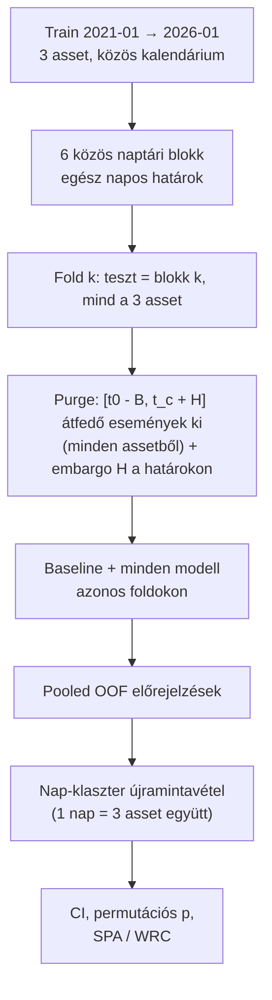

### Időbeli felosztás: train, OOS, holdout-2

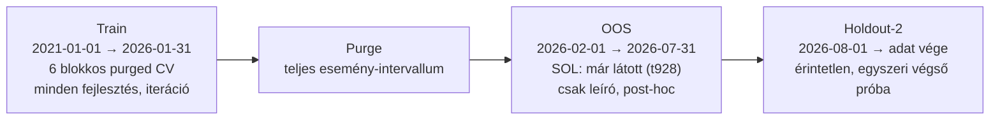

- **Train:** minden modellfejlesztés, hiperparaméter-választás, jellemző-szelekció és iteráció kizárólag itt, a purged CV-vel történik.
- **OOS (2026-02-01 → 2026-07-31):** a **SOL** OOS-t a t928 post-hoc módon már megnézte, így a kalendárium (és az, hogy abban az időszakban mi történt a piacon) a tervezők számára ismert. A **BTC/ETH** OOS adatait modell még nem látta, de ugyanaz az időszak, ugyanazok a piaci rezsimek: **nem tiszta**, "félig friss". Szabály: az OOS **nem vesz részt** a modell- vagy küszöb-választásban, a go/no-go-ban nincs döntő szerepe; csak a leaderboard lezárása után, a befagyasztott jelöltekre **egyszer**, leíró, assetenkénti jelentésként értékelhető (előjel és nagyságrend).
- **Holdout-2 (2026-08-01 → adat vége):** assetenként érintetlen; lásd a következő szekciót.
- **Végső újratanítás (feltételezés — validálásra vár):** a holdout-2 előtt a befagyasztott hiperparaméterekkel a modell a **train + OOS** adaton újratanulható (a határon purge-olva), mert az OOS ekkor már csak extra tanító adat; a CV-ben validált konfiguráció nem változik.

### Metrikák

Minden metrika a **pooled OOF mintán** számolódik (a baseline-ra és minden modellre azonos eseményeken), emellett assetenként és blokkonként bontva.

| Metrika | Mit mér | Szerep |
|---------|---------|--------|
| **AUC (impulzus vs többi)** | rangsorolás, arány-érzéketlen | elsődleges döntési metrika (ΔAUC a baseline-hoz) |
| **3 osztályos log-loss** | a teljes valószínűség-hármas minősége | másodlagos, következetesség-feltétel |
| **Felső 20% / 10% precizitás és lift** | a gyakorlatban használt, szelektív jelzés minősége (lift = precizitás / alapráta) | go-feltétel és szimulációs belépő-szabály |
| **Kalibráció** | a becsült valószínűség egyezése a gyakorisággal (meredekség, tengelymetszet, sávos megbízhatósági görbe, assetenként is) | a gazdasági kiértékeléshez szükséges; szükség esetén beágyazott rekalibráció |
| **Triple-barrier kereskedési szimuláció** | díjak utáni átlag-hozam és hit-arány a jelzett eseményeken | gazdasági gate (lásd lent) |

**Felső-q% szabály.** A felső 20% és 10% küszöbe a **train-OOF score-eloszlás 80. / 90. percentilise** (a t928 szabálya szerint), nem a tesztelt minta saját percentilise; így a jelzések száma a mintán nem rögzített. A pooled OOF mintán a rangsorolás a pooled score alapján történik; assetenkénti bontás diagnosztika.

**Bizonytalanság:** minden metrikához nap-klaszter bootstrap 95% CI (az asset-közi függőség miatt). Az epic_072 tanulsága: 117 impulzus mellett a CI-k szélesek; a pontbecslés önmagában nem döntési alap.

### Triple-barrier kereskedési szimuláció

A szimuláció a címke szintjeit használja kereskedési korlátokként, a **meta-labeling / triple barrier** logika szerint (López de Prado): a jelzés belépőt ad, három kilépési feltétel közül az első teljesül.

- **Belépés:** a jelzett eseményen (felső 20% vagy 10% score), a megerősítés után; hosszú pozíció. A belépő ár a `t_c` utáni **első elérhető 1 perces bar nyitója** (feltételezés — validálásra vár; a `t_c` záróár nem kereskedhető, mert a megerősítés a bar zárásakor ismert).
- **Felső korlát (célszint):** `P*` (az impulzus szintje).
- **Alsó korlát (stop):** `low[t0]` (a hamis indulás szintje).
- **Időkorlát:** `t_c + H` (8h), kilépés az ablak záróáron. Az oldalazás itt időkorlát-kilépés.
- **Same-bar kettős érintés:** a stop teljesül (konzervatív, a címkével egyezően).
- **Költségek:** a díjak a `config/strategies.json` `costs` szekciójából jönnek (maker díj, taker díj, csúszás bázisponttal, és a kilépés-típus korlátonként: a célszint maker, a stop és az időkorlát taker). **Megjegyzés:** a `config/trading.json` nem tartalmaz díj-mezőt, a költségek kizárólag a `strategies.json`-ban vannak; a szimuláció **nem kódol be számokat**, hanem a konfigurációból olvas, így a díjváltozás nem érinti a módszertant. A belépő típusa: piaci (taker) + csúszás (feltételezés — validálásra vár). A **finanszírozási díj** (funding) az 8 órás tartásnál releváns lehet, az első verzióban nincs modellezve, hanem érzékenységi ellenőrzésként közlendő (korlát).
- **Jelentett mutatók:** jelzés-szám, hit-arány (cél / stop / időkorlát), átlagos nettó hozam eseményenként (σ_W-egységben és bázisponttal), nettó összhozam, profit faktor, maximális visszaesés az időrendi esemény-sorozaton, assetenként és blokkonként. A **break-even hit-arány** (amelynél a nettó hozam nulla) a díjak és a stop/cél aszimmetriájából következik, és a hit-aránnyal együtt közlendő.
- **Mintafüggés:** az egyidejű események (több asset ugyanazon a napon) korreláltak, ezért a szimuláció nem fut "függetlenként": a CI nap-klaszter bootstrappel készül, és a portfólió-szintű kitettség (egyidejű pozíciók) leíró riportban szerepel.

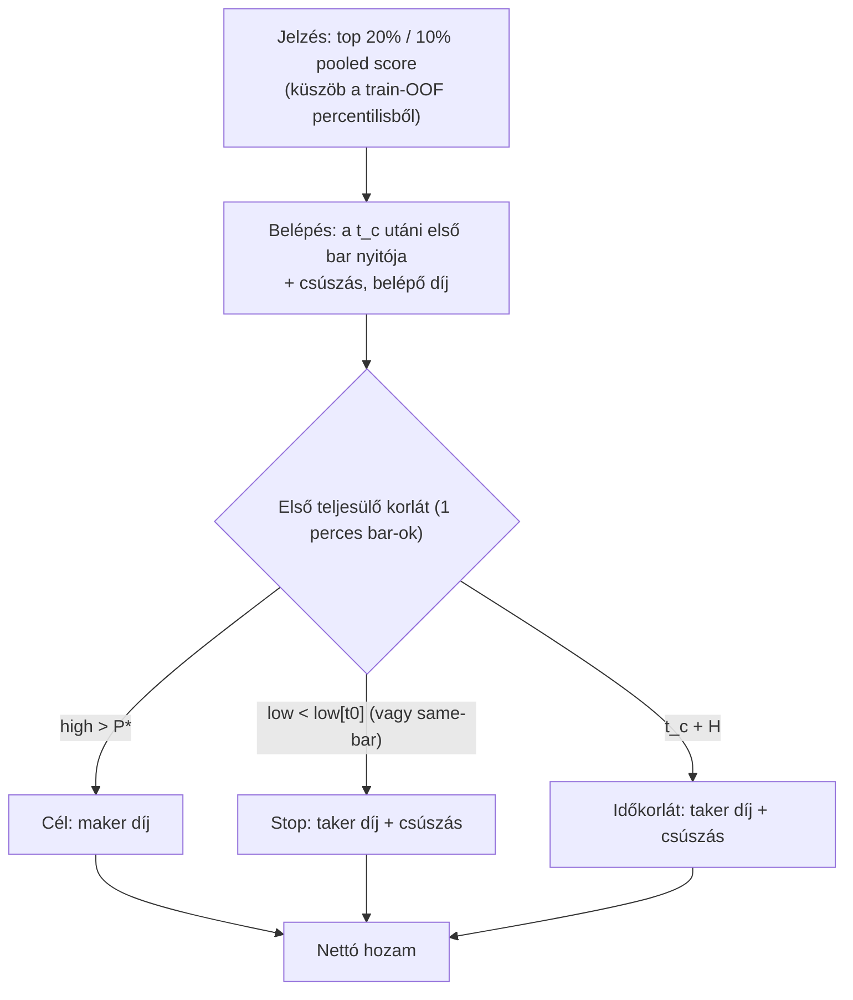

### Modellcsaládok és szakirodalmi indoklás

Minden család **ugyanazt a bemenetet** (a `[t0 − B, t_c]` bar-okból épülő, σ-normált jellemzők vagy prefix) és **ugyanazt a P(impulzus) becslést** (és ahol értelmezhető, a 3 osztály valószínűségét) adja. A feltétel: minden jellemző `t_c`-ig zárt bar-okból épül.

| Jelölés | Család | Szerep | Rövid indoklás |
|---------|--------|--------|----------------|
| **P1** | LightGBM kézi jellemzőkön (S0 + C + order flow + kontextus) | **elsődleges** | Táblázatos, kevés mintás feladatra a gradiens-boosting a bevett erős tanuló. A **meta-labeling / triple barrier** keret (López de Prado, 2018) pontosan ezt a helyzetet írja le: az esemény adott, az ML a kimenet minőségét szűri. Az **order flow** (agresszív vétel/eladás egyensúlya) a rövid távú ár-mozgás ismert előrejelzője (Cont–Kukanov–Stoikov, 2014); itt a taker vételi hányad és kumulált delta a rebound minőségét közelíti. |
| **P2** | MiniRocket (véletlen konvolúciós magok + lineáris osztályozó) a nyers prefixen | **elsődleges** | Az idősor-osztályozás gyors, erős alapmodellje (Dempster–Petitjean–Webb, 2020; Dempster–Schmidt–Webb, 2021); olcsó, determinisztikus magokkal, így a teljes refit és a permutációs teszt kivitelezhető. Azt méri, hogy a kézi jellemzők mellett a sorozat-alak hordoz-e többletet. |
| **P3** | Diszkrét idejű hazard / versengő kockázatok (impulzus vs hamis indulás, cenzorált oldalazás) | **elsődleges** | A feladat természetes leírása: két egymást kizáró esemény versenye az idő függvényében, cenzorálással (Fine–Gray, 1999; diszkrét idejű túlélés-elemzés: Tutz–Schmid, 2016; mély változat: DeepHit, Lee et al., 2018). A `τ`-t is kihasználja, így több információt használ, mint a végpont-címke; a kumulált incidencia a `H`-nál a P(impulzus). |
| **X1** | InceptionTime (mély konvolúciós ensemble) a nyers prefixen | kísérleti | Az idősor-osztályozás mély alapmodellje (Ismail Fawaz et al., 2020); a teljes refit és az 1000 permutáció költsége miatt nem elsődleges. |
| **X2** | Idősor-alapmodell embedding (Chronos, Kronos) + regularizált fej | kísérleti | Előtanított idősor- illetve K-line modellek (Chronos: Ansari et al., 2024; Kronos: Shi et al., 2025). A pénzügyi, zajos, alacsony jel/zaj arányú adatokon az irodalmi és a gyakorlati tapasztalat **gyenge vagy vegyes** (feltételezés — validálásra vár: a konkrét, asset-szintű eredmények ellenőrizendők), az epic_072 AE-embeddingje is zajszintű volt; ezért exploratory, és nem foglal el elsődleges helyet. |
| **X3** | Pooled P1 asset-azonosítóval / asset-közi kontextussal | kísérleti | Az asset-szerep (fent) ellenőrzése. |

**Elsődleges család: P1, P2, P3** (a legkisebb, indokolt lista; mindegyik a baseline elleni páros összehasonlítás). A többi **kísérleti**, a leaderboardon szerepel, de GO nem deklarálható rájuk, csak "jelölt" státusz (lásd go/no-go).

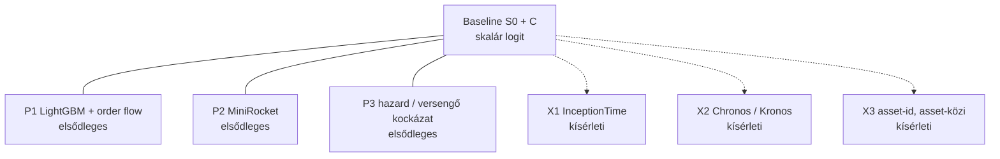

### Többszörös tesztelés

Két réteg, két célra.

**1. Elsődleges összehasonlítások (előre regisztrált, Holm).** Három hipotézis, mind a baseline (S0 + C) ellen, mind ugyanazon a metrikán (pooled OOF ΔAUC, impulzus vs többi):

- **H1:** P1 > baseline;
- **H2:** P2 > baseline;
- **H3:** P3 > baseline.

A p-érték: **nap-csomagos permutációs teszt** (fent), N = 1000, **teljes refit** minden permutációban (a modell és a baseline is újratanul ugyanazokon a foldokon); `p = (1 + #{null ≥ megfigyelt}) / 1001`. A három p-értékre **Holm-korrekció**; a küszöb **korrigált p < 0,01** (az 5200 v2 mércéje). Ha egy elsődleges modell teljes refit költsége miatt N = 1000 nem megoldható, az nem engedi a küszöb-csökkentést: a modell kísérletire minősül (ezért P1–P3 olcsó, gyorsan refitelhető családok).

**2. A teljes leaderboard (data snooping elleni védelem).** A kísérleti és minden további változat (hiperparaméter-készlet, iteráció, asset-azonosítós változat) együtt egy **modell-sokaságot** alkot. Erre **White Reality Check (White, 2000) vagy Hansen SPA (Hansen, 2005)** fut (az SPA-t részesítjük előnyben, mert kevésbé érzékeny a gyenge modellek hozzáadására; a WRC elfogadható kiegészítés). A veszteség-különbség sorozat: eseményenkénti **bináris log-loss** (baseline mínusz modell), **nap-összegzett**, **stacionárius blokk-bootstrappal**, legalább 5000 újramintavétellel (feltételezés — validálásra vár). A **kimutatott "legjobb" modellre** az SPA p < 0,05 a feltétel ahhoz, hogy a modell **jelölt** lehessen (lásd go/no-go). **Minden kipróbált változatot** a leaderboardon kell tartani, az iteráció sorszámával: a ki nem próbált vagy elhallgatott változat a snooping fő forrása (kötelező a változat-lista teljessége).

**Gazdasági szimuláció korrekciója.** A szimuláció a **kiválasztott** jelöltre számolódik; a modell-sokaság hatása a kiválasztási torzításon át a nettó hozamra is hat. Ezért a gazdasági gate a **holdout-2 egyszeri próbáján** dől el, a CV-szimuláció csak előszűrő (lásd go/no-go).

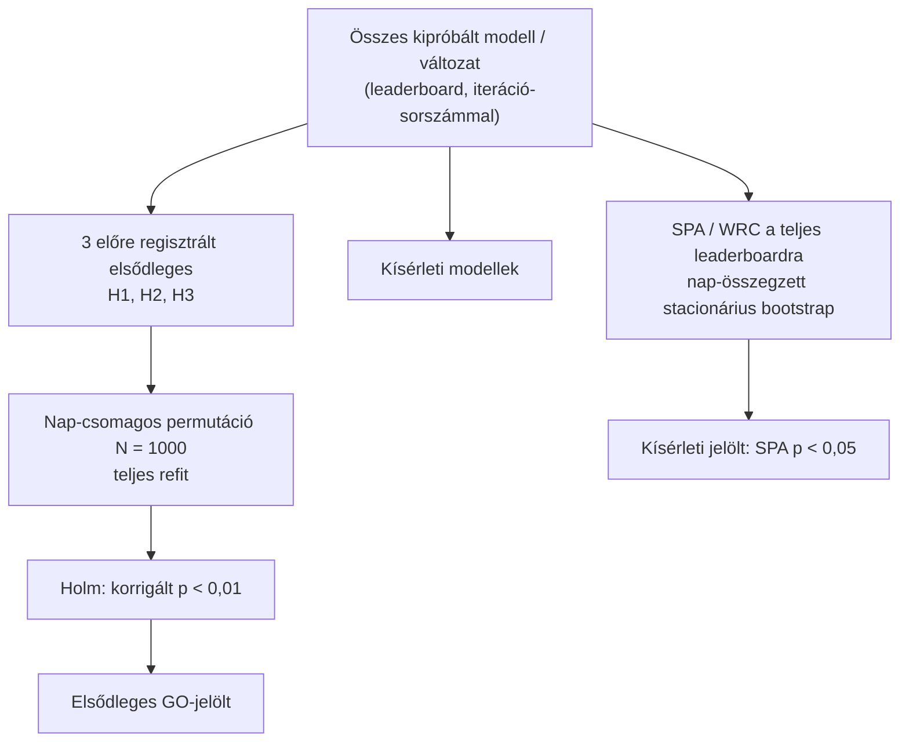

### Iterációs szabályok

1. **1. forduló:** **minden család** (P1–P3 és a kísérletiek) előre rögzített, kis hiperparaméter-készlettel fut, a közös protokollal. Beágyazott hangolás csak a fold tanító halmazán belül.
2. **Kiválasztás a 2. fordulóra:** az 1. forduló **pooled OOF ΔAUC** alapján a **legjobb 1–2 család** (döntetlennél a felső 20% precizitás, majd a 3 osztályos log-loss). A kiválasztási szabályt a forduló előtt rögzítettük, a kiválasztás indoklása a leaderboardon szerepel.
3. **2. forduló:** csak a kiválasztott 1–2 családon: jellemző-bővítés (pl. order flow részletesebb készlet), architektúra-finomítás, ensemble a két legjobbból. **Több forduló nincs.** További forduló csak új verzióként (v2), új jelöléssel, a leaderboard-sokaság növelésével.
4. **Minden kipróbált változat beszámít** az SPA modell-sokaságába, a 2. forduló változatai is.
5. **Tiltott:** a döntési küszöb vagy az elsődleges lista módosítása az eredmények látása után; a holdout-2 (vagy az OOS) használata kiválasztásra; fold-ok vagy blokkhatárok módosítása; a negatív eredmény eltüntetése.
6. **A negatív eredmény érvényes:** ha egyetlen modell sem üti meg a baseline-t, a Scout a skalár logit marad, és ez dokumentált, nem hiba.

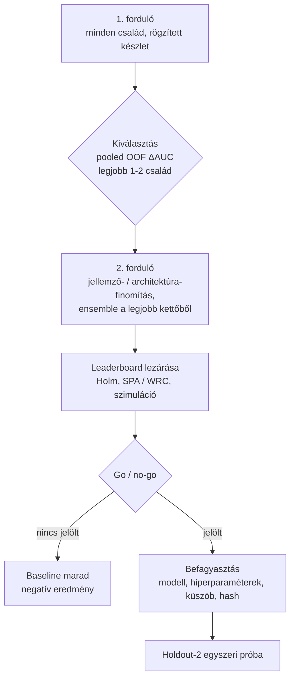

### Go / no-go: mikor jobb egy modell a baseline-nál?

**A) Statisztikai szint — "jobb a baseline-nál" (mind teljesülnie kell, sorrendben).**

1. **Minimum eseményszám (pooled, train, W4h_H8h):** ≥ 1500 esemény és ≥ 300 impulzus; assetenként ≥ 300 esemény és ≥ 50 impulzus; CV-blokkonként ≥ 100 pooled teszt-esemény. Ha nem teljesül: NO-GO (nem küszöb-csökkentés). (feltételezés — validálásra vár; a t930 eseményszámai határoznak, az 5200 elve alapján)
2. **ΔAUC_CV ≥ 0,02** (pooled OOF, modell − baseline) **és** a nap-klaszter bootstrap 95% CI **alsó határa > 0** (az epic_072-ben a CI a nullát tartalmazta; ez a kikötés új és szigorúbb).
3. **Korrigált p < 0,01** a permutációs tesztből, Holm után a 3 elsődleges hipotézisen. A kísérleti modellekre ez nem alkalmazható; ők csak a 6. lépés szerint lehetnek jelöltek.
4. **Következetesség a 3 osztályra:** a 3 osztályos log-loss a baselinenél **alacsonyabb** (ΔLL < 0).
5. **Felső 20% szelekció:** a felső 20% precizitás a baselinenél magasabb a pooled mintán **és** legalább 4 / 6 blokkban; a lift > 1 (az alapráta felett).
6. **Blokk- és asset-stabilitás:** a blokkonkénti ΔAUC > 0 legalább 4 / 6 blokkban, **és a legjobb blokk elhagyása után** az átlagos ΔAUC > 0,01 (az epic_072 B5 blokkja hordozta az átlagot); assetenként a ΔAUC ≥ 0 legalább 2 / 3 assetnél, és egyiknél sem rosszabb −0,02-nél (feltételezés — validálásra vár).
7. **Leaderboard-szint:** a kiválasztott "legjobb" modellre az **SPA p < 0,05**. Elsődleges modellnél ez további védelem a modell-sokaság ellen; kísérleti modellnél ez a **belépő** a jelölti státuszhoz.

Eredmény: **GO-jelölt** (elsődleges modell, az A) 1–7 mind és a B) CV-szimuláció előszűrő teljesül) vagy **kísérleti jelölt** (kísérleti modell, az A) 1–2 és 4–7, valamint a B) előszűrő teljesül; GO nem deklarálható rá). Egyébként **NO-GO**; a baseline marad.

**B) Gazdasági szint — "kereskedhető-e" (előszűrő a CV-n, döntő a holdout-2-n).** A felső 20% (és 10%) jelzéseken a triple-barrier szimuláció, a konfigurációból vett díjakkal és csúszással: az átlagos **nettó hozam eseményenként > 0**, a nap-klaszter bootstrap 95% CI alsó határa > 0, és a hit-arány a break-even felett. A CV-szimuláció csak az előszűrő (a kiválasztási torzítás miatt); a végleges gazdasági döntés a holdout-2-n.

**C) Kalibráció:** a becsült valószínűségek meredeksége a 0,7–1,3 sávon belül vagy beágyazott rekalibrációval javítható (a rekalibráció is csak fold-train adaton illeszthető). Nem go/no-go feltétel a rangsoroláshoz, de a gazdasági kiértékeléshez és a későbbi döntési-súlyokhoz szükséges (feltételezés — validálásra vár).

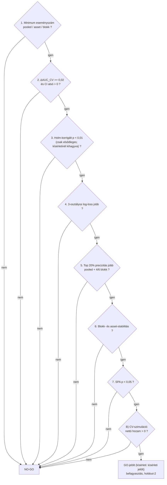

### Holdout-2: egyszeri végső próba

- **Státusz:** a holdout-2 (2026-08-01 → adat vége) mindhárom assetre **érintetlen**. Nem használható kiválasztásra, hangolásra, küszöb-választásra vagy leíró felfedezésre. Az **esemény-számolás címke nélkül** (csak a `t0` és a `t_c` észlelése, amely a `t_c`-ig ismert adatot használja) megengedett, mert nem nyit címke-információt; a címke- és ár-eredmények nem nézhetők meg.
- **Megnyitás feltétele:** (a) a leaderboard lezárult, van legalább egy GO-jelölt vagy kísérleti jelölt; (b) a **jelölt befagyasztva**: modell, hiperparaméterek, jellemzők, felső-q% küszöb (train-OOF percentilisből), szimulációs szabályok és a baseline egy hash-sel rögzítve **a holdout-2 megnyitása előtt**; (c) a **minimum eseményszám** teljesül (lásd lent); (d) a user külön döntése.
- **Minimum eseményszám (teljesen kifutott címke-ablakkal):** pooled ≥ 250 esemény, ≥ 40 impulzus, legalább 60 különböző UTC naptári napon (a nap a hatékony egység a korreláció miatt), assetenként ≥ 50 esemény (feltételezés — validálásra vár; az epic_072 szerint a SOL egyedül 41 W4h_H8h eseményt adott a holdout-2-ben (44 egyedi t0 a két 4h cellában), ez kevés volt). Ha nem teljesül, **várakozás** (több adat gyűl), nem küszöb-csökkentés.
- **Egyszeri próba:** a holdout-2 egyszer, egy jelöltre (és a baselinere) értékelhető. **Egy jelölt:** az a modell, amelyet a leaderboard lezárásakor a user jelöl meg; több jelölt együttes tesztelése új, külön holdout-ot igényel. Az eredmény, bármi legyen is, végleges: a holdout-2 **elhasználódott**, újrapróbához új, érintetlen ablak (holdout-3) kell.
- **Döntési feltételek a holdout-2-n (egyetlen teszt, nincs multiplicitás):** (1) ΔAUC > 0 a baseline-hoz képest és a nap-klaszter bootstrap egyoldali p < 0,05; (2) a felső 20% precizitás a baseline fölött és a lift > 1; (3) a **gazdasági szint** (B): nettó hozam eseményenként > 0 díjak után, CI alsó határa > 0; (4) assetenként az előjel nem ellentétes a pooled iránnyal legalább 2 / 3 assetnél. Mind teljesül: a Scout **döntési forrásnak minősíthető** (integrációs döntés külön, a három forrás összehangolásával). Egyébként a Scout nem lép előre. **Kísérleti jelölt** esetén a holdout-2 siker csak a jelölt megerősítése: GO és döntési-forrás státusz nem deklarálható rá, ahhoz új verzió (v2), a modell elsődleges listára vétele és új, érintetlen holdout kell.
- **Kontamináció-védelem:** a holdout-2 eredményéből tanulságot levonni csak új verzióban lehet, új holdouttal; nincs "hangolás a holdout-2 alapján".

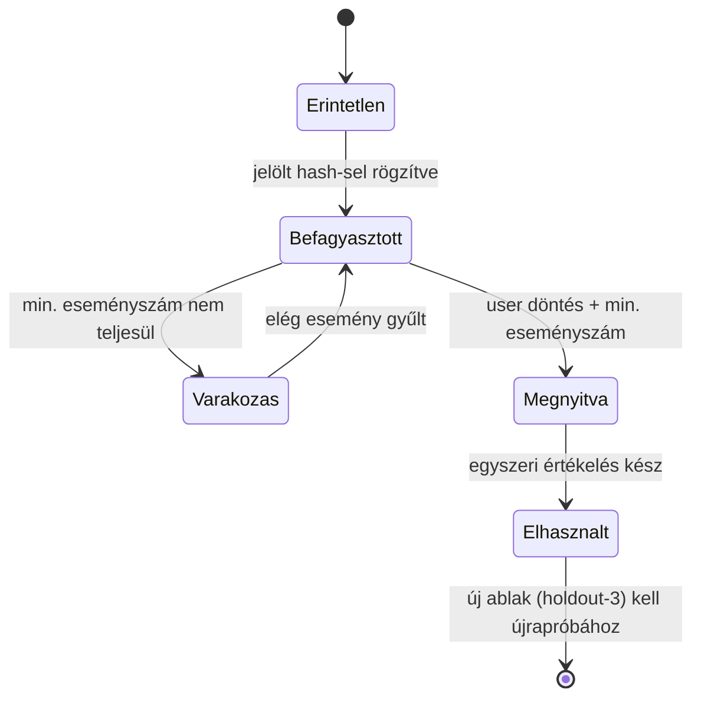

### Paraméter alapértékek és indoklásuk

| Paraméter | Alapérték | Indoklás |
|-----------|-----------|----------|
| Assetek | SOLUSDT, BTCUSDT, ETHUSDT | Epic-döntés (user, 2026-11-21); hasonló DB, 1 perces futures. |
| Elsődleges cella | W = 4h, B = 4h, H = 8h | A SOL-on az egyetlen cella, amely az 5200 v2 minimumait teljesítette. |
| Leíró cella | W4h_H4h | Alacsony impulzus-arány; csak összehasonlítási, leíró célra. |
| Esemény, címke | 5200 v2 szerint, assetenként; + `τ` | Konzisztencia; a hazard és a szimuláció a `τ`-t igényli. |
| Normalizálás | `σ_W` / ATR14(15m), 7 napos volumen-átlag | Dimenzió- és szint-mentes pooling; az amplitúdó megőrzése. |
| Asset-azonosító | nincs (elsődleges); X3 kísérleti | Lásd a szerep-indoklás. |
| Train | 2021-01-01 → 2026-01-31 | A champion train-ablaka; mindhárom asset. |
| OOS | 2026-02-01 → 2026-07-31 | Nem tiszta (SOL látott); csak leíró, post-hoc. |
| Holdout-2 | 2026-08-01 → adat vége | Érintetlen; egyszeri végső próba. |
| CV | 6 közös naptári blokk, egész napos határok | Az 5200 v2 szerkezete, asset-közi közös határokkal. |
| Purge | teljes `[t0 − B, t_c + H]` intervallum, minden assetre | A határt átlógó események kizárva; közös naptári blokkok. |
| Embargo | `H` (8h) a teszt-blokk szélein; érzékenység: `2H` | Címke-autokorreláció; feltételezés — validálásra vár. |
| Baseline | S0 + C skalár logit, pooled; referencia: assetenkénti | Az epic_072 erős alapja; a pooling hatását mérni kell. |
| Tanuló a baseline-hoz | regularizált logisztikus regresszió, rögzített erősség | Az epic_072-vel azonos, belső hangolás nélkül. |
| Újramintavétel egysége | 1 UTC naptári nap (mindhárom asset együtt) | Asset-közi korreláció kezelése. |
| Permutációk száma | 1000, teljes refit | p < 0,01 Holm után 3 hipotézisnél legalább ennyi kell. |
| Elsődleges hipotézisek | H1 (P1), H2 (P2), H3 (P3) | Rövid, előre rögzített lista. |
| Holm küszöb | korrigált p < 0,01 | Az 5200 v2 mércéje. |
| SPA / WRC | p < 0,05 a legjobb modellre; ≥ 5000 újramintavétel | Leaderboard-szintű snooping-védelem; feltételezés a darabszámra. |
| Felső-q% | 20% és 10%; küszöb a train-OOF 80. / 90. percentilis | A t928 szabálya szerint. |
| Go: ΔAUC | ≥ 0,02 és CI alsó > 0 | Az epic_072 mértéke, szigorítva CI-vel. |
| Go: blokk-előjel | > 0 legalább 4 / 6 blokkban + a legjobb blokk nélkül > 0,01 | Az epic_072 B5-tanulsága. |
| Go: asset-előjel | ≥ 0 legalább 2 / 3 assetnél, egyiknél sem < −0,02 | Pooling-torzítás kizárása; feltételezés — validálásra vár. |
| Iteráció | 1. forduló: minden család; 2. forduló: legjobb 1–2; több nincs | Rögzített költségvetés, korlátozott snooping. |
| Díjak | `config/strategies.json` `costs`: maker, taker, csúszás, kilépés-típus | Nem kódolt számok; a konfiguráció a forrás. |
| Belépés a szimulációban | a `t_c` utáni első bar nyitója, taker + csúszás | Kereskedhető ár; feltételezés — validálásra vár. |
| Holdout-2 min. | ≥ 250 esemény, ≥ 40 impulzus, ≥ 60 nap, assetenként ≥ 50 | Feltételezés — validálásra vár; a SOL egyedül 41 W4h_H8h esemény volt. |

### Ismert kockázatok és korlátok

| Kockázat | Tünet | Mitigáció |
|----------|-------|-----------|
| Asset-közi függőség | Túl optimista p, szűk CI; látszólag nagy minta | Nap-csomagos permutáció és bootstrap, közös naptári blokkok, nap-szintű SPA. |
| Asset-közi szivárgás a foldok között | Felfújt OOF teljesítmény a blokkhatárokon | Közös blokkok, purge minden assetre, embargo `H`. |
| Look-ahead (σ, ATR, order flow, asset-közi jellemző) | Szokatlanul magas AUC a `t0` közeli eseményeknél | Minden jellemző csak `t_c`-ig zárt bar-ból; σ csak `close ≤ t0`; egységteszt és oszlop-szintű ellenőrzés. |
| Data snooping (sok modell, sok változat) | A "legjobb" modell csak szerencsés | Előre regisztrált 3 elsődleges, Holm, SPA / WRC, teljes leaderboard, korlátos iteráció. |
| Pooling-torzítás | A közös modell egy assetnél rosszabb, mint a külön | Assetenkénti riport, assetenkénti baseline-referencia, asset-előjel feltétel. |
| Az amplitúdó elvesztése | A sorozat-modell a z-normálással a jelet (relatív méret) eldobja | A nyers prefix σ_W-egységben, amplitúdóval; a z-normált változat kísérleti. |
| Az SOL OOS kontamináció | A kalendárium ismert, a modellezők elfogultak | OOS nem hangol és nem dönt; csak leíró; döntő a holdout-2. |
| Költség-alulbecslés | A szimuláció díj után is jónak látszik, de az élő végrehajtás rosszabb | Konfigurációból vett díjak és csúszás, konzervatív same-bar, finanszírozási díj érzékenységi ellenőrzése; a döntő a holdout-2 szimuláció. |
| Same-bar kétértelműség | A bar mindkét szintet érinti | Konzervatív tie-break (stop), gyakoriság közlendő. |
| Kis impulzus-szám | A CI-k szélesek, a blokkonkénti ΔAUC zajos | A minimum eseményszám, a CI-alapú feltétel, a legjobb blokk nélküli ellenőrzés. |
| Rezsim-váltás (BTC/ETH/SOL korrelációja, volatilitás) | A tanult szerkezet időben instabil | Blokk-stabilitás feltétel, időbeli bontás a riportban. |
| Foundation modell túlértékelése | Az embedding látszólag jó, de zaj | Kísérleti státusz, nincs elsődleges hipotézis, a Holm családon kívül; SPA belépő. |
| Erős skalár alap | Egyik modell sem jobb | Érvényes NO-GO eredmény; a Scout a skalár logit marad. |
| Holdout-2 újrahasználat | A "még egy próba" kísértés | Egyszeri szabály, elhasználódott státusz, holdout-3 igény. |

### Kapcsolódó és forrásokkal alátámasztott kiindulópontok

A hivatkozások emlékezetből, a pontos kötetek, oldalak és az idézett állítások ellenőrzése még hátravan (feltételezés — validálásra vár).

- **López de Prado, M. (2018):** *Advances in Financial Machine Learning.* Wiley. — triple-barrier címkézés, meta-labeling, purged CV, embargo.
- **Dempster, A., Petitjean, F., Webb, G. I. (2020):** *ROCKET: Exceptionally fast and accurate time series classification using random convolutional kernels.* Data Mining and Knowledge Discovery.
- **Dempster, A., Schmidt, D. F., Webb, G. I. (2021):** *MiniRocket: A very fast (almost) deterministic transform for time series classification.* KDD.
- **Ismail Fawaz, H. és társai (2020):** *InceptionTime: Finding AlexNet for time series classification.* Data Mining and Knowledge Discovery.
- **Fine, J. P., Gray, R. J. (1999):** *A proportional hazards model for the subdistribution of a competing risk.* JASA.
- **Tutz, G., Schmid, M. (2016):** *Modeling Discrete Time-to-Event Data.* Springer.
- **Lee, C., Zame, W., Yoon, J., van der Schaar, M. (2018):** *DeepHit: A deep learning approach to survival analysis with competing risks.* AAAI.
- **Cont, R., Kukanov, A., Stoikov, S. (2014):** *The price impact of order book events.* Journal of Financial Econometrics. — order flow egyensúly és a rövid távú ár-változás.
- **Ansari, A. F. és társai (2024):** *Chronos: Learning the language of time series.* TMLR.
- **Shi, Y. és társai (2025):** *Kronos: A foundation model for the language of financial markets.* arXiv.
- **White, H. (2000):** *A Reality Check for Data Snooping.* Econometrica.
- **Hansen, P. R. (2005):** *A Test for Superior Predictive Ability.* Journal of Business and Economic Statistics.
- **Holm, S. (1979):** *A simple sequentially rejective multiple test procedure.* Scandinavian Journal of Statistics.
- **Politis, D. N., Romano, J. P. (1994):** *The stationary bootstrap.* JASA.
- **Bailey, D. H., López de Prado, M. (2014):** *The Deflated Sharpe Ratio.* Journal of Portfolio Management. — a sok próbálkozás utáni kiválasztási torzítás.
- Belső kontextus: `5200_wave_start_image_model.md` (esemény, címke, protokoll, v2 döntések), `_doc_/research/wave_image_clustering.md` (epic_072 eredmények és a post-hoc OOS), `1700_features_sr_trendline.md` (placebo-tanulság), `7000_validacios_elvek.md` (mérési fegyelem), `3000_sampling.md` (embargo logika).

### Validációs checklist

- [ ] Minden asset eseménye az 5200 v2 szerint, assetenként saját σ_W / ATR / nem-átfedő szűrővel készül; a címke 3 osztályt és az első érintés idejét adja (oldalazás: τ = H).
- [ ] Minden jellemző `t_c`-ig zárt bar-ból épül; `τ` és a címke nincs a jellemzők között (oszlop-szintű ellenőrzés).
- [ ] A bemenetek σ_W / ATR egységűek, a volumen asset-saját 7 napos átlaghoz viszonyított; a nyers prefix amplitúdót megőriz.
- [ ] Az elsődleges modellekben nincs asset-azonosító; az assetenkénti riport és az assetenkénti baseline-referencia elkészül.
- [ ] A 6 CV-blokk közös naptári, egész napos határú; a purge a teljes intervallumra minden assetre; embargo `H`; a fold-szerkezet hash-sel rögzített.
- [ ] A baseline (S0 + C) és minden modell azonos foldokon, azonos eseményeken fut; a beágyazott hangolás a fold tanító halmazán belül marad.
- [ ] A permutáció és a bootstrap nap-csomagos (egy nap = 3 asset együtt), teljes refittel; az N = 1000.
- [ ] Holm a 3 elsődleges hipotézisen (H1–H3); az SPA / WRC a teljes leaderboardra; a leaderboard minden kipróbált változatot tartalmaz iteráció-sorszámmal.
- [ ] Az iteráció legfeljebb 2 forduló; a 2. fordulóra a legjobb 1–2 család megy; a szabály az 1. forduló előtt rögzített.
- [ ] A felső 20% / 10% küszöb a train-OOF 80. / 90. percentilis; a precizitás és a lift pooled és assetenként közölve.
- [ ] A szimuláció díjai a `config/strategies.json` `costs` szekciójából jönnek (nincs beégetett szám); a same-bar kettős érintés stop.
- [ ] A kalibráció (meredekség, tengelymetszet, sávos görbe) assetenként és pooled közölve.
- [ ] Az OOS nem szerepel a kiválasztásban; csak a lezárt leaderboard után, egyszer, leíróan értékelhető.
- [ ] A holdout-2 érintetlen; a jelölt befagyasztva (hash) a megnyitás előtt; a minimum eseményszám (címke nélkül számolva) teljesül; egyszeri próba.
- [ ] A negatív eredmény (nincs jelölt) dokumentált, a baseline marad.

---

## Rögzített döntések (v1)

1. **Önálló modell:** a Scout nem a fw60 feature-je; hosszú távon a quant + Scout + hírek három független döntési forrás egyike.
2. **Elsődleges cella:** W4h_H8h; a W4h_H4h csak leíró.
3. **Pooling:** SOL + BTC + ETH, σ_W / ATR egységekben; asset-azonosító nincs az elsődleges modellekben (X3 kísérleti).
4. **Split:** train 2021-01-01 → 2026-01-31; OOS 2026-02-01 → 2026-07-31 (nem tiszta, csak leíró); holdout-2 2026-08-01 → érintetlen.
5. **Protokoll:** 6 közös naptári blokkos purged CV, purge a teljes intervallumra minden assetből, embargo `H`; azonos foldok; baseline S0 + C.
6. **Asset-közi függőség:** nap-klaszter újramintavétel (1 nap = 3 asset), nap-csomagos permutáció.
7. **Elsődleges összehasonlítások:** H1 (LightGBM + order flow), H2 (MiniRocket), H3 (hazard); minden más kísérleti.
8. **Többszörös tesztelés:** Holm a 3 elsődlegesre (p < 0,01); SPA / WRC a teljes leaderboardra.
9. **Metrikák és szimuláció:** AUC, 3 osztályos log-loss, top 20% / 10% precizitás és lift, kalibráció, triple-barrier szimuláció a konfigurációban lévő díjakkal.
10. **Iteráció:** 1. forduló minden család; 2. forduló a legjobb 1–2; több forduló nincs.
11. **Holdout-2:** egyetlen jelölt, befagyasztott, minimum eseményszám, egyszeri próba, utána elhasznált.

## Felülvizsgálandó feltételezések (új verzióként)

- A minimum eseményszámok (train pooled ≥ 1500 / ≥ 300 impulzus, assetenként ≥ 300 / ≥ 50, blokkonként ≥ 100; holdout-2: ≥ 250 / ≥ 40 / ≥ 60 nap / assetenként ≥ 50) — a t930 tényleges eseményszámai után pontosítandók, de csak a mérés előtt.
- A CI-alapú feltétel (ΔAUC alsó határ > 0), az asset-előjel szabály (≥ 2 / 3, nincs < −0,02), a legjobb-blokk-nélküli 0,01 küszöb.
- A nap-csomagos permutáció csoportosítási szabálya (azonos assetenkénti eseményszámú napok, tartalék: összes-eseményszám szerint).
- A stacionárius bootstrap blokkhossza és az SPA újramintavétel-száma (≥ 5000).
- A szimuláció belépő ára (az első bar nyitója), a belépő típusa (taker + csúszás), a finanszírozási díj kezelése (első verzióban nincs).
- A holdout-2 előtti train + OOS újratanítás.
- A kalibráció-sáv (meredekség 0,7–1,3).
- Az irodalmi hivatkozások pontos adatai és a foundation modellek pénzügyi eredményeinek állítása.
